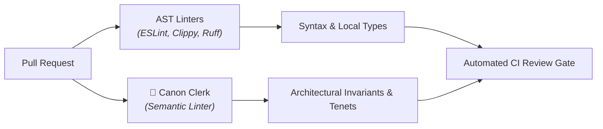

<p align="center">
  <picture>
    <source media="(prefers-color-scheme: dark)" srcset="assets/logo-dark.png">
    <source media="(prefers-color-scheme: light)" srcset="assets/logo-light.png">
    
  </picture>
</p>

# 📜 Canon Clerk

[](.canons/)
[](SPEC.md)
[](LICENSE)

**Canon Clerk** is an open specification and emerging **semantic linter** for software architecture, engineering conventions, and project tenets. It pairs declarative, version-controlled rule packs (*canons*) with an automated [Caseload Pipeline](docs/architecture.md) (a DAG execution model) that audits pull requests against architectural invariants in CI.

---

## What is a Canon?

> **Canon:** *(n)*. A source code or repository change rule that is: **semantic**, **atomic**, **falsifiable**, **bounded**, **grounded**, **salient**, and **correctable**.

- **Semantic** — Governs architectural intent and conventions that cannot be evaluated purely deterministically by an AST parser or regex.
- **Atomic** — Enforces a single cohesive invariant to prevent compound evaluation flakiness.
- **Falsifiable** — Defines a testable, binary condition of violation rather than an aspirational goal.
- **Bounded** — Demarcates its applicability via explicit directory scoping, trigger paths, or verified exception conditions.
- **Grounded** — Warranted by authoritative precedent, standards, or documented architectural trade-offs (Chesterton's Fence) rather than arbitrary personal preference.
- **Salient** — Maximizes signal density and precise domain terminology tailored for an AI readership.
- **Correctable** — Admits a viable path to compliance, whether through explicit remediation instructions or implicit action.

Canons scale across an intuitive **What / When / Why / How** cognitive tetrad ([`SPEC.md`](SPEC.md)), functioning both as off-the-shelf standard rule packs and as custom repository-specific invariants.

---

## Why This? Why Now?

**Problem:** Generative AI tools have accelerated code production, shifting the engineering bottleneck to code custodians and maintainers. Reviewers bear an asymmetric cognitive tax: vetting plausible, AI-assisted pull requests that pass existing unit tests and AST linters, but quietly violate unwritten architectural boundaries, domain conventions, or repository tenets.

**Solution:** Canon Clerk introduces **Semantic Linting**:
- **AST Linters (ESLint, Clippy, Flake8):** Verify syntax, type signatures, and local AST structures.
- **Semantic Linters (Canon Clerk):** Verify architectural invariants, author intent, cross-cutting conventions, and domain policies that static ASTs cannot observe.



Canon Clerk codifies these rules into plain, zero-friction Markdown files stored in `.canons/` directories. Organized into modular, domain-scoped rule packs (such as CLI ergonomics, canon authoring, and Conventional Commits), canons establish clear, enforceable boundaries for human contributors and AI coding assistants alike.

---

## Who Needs This?

Canon Clerk addresses the friction points where static code analysis ends and semantic engineering intent begins:

### 1. Maintainers & Code Custodians
* **The Challenge:** Drowning in plausible, syntactically clean PRs—especially generated by AI coding tools—that pass unit tests and AST linters, but quietly violate unwritten architectural boundaries, cross-cutting conventions, or project tenets.
* **With Canon Clerk:** Codify project knowledge into version-controlled, modular rule packs that gate CI objectively. Stop repeating the same review feedback in pull request comments.

### 2. AI-First Teams & Pair Programmers
* **The Challenge:** AI coding assistants (Claude Code, Cursor, Copilot, Antigravity) produce code rapidly, but may invent idiosyncratic patterns, or drift from codebase conventions unless strictly anchored.
* **With Canon Clerk:** Canons provide compact, high-signal, falsifiable rules that anchor AI coding agents during generation (via `AGENTS.md` or `.canons/`), and enforce them semi-deterministically before changes merge.

### 3. Platform & Monorepo Architects
* **The Challenge:** Enforcing cross-cutting standards (CLI design ergonomics, API error schemas, logging invariants, bounded context isolation) across multiple languages usually requires building and maintaining brittle, custom AST compiler plugins for every language toolchain.
* **With Canon Clerk:** A single, stack-ambivalent format using plain Markdown rules scoped to specific directory trees (`.canons/cli/`, `services/auth/.canons/`) without language toolchain dependencies.

### 4. Open-Source Project Leads
* **The Challenge:** Onboarding external contributors is exhausting when review feedback feels subjective, unwritten, or gatekeep-y ("we don't do it that way here"), burning maintainer goodwill and frustrating new contributors.
* **With Canon Clerk:** Transparent, objective, self-service guardrails committed right in the repository. Contributors see expectations upfront, and CI provides actionable remediation (`Remediation`) when invariants are violated.

---

## CLI Usage (`canon-clerk`)

The `canon-clerk` CLI evaluates diffs, target paths, and pull request metadata against `.canons/` rule packs locally or in CI:

```bash
# Audit an in-flight diff against governing canons (defaults to google:gemini-decision-1 across
# docket, admit, and vet alongside google:gemini-4-carbon on audit):
git diff origin/main | canon-clerk audit --diff -

# Run a fast pre-flight prima facie compliance check (~1s, 0 output tokens; defaults to
# google:gemini-decision-1, or select TypeSafe Jev via --provider typesafe):
git diff origin/main | canon-clerk vet --diff -

# Mix providers across nodes using explicit <provider>:<model> specifiers:
git diff origin/main | canon-clerk audit --diff - --provider typesafe --audit-model google:gemini-4-carbon

# Audit explicit target paths or run in GitHub Actions annotation mode with Caseload archival:
canon-clerk audit src/cli
git diff origin/main | canon-clerk audit --diff - --format github --output-caseload caseload.json

# Statically lint all repository canons offline (0 tokens, no API key required):
canon-clerk validate --all-canons

# Apprise planned work of governing canons before implementation:
canon-clerk apprise --intent "Add a new CLI subcommand flag" src/cli
```

Model bindings cascade deterministically across explicit per-node CLI flags (`--apprise-model`, `--docket-model`, `--admit-model`, `--vet-model`, `--audit-model`), environment variables (`CANON_CLERK_<NODE>_MODEL`, `CANON_CLERK_PROVIDER`), structured host configuration (`~/.config/canon-clerk/config.json` with `{ providers, defaults, nodes }`—supporting built-in `google` and `typesafe` profiles, `baseUrl` gateway overrides, and zero-code custom `gemini` or keyless/authenticated `systemone` `providers.<slug>` profiles), and the active provider's per-node defaults (`google` by default: `google:gemini-decision-1` on `apprise`/`docket`/`admit`/`vet` and `google:gemini-4-carbon` on `audit`; `typesafe` via `--provider typesafe`: `typesafe:jev-latest` across discriminative screening/vetting nodes), verifying credentials strictly for the providers used by the executed closure; see the [`configure` Stage Specification](docs/architecture/nodes/configure.md). Stage-specific and shared transport flags (`--provider`, `--audit-model`, `--audit-threshold`, `--audit-concurrency`, `--vet-model`, `--vet-threshold`, `--vet-concurrency`, `--admit-model`, `--admit-threshold`, `--admit-concurrency`, `--docket-model`, `--docket-threshold`, `--docket-batch-size`, `--docket-concurrency`, `--apprise-model`, `--apprise-threshold`, `--apprise-batch-size`, `--apprise-concurrency`, `--thinking-level`, `--reasoning-budget`, `--max-retries`, `--max-backoff-ms`, `--gemini-api-key`, `--typesafe-api-key`, `--gemini-base-url`, `--typesafe-base-url`, `--caseload`, `--json`), coordinated per-origin `429` cooldown gating, and bounded batch/slice execution mechanics are documented in the [Caseload Pipeline Architecture](docs/architecture/overview.md), [Provider Transport & Rate-Limit Scheduling](docs/architecture/transport.md), [`docket` Stage Specification](docs/architecture/nodes/docket.md), [`apprise` Stage Specification](docs/architecture/nodes/apprise.md), [`admit` Stage Specification](docs/architecture/nodes/admit.md), [`vet` Stage Specification](docs/architecture/nodes/vet.md), and [`audit` Stage Specification](docs/architecture/nodes/audit.md).

---

## The Canon Corpus

Canon Clerk includes a production-grade corpus of **modular, domain-scoped canons** adhering to the formal specification ([`SPEC.md`](SPEC.md)), ready to explore, adapt, and enforce:

| Domain Pack | Path | Count | Governed Conventions |
| :--- | :--- | :--- | :--- |
| 🛠️ **CLI Ergonomics** | [`.canons/cli/`](.canons/cli/) | 24 | Strict Unix CLI standards: POSIX streams, `--json` schema output, stage/provider flag qualification, error remediation hints, and exit codes. |
| 📜 **Canon Authoring** | [`.canons/canon-authoring/`](.canons/canon-authoring/) | 14 | Meta-canons governing canon authoring: atomicity, falsifiability, semantic scope, What/When/Why/How tetrad, succinctness, and directive contracts. |
| 🤖 **Agent Scripts** | [`.canons/agent-scripts/`](.canons/agent-scripts/) | 9 | Runtime script standards for AI agent helpers: POSIX shell portability, command echo traces, passthrough fidelity, and `>8KB` output shunting. |
| 🧪 **Testing** | [`.canons/testing/`](.canons/testing/) | 9 | Behavioral contract assertions, topical sub-suite structure, live-service test segregation, and change-detector prohibition. |
| 🏛️ **Internal Dogfooding** | [`.canons/internal/`](.canons/internal/) | 8 | Repository-specific dogfood policies: conceptual architecture docs, curated `llms.txt` indexing, domain-scoped tagging, and portable standards. |
| 🔌 **API Design** | [`.canons/api-design/`](.canons/api-design/) | 7 | Single-source defaults, additive exclusions, co-located option/result types, streaming multi-resource APIs, and domain encapsulation. |
| 📐 **OpenSpec** | [`.canons/openspec/`](.canons/openspec/) | 5 | Reference pack for Spec-Driven Development: living spec synchronization on `feat`/`fix` changes and conceptual capability modeling. |
| 📝 **README Authoring** | [`.canons/readme-authoring/`](.canons/readme-authoring/) | 5 | Inverted pyramid orientation (lead with what and why), no unreleased roadmaps, feature parity, responsive dark/light hero banners, and shunting architecture to `docs/`. |
| 🛡️ **Repository Governance** | [`.canons/repo-governance/`](.canons/repo-governance/) | 5 | GitHub repository metadata parity, workflow script delegation, and third-party GitHub App restrictions. |
| 🏗️ **Architecture** | [`.canons/architecture/`](.canons/architecture/) | 5 | Pure format validators, explicit library dependencies, narrow module option boundaries, and Hexagonal workspace isolation. |
| 🏷️ **Conventional Commits** | [`.canons/conventional-commits/`](.canons/conventional-commits/) | 4 | Semantic commit and PR invariants (`feat` for user-facing functionality, `fix` for user-facing defect repairs). |
| 🧩 **Agent Skills** | [`.canons/agent-skills/`](.canons/agent-skills/) | 3 | Procedural runtime execution targets and non-duplicative skill metadata. |
| ⚙️ **Configuration** | [`.canons/configuration/`](.canons/configuration/) | 3 | Orthogonal configuration namespaces, `<provider>:<name>` specifier qualification, and deterministic specificity cascades. |
| 🔒 **Security** | [`.canons/security/`](.canons/security/) | 3 | Workspace-external secret storage and POSIX `0600` owner-only credential file enforcement. |
| 📦 **Build Systems** | [`.canons/build-systems/`](.canons/build-systems/) | 2 | Consolidated monorepo root bundling and private-package declaration hygiene. |
| 🔀 **Git Workflow** | [`.canons/git-workflow/`](.canons/git-workflow/) | 2 | Sanctioned issue scope hygiene and independent precursor domain-contract delivery. |
| 🔍 **Parser Design** | [`.canons/parser-design/`](.canons/parser-design/) | 2 | Lexical/semantic phase separation and explicit multi-occurrence/blank semantics. |
| 🧭 **Agent Orientation** | [`.canons/agent-orientation/`](.canons/agent-orientation/) | 1 | Unconditional AI assistant orientation in `AGENTS.md` across worktrees and clones. |
| ⚡ **Concurrency & Async I/O** | [`.canons/concurrency/`](.canons/concurrency/) | 1 | Persistent, continuously driven runtime lifecycles for shared pooled or multiplexed asynchronous I/O clients. |
| 🔖 **Versioning** | [`.canons/versioning/`](.canons/versioning/) | 1 | Omission of speculative backwards-compatibility shims during pre-`1.0` (`0.y.z`) refactors. |
| 🎨 **Visual Identity** | [`.canons/visual-identity/`](.canons/visual-identity/) | 1 | Standalone brand iconography isolation, transparent canvas defaults, and defringed alpha perimeter standards. |

### Adopting Canons Alongside the CLI

Beyond automated `canon-clerk audit` gates in CI, teams and AI coding assistants leverage the canon corpus directly across workflows:

- **AI Coding Assistants (Claude Code, Cursor, Copilot, Antigravity):** Reference canon directories or individual canons in `AGENTS.md`, system prompts, or cursorrules to anchor agent generation to your team's architectural invariants.
- **Pull Request Review Checklists:** Link directly to version-controlled canons in PR templates to make expectations transparent and citations unambiguous.
- **Architectural Standards:** Use the normative What/When/Why/How tetrad ([`SPEC.md`](SPEC.md)) as a clean, standardized format for Architectural Decision Records (ADRs) and engineering tenets.

---

## Contributing

Contributions are welcome! Please see [CONTRIBUTING.md](docs/contributing.md) and [Development Workflow](docs/development-workflow.md) for details on how to get started.

## License

Apache 2.0 - See [LICENSE](LICENSE) for details.

---

> *Disclaimer: This is not an officially supported Google product.*
