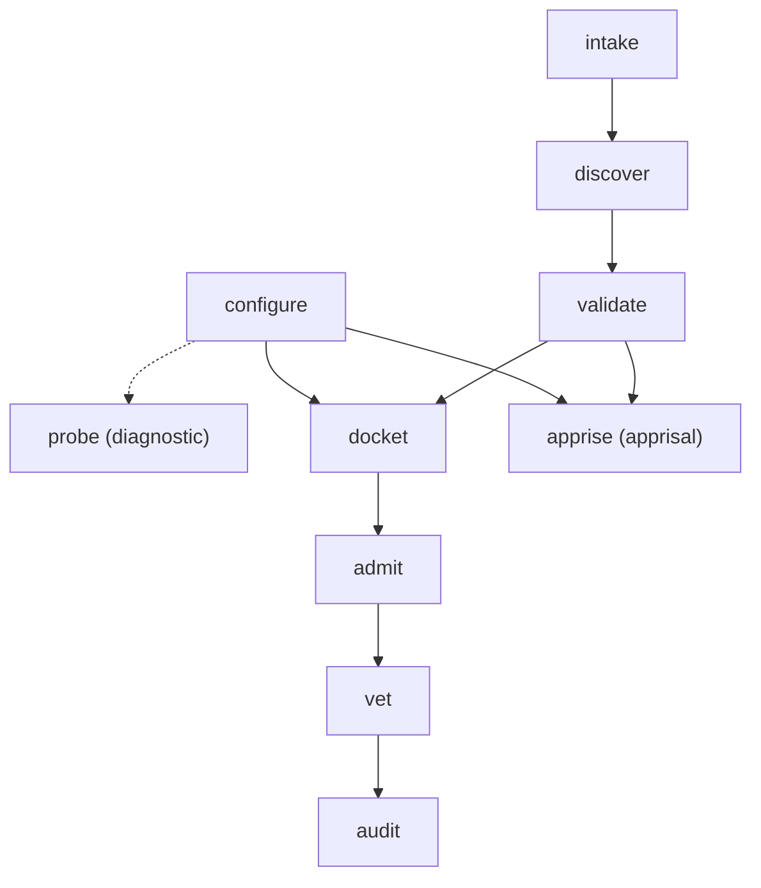

# Architecture & The Caseload Pipeline

**Status:** Authoritative Architectural Standard  
**Domain Concept:** The Caseload DAG Execution Model

---

## 1. Overview & Motivation

Canon Clerk is an automated review gate that enforces declarative engineering rule packs (*canons*) without incurring the prohibitive latency and cost of evaluating every rule with deep reasoning models on every commit.

Evaluation is orchestrated across a **Directed Acyclic Graph (DAG)** organized around a central, cumulative state container: **The Caseload**.

Rather than disjoint subcommands producing disparate outputs, Canon Clerk treats the entire evaluation as a functional state machine where subcommands serve as named **terminal stop points** along the DAG, formulated as crisp, single-word **imperative verbs**:

---

## 2. Architectural Documentation Suite

The complete architectural specification is partitioned across the following dedicated documents:

### Core Framework & Execution Model
- **[Caseload DAG Overview](architecture/overview.md):** The Caseload paradigm, Hexagonal Architecture (Ports & Adapters with the CLI binary as the driving adapter), Two Feeder Branches $\to$ Dual Adjudication/Apprisal Spines (Contentious Dispute Resolution vs. Statutory Apprisal), the Architectural Triad (Colorability $\to$ Admissibility $\to$ Compliance), Token & Latency Sieve funnel, `Caseload` schema, and telemetry event stream.
- **[DAG Scheduling & Semantics](architecture/scheduling.md):** Transitive dependency closure calculation, branch pruning, the Guarded/Lazy Scheduling Invariant (zero-credential short-circuits for un-governed changes), telescoping backfill mode, and the static schedule lookup table.
- **[Provider Transport & Rate-Limit Scheduling](architecture/transport.md):** Shared pooled HTTPS connection lifecycle on the persistent background reactor, per-origin `429`/`503` cooldown gating with monotonic coalescing and staggered release, multi-source retry-delay precedence, bounded transient retry (`--max-retries`, `--max-backoff-ms`), and single-shot `probe` isolation.
- **[GitHub Platform Adapter & Checks Publication](architecture/github.md):** Stage-agnostic GitHub Checks REST API outbound adapter (`POST` + 50-annotation `PATCH` batching), target/credential resolution (`GITHUB_TOKEN`/`GH_TOKEN`, `GITHUB_EVENT_PATH` $\to$ `GITHUB_SHA`), annotation span sanitization, 65,535-character output guards, duplicate workflow-command suppression, and forensics-first `--caseload` replay.
- **[Consistency & Flipper Benchmarking](architecture/benchmarking.md):** Multi-trial stage stability evaluation, out-of-band developer harness boundary, upstream closure reuse with downstream namespace stripping, polymorphic 1D/2D subject keys, and flipper dispersion metrics.

### Node-by-Node Stage Specifications (`docs/architecture/nodes/`)
Comprehensive specifications for each of the ten imperative verb stages:

- **[intake](architecture/nodes/intake.md):** Universal front door parsing diffs, target paths/globs, prospective intent queries, or whole-repo target scope (`--all-targets`) into `FileArtifact` records (Branch A).
- **[discover](architecture/nodes/discover.md):** Path filter evaluating `triggers:` globs and declarative `<scope>/.canons/config.yaml` allow/deny policy against modified files, short-circuiting on zero matches, or compiling the full corpus via `--all-canons` (Branch A).
- **[validate](architecture/nodes/validate.md):** Deterministic AST and YAML schema pre-flight linter for candidate canons or full corpus (Branch A).
- **[configure](architecture/nodes/configure.md):** Local environment and provider credential normalizer (Branch B).
- **[probe](architecture/nodes/probe.md):** Diagnostic leaf measuring live provider reachability and roundtrip endpoint latency.
- **[docket](architecture/nodes/docket.md):** Macro triage establishing subject-matter jurisdiction (`colorability_score >= 0.5`) over in-flight changes.
- **[admit](architecture/nodes/admit.md):** Micro triage establishing evidentiary admissibility (`admissibility_score >= 0.5`) per active case (Contentious Track).
- **[vet](architecture/nodes/vet.md):** Pre-trial prima facie compliance vetting (`vetting_score >= 0.8`) clearing uncontested cases and binding contested cases over for trial (Contentious Track).
- **[audit](architecture/nodes/audit.md):** Generative substantive adjudication rendering decrees, evaluating exceptions, and generating line annotations for contested cases (Contentious Track).
- **[apprise](architecture/nodes/apprise.md):** Prospective design-time procedural notice identifying governing canons intersecting prospective intent (Apprisal Track).

---

## 3. The Pipeline Stages at a Glance

| Node / Verb | Track | Capability / Engine | Cost / Latency | Gate Rule |
| :--- | :--- | :--- | :--- | :--- |
| `intake` | Branch A (Filing) | Local parser | 0 tokens, ~5ms | Parsed context; fails on corrupted stream |
| `discover` | Branch A (Filing) | Path matcher | 0 tokens, ~8ms | Matches > 0; short-circuits (exit 0) on 0 candidates |
| `validate` | Branch A (Filing) | AST linter | 0 tokens, ~12ms | 0 syntax errors; fails fast (exit 1) on error |
| `configure` | Branch B (Env) | Config resolver | 0 tokens, <5ms | Valid config; fails fast (exit 2) on missing keys |
| `probe` | Diagnostic Leaf | Network probe | 0 tokens, variable | Reachable; fails fast (exit 2) on unreachable |
| `docket` | Macro Triage Spine | Discriminator (`google:gemini-decision-1` / `typesafe:jev-latest` / `local:kev-4b`) | ~200–400ms, 0 output tokens | `colorability_score >= 0.5`; exits 0 if empty |
| `admit` | Contentious Track | Discriminator (`google:gemini-decision-1` / `typesafe:jev-latest` / `local:kev-4b`) | ~250–600ms, 0 output tokens | `admissibility_score >= 0.5`; exits 0 if no exhibits |
| `vet` | Contentious Track | Discriminator (`google:gemini-decision-1` / `typesafe:jev-latest` / `local:kev-4b`) | ~200ms, 0 output tokens | `vetting_score >= 0.8` $\implies$ vetted (0), else contested (1) |
| `audit` | Contentious Track | Generator (`google:gemini-4-carbon`) | ~2.5s, contested only | `compliance_score >= 0.5` $\implies$ pass (0), else fail (1) |
| `apprise` | Apprisal Track | Discriminator (`google:gemini-decision-1` / `typesafe:jev-latest` / `local:kev-4b`) | ~200–400ms, 0 output tokens | Determines prospective governing canons; exits 0 |

---

## 4. Doc-Driven Architecture

Architectural contracts for individual subsystems and pipeline stages are maintained directly as living specifications under [`docs/architecture/`](architecture/overview.md). All design decisions, data models, and functional invariants are documented authoritatively before code implementation.

