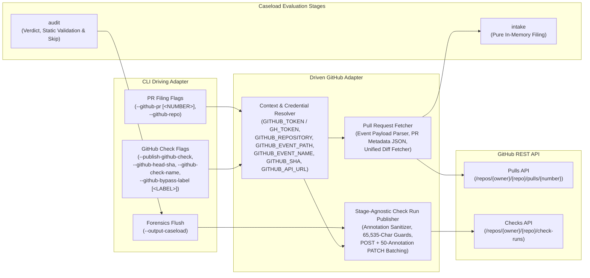

# GitHub Platform Adapter: PR Ingestion & Checks Publication

**Status:** Authoritative Architectural Standard  
**Domain Concept:** Stage-Agnostic Pull Request Ingestion, Outbound Checks Publication, Target Context Resolution & CI Forensics Durability

---

## 1. Executive Summary & Architectural Role

GitHub Actions workflow command annotations (`::error::`, `::warning::`, `::notice::`) enforce a hard platform ceiling of **10 errors and 10 warnings per step** (50 annotations total per job). On pull requests with more than 10 canon violations, findings beyond the limit are silently dropped from the pull request **Files changed** diff and Checks UI. Likewise, relying on shell wrappers (`jq`, `gh`) to extract pull request diffs and metadata duplicates GitHub context parsing outside the binary and complicates standalone GitHub Action adoption.

Canon Clerk treats forge integrations as **driven adapters at the boundary of the hexagon** (`overview.md` §3)—parallel to outbound model providers (`transport.md`)—so stage engines (`intake`, `audit`, `vet`, etc.) remain completely decoupled from GitHub wire protocols and environment conventions.

---

## 2. Target Context Resolution & Pre-Flight Fail-Fast

Both GitHub PR ingestion (`--github-pr [<NUMBER>]`) and GitHub Checks publication (`--publish-github-check`) are strictly **opt-in** and never fire implicitly—even when `GITHUB_ACTIONS=true`.

When either option is enabled, Canon Clerk resolves and validates the required GitHub context **up front before any model spend occurs**, failing fast with exit code `2` and an actionable remediation `Hint:` if any required input is missing or malformed. Target resolution executes independently of Branch B `configure` so that zero-candidate short-circuits, static validation failures, credential-skip exits (`--on-missing-credentials skip`), and offline `--caseload` replays all validate and publish consistently.

| Parameter | Resolution Precedence | Validation & Security Constraints |
| :--- | :--- | :--- |
| **Auth Token** | `GITHUB_TOKEN` $\to$ `GH_TOKEN` | Read strictly from environment variables; **never** accepted as a CLI flag and redacted from debug/diagnostic output. Requires `pull-requests: read` for PR ingestion and `checks: write` for Check Run publication. |
| **Repository** | `--github-repo <OWNER/REPO>` $\to$ `GITHUB_REPOSITORY` | Shared across filing ingestion (`FilingSourceArgs`) and Check Run publication without flag collisions. Must be a valid `<owner>/<repo>` slug (two non-empty path segments, no whitespace or traversal). |
| **Pull Request Number** | `--github-pr <NUMBER>` $\to$ `pull_request.number` in `GITHUB_EVENT_PATH` | Required when `--github-pr` is active; must be a positive integer (`>= 1`). |
| **Head Commit SHA** | `--github-head-sha <SHA>` $\to$ `pull_request.head.sha` in `GITHUB_EVENT_PATH` $\to$ fetched PR API `head.sha` (when `--github-pr` is active) $\to$ `GITHUB_SHA` | Preferring `pull_request.head.sha` over `GITHUB_SHA` ensures triangular fork PRs running under `pull_request_target` annotate the pull request's head commit rather than the base branch; falling back to the fetched PR API `head.sha` enables `--github-pr <NUMBER> --publish-github-check` outside GitHub Actions. |
| **API Base URL** | `GITHUB_API_URL` $\to$ `https://api.github.com` | Supports GitHub Enterprise Server deployments and hermetic loopback mock servers. |
| **Check Run Name** | `--github-check-name <NAME>` $\to$ `"Canon Clerk Audit"` | Distinct from the Actions job name to avoid Check Run collisions. |
| **Bypass Label** | `--github-bypass-label [<LABEL>]` $\to$ `CANON_CLERK_GITHUB_BYPASS_LABEL` | Strictly opt-in (disabled when omitted); bare `--github-bypass-label` defaults to `"skip-audit"`. Must be non-empty when explicitly passed; matched case-insensitively against `pull_request.labels[].name`. |

---

## 3. Pull Request Diff & Metadata Ingestion (`--github-pr`)

The CLI driving adapter supports native pull request ingestion via `--github-pr [<NUMBER>]` across `intake` and every cascading stage (`discover`, `validate`, `apprise`, `docket`, `admit`, `vet`, `audit`), while keeping the `intake` core domain engine (`src/intake/`) 100% pure in-memory with zero network or subprocess side effects:

1. **Metadata Resolution:**
   - **Bare `--github-pr`:** Reads `pull_request.number`, `pull_request.title`, `pull_request.body`, `pull_request.head.sha`, `pull_request.labels[].name`, and event `sender.login` directly from the JSON file at `$GITHUB_EVENT_PATH`. Unreadable or malformed event payloads, or payloads missing `pull_request.number`, fail fast with exit code `2` and an actionable `Hint:`.
   - **Explicit `--github-pr <NUMBER>`:** Fetches pull request metadata (`title`, `body`, `head.sha`, `labels[].name`) via `GET /repos/{owner}/{repo}/pulls/{pull_number}` with `Accept: application/vnd.github+json`.
2. **Unified Diff Fetching:**
   - Fetches the pull request unified diff directly via `GET /repos/{owner}/{repo}/pulls/{pull_number}` with `Accept: application/vnd.github.v3.diff` over Canon Clerk's persistent background HTTP reactor (`transport.md` §2), setting `X-GitHub-Api-Version: 2022-11-28`, `User-Agent: canon-clerk/<version>`, and `Authorization: Bearer <token>`.
3. **Flag Composition & Precedence:**
   - `--github-pr` conflicts with `--diff` (mutually exclusive patch sources).
   - Explicit `--pr-title`, `--pr-body`, and `--pr-body-file` always override metadata fetched from `$GITHUB_EVENT_PATH` or the GitHub API (`CLI flag > event/API metadata`).
   - **Workspace State Heuristic:** When `--github-pr` is active and `--workspace-state` is omitted, `--workspace-state` defaults to `base` **iff** `GITHUB_EVENT_NAME == "pull_request_target"`; otherwise it preserves the default `head`. An explicit `--workspace-state <head|base>` always overrides.
   - **Linked Issues Scope:** Fetching `linked_issues` via additional GitHub Issues API calls is intentionally out of scope for basic PR ingestion and reserved for a follow-up capability.

---

## 4. Stage-Agnostic Check Run Publication & Wire Invariants

Stages translate their domain outcomes into a stage-agnostic Check Run report consisting of a check name, terminal conclusion (`success`, `failure`, `neutral`, or `skipped`), headline title, Markdown summary, optional Markdown detail text, and flat list of source annotations.

The outbound GitHub Checks client enforces the following wire invariants over Canon Clerk's persistent background HTTP reactor (`transport.md` §2):

1. **Batched Creation & Continuation (`POST` + 50-Annotation `PATCH`):**  
   - Creates the completed Check Run via `POST /repos/{owner}/{repo}/check-runs` with the first batch of up to **50** annotations.
   - Streams all remaining annotations in consecutive batches of **50** via `PATCH /repos/{owner}/{repo}/check-runs/{check_run_id}` until every finding is published, carrying `output.title`, `output.summary`, and `output.text` on each update as required by GitHub's Checks API.
   - Sets required GitHub REST API headers (`Accept: application/vnd.github+json`, `X-GitHub-Api-Version: 2022-11-28`, `User-Agent: canon-clerk/<version>`, and `Authorization: Bearer <token>`).
2. **Annotation Span Sanitization (HTTP 422 Prevention):**  
   - Normalizes line bounds to 1-based `start_line >= 1` and `end_line >= start_line`.
   - Preserves 1-based `start_column` / `end_column` strictly on single-line spans (`start_line == end_line`) and omits both column fields whenever `start_line != end_line`, preventing GitHub API HTTP `422 Unprocessable Entity` rejections on multi-line annotations.
3. **Output Character-Budget Guards (65,535-Character Ceiling):**  
   - Both `output.summary` and `output.text` are bounded to GitHub's 65,535-character limit at valid Unicode scalar boundaries, appending an explicit truncation notice whenever content exceeds the ceiling so findings are never silently cut off.

---

## 5. CLI Ergonomics, Forensics Durability & Replay

1. **Duplicate Annotation Suppression & Step Summary Parity:**  
   When `--publish-github-check` is active and neither `--format` nor `--json` is explicitly specified under `GITHUB_ACTIONS=true`, terminal `stdout` defaults to `stylish` rather than `github`. This prevents GitHub Actions from rendering duplicate `::error::` workflow commands alongside the Check Run's inline annotations, while still appending the rendered Markdown Funnel Provenance Receipt and Verdict Report to `$GITHUB_STEP_SUMMARY` when set so the Actions workflow run summary page displays full results alongside the standalone Check Run. Explicit `--format github` remains available for zero-setup workflows that do not grant `checks: write`.
2. **Forensics-First Durability:**  
   `--output-caseload <PATH>` is always flushed to disk **before** issuing any GitHub Checks API request. If GitHub returns a transient HTTP or transport error, the CLI exits with code `2` and prints an actionable replay hint referencing the saved Caseload artifact so forensics and LLM results are never lost.
3. **Zero-Spend Replay:**  
   Because terminal stages fast-forward pre-populated Caseload records, invoking `canon-clerk audit --caseload <PATH> --publish-github-check` replays publication directly from a recorded Caseload artifact with zero LLM spend.

---

## 6. Pull Request Label Bypass & Collaborator Security Boundary

When `Canon Clerk Audit` is promoted from advisory to an enforcing required status check, maintainers need a lightweight, auditable escape hatch for LLM false positives, emergency hotfixes, and pull requests that delete or revise faulty canons (which `pull_request_target` otherwise evaluates against `main`'s older `.canons/` corpus).

1. **Opt-In Configuration & Label Resolution:**  
   Bypass evaluation is strictly **opt-in** via `--github-bypass-label [<LABEL>]` (bare flag defaults to `"skip-audit"`) or the `CANON_CLERK_GITHUB_BYPASS_LABEL` environment variable (`CLI flag > env var`). When active, Canon Clerk inspects pull request labels from the resolved `--github-pr` metadata (`$GITHUB_EVENT_PATH` or Pulls API) or, when `--github-pr` is inactive, from `pull_request.labels[].name` in `$GITHUB_EVENT_PATH`. Label comparison is case-insensitive to match GitHub's label semantics.
2. **Zero-Spend Short-Circuit & `skipped` Check Run Publication:**  
   When the configured bypass label is present on the pull request, `audit` short-circuits immediately after pre-flight target validation—before `discover`, `validate`, `configure`, and any model calls (0 tokens, 0 provider requests, and independent of provider API credentials). Canon Clerk flushes `--output-caseload` (when configured), writes an explicit bypass notice to stdout and `$GITHUB_STEP_SUMMARY`, publishes a GitHub Check Run with `conclusion: "skipped"` (which GitHub treats as non-blocking for required status checks) recording the matched bypass label and triggering actor (`GITHUB_ACTOR` or event `sender.login`) in `output.summary`, and exits with code `0`.
3. **Collaborator-Only Security Boundary & Workflow Lifecycle:**  
   On GitHub, external fork contributors cannot apply or remove pull request labels; only repository collaborators with `triage` or `write`+ permissions can trigger the bypass, and GitHub's pull request timeline permanently audits who applied the label. Workflows enabling `--github-bypass-label` SHOULD subscribe to both `labeled` and `unlabeled` pull request event types so removing the bypass label immediately re-runs the audit and replaces the `skipped` Check Run on the head commit.
