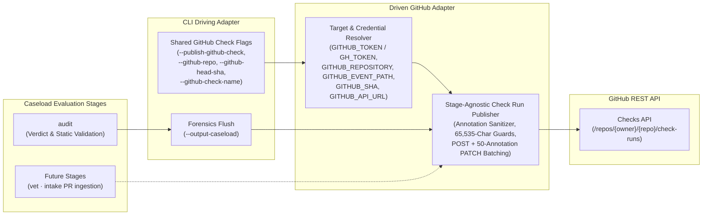

# GitHub Platform Adapter & Checks Publication

**Status:** Authoritative Architectural Standard  
**Domain Concept:** Stage-Agnostic Outbound Checks Publication, Target Context Resolution & CI Forensics Durability

---

## 1. Executive Summary & Architectural Role

GitHub Actions workflow command annotations (`::error::`, `::warning::`, `::notice::`) enforce a hard platform ceiling of **10 errors and 10 warnings per step** (50 annotations total per job). On pull requests with more than 10 canon violations, findings beyond the limit are silently dropped from the pull request **Files changed** diff and Checks UI.

Canon Clerk treats forge integrations as **driven adapters at the boundary of the hexagon** (`overview.md` §3)—parallel to outbound model providers (`transport.md`)—so stage engines (`audit`, and future stages such as `vet` or `intake`) remain completely decoupled from GitHub wire protocols and environment conventions.

---

## 2. Target Context Resolution & Pre-Flight Fail-Fast

GitHub Checks publication is strictly **opt-in** via `--publish-github-check` and never fires implicitly—even when `GITHUB_ACTIONS=true`.

When `--publish-github-check` is enabled, Canon Clerk resolves and validates the complete publication target **up front before any model spend occurs**, failing fast with exit code `2` and an actionable remediation hint if any required input is missing or malformed. Target resolution executes independently of Branch B `configure` so that zero-candidate short-circuits, static validation failures, and offline `--caseload` replays all validate and publish consistently.

| Parameter | Resolution Precedence | Validation & Security Constraints |
| :--- | :--- | :--- |
| **Auth Token** | `GITHUB_TOKEN` $\to$ `GH_TOKEN` | Read strictly from environment variables; **never** accepted as a CLI flag and redacted from debug/diagnostic output. Requires `checks: write` scope. |
| **Repository** | `--github-repo <OWNER/REPO>` $\to$ `GITHUB_REPOSITORY` | Must be a valid `<owner>/<repo>` slug (two non-empty path segments, no whitespace or traversal). |
| **Head Commit SHA** | `--github-head-sha <SHA>` $\to$ `pull_request.head.sha` in `GITHUB_EVENT_PATH` $\to$ `GITHUB_SHA` | Preferring `pull_request.head.sha` over `GITHUB_SHA` ensures triangular fork PRs running under `pull_request_target` annotate the pull request's head commit rather than the base branch. |
| **API Base URL** | `GITHUB_API_URL` $\to$ `https://api.github.com` | Supports GitHub Enterprise Server deployments and hermetic loopback mock servers. |
| **Check Run Name** | `--github-check-name <NAME>` $\to$ `"Canon Clerk Audit"` | Distinct from the Actions job name to avoid Check Run collisions. |

---

## 3. Stage-Agnostic Check Run Publication & Wire Invariants

Stages translate their domain outcomes into a stage-agnostic Check Run report consisting of a check name, terminal conclusion (`success`, `failure`, `neutral`, or `skipped`), headline title, Markdown summary, optional Markdown detail text, and flat list of source annotations.

The outbound GitHub Checks client enforces the following wire invariants over Canon Clerk's persistent background HTTP reactor (`transport.md` §2):

1. **Batched Creation & Continuation (`POST` + 50-Annotation `PATCH`):**  
   - Creates the completed Check Run via `POST /repos/{owner}/{repo}/check-runs` with the first batch of up to **50** annotations.
   - Streams all remaining annotations in consecutive batches of **50** via `PATCH /repos/{owner}/{repo}/check-runs/{check_run_id}` until every finding is published, carrying `output.title`, `output.summary`, and `output.text` on each update as required by GitHub's Checks API.
   - Sets required GitHub REST API headers (`Accept: application/vnd.github+json`, `X-GitHub-Api-Version: 2022-11-28`, `User-Agent: canon-clerk/<version>`, and `Authorization: Bearer <token>`).
2. **Annotation Span Sanitization (HTTP 422 Prevention):**  
   - Normalizes line bounds to 1-based `start_line >= 1` and `end_line >= start_line`.
   - Preserves 1-based `start_column` / `end_column` strictly on single-line spans (`start_line == end_line`) and omits both column fields whenever `start_line != end_line`, preventing GitHub API HTTP `422 Unprocessable Entity` rejections on multi-line annotations.
3. **Output Character-Budget Guards (65,535-Character Ceiling):**  
   - Both `output.summary` and `output.text` are bounded to GitHub's 65,535-character limit at valid Unicode scalar boundaries, appending an explicit truncation notice whenever content exceeds the ceiling so findings are never silently cut off.

---

## 4. CLI Ergonomics, Forensics Durability & Replay

1. **Duplicate Annotation Suppression:**  
   When `--publish-github-check` is active and neither `--format` nor `--json` is explicitly specified under `GITHUB_ACTIONS=true`, terminal `stdout` defaults to `stylish` rather than `github`. This prevents GitHub Actions from rendering duplicate `::error::` workflow commands alongside the Check Run's inline annotations. Explicit `--format github` remains available for zero-setup workflows that do not grant `checks: write`.
2. **Forensics-First Durability:**  
   `--output-caseload <PATH>` is always flushed to disk **before** issuing any GitHub Checks API request. If GitHub returns a transient HTTP or transport error, the CLI exits with code `2` and prints an actionable replay hint referencing the saved Caseload artifact so forensics and LLM results are never lost.
3. **Zero-Spend Replay:**  
   Because terminal stages fast-forward pre-populated Caseload records, invoking `canon-clerk audit --caseload <PATH> --publish-github-check` replays publication directly from a recorded Caseload artifact with zero LLM spend.
