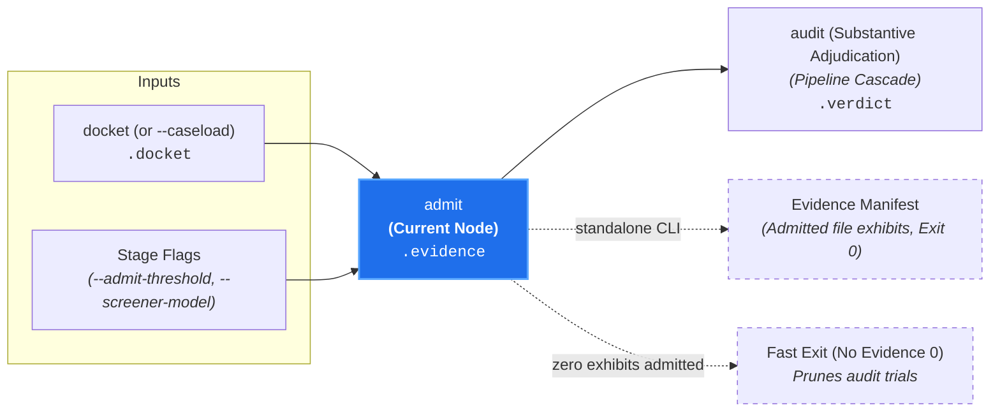

# Evidence Admissibility Triage (`admit`)

**Status:** Authoritative Architectural Standard  
**Core Domain Engine:** Caseload Domain Engine  
**Driving Adapter:** CLI (`admit`)

---

## 1. Domain Concept & Role (`core`)

`admit` performs **Micro Triage: Evidentiary Relevance Screening** for each active Case on the docket. In the court clerkship taxonomy, it represents the clerk reviewing tendered documents, affidavits, and physical exhibits to formally admit only relevant evidence into the case record prior to trial.

- **Imperative Verb:** `admit`
- **Court Clerkship Role:** Micro triage establishing evidentiary admissibility.
- **Metric Pair:** `admissibility_score` (number [0.0, 1.0]) and `admissibility_summary` (string rationale).
- **Core Question:** *"For an active Case, is this candidate exhibit (diff hunk, PR title, PR body, or reference document) admissible as relevant evidence?"*

---

## 2. Dependencies & Prerequisites (`core`)



- **Direct Prerequisites:** `docket` (requires active cases in `caseload.docket.active_docket`).
- **Transitive Prerequisites:** `intake`, `discover`, `validate`, `configure`.
- **Pruned from Execution:** `probe`, `audit`.

---

## 3. Caseload Contribution & Data Plane Constraints

### Caseload Delta
`admit` populates the `.evidence` namespace on the cumulative `Caseload` envelope with micro evidentiary relevance records for each active case:

- **Per-Case Evidence Manifests (`exhibits`):** A deterministic map keyed by active canon identifier (`canon_path`), pairing each docketed case with its list of admitted `exhibits`.
- **Admitted Exhibit Records (`AdmittedExhibit`):** Each admitted exhibit identifies the repository-relative `file_path` (or exhibit plane identifier), the model's `admissibility_summary` (rationale for admitting the exhibit into evidence for that canon), and its continuous `admissibility_score` in `[0.0, 1.0]` meeting or exceeding `--admit-threshold` (default `0.5`).

### Data Plane & Domain Short-Circuit Invariants
1. **Evidentiary Filtering:** Exhibits scoring below `--admit-threshold` are excluded from the case's admitted `exhibits` list so downstream `audit` trials receive only relevant evidence.
2. **Zero-Evidence Short-Circuit:** If every active case on `.docket.active_docket` retains zero admitted exhibits after threshold filtering, the engine attaches `.evidence` and halts downstream cascade execution immediately with exit code `0`, scheduling zero substantive `audit` trials.

---

## 4. Process & Domain Logic (`core`)

1. **Per-Case Evidentiary Review:** Iterates through each canon on `caseload.docket.active_docket`.
2. **Fast Heuristic Screening (`gemini-flash-lite-latest`):** Evaluates candidate exhibits—including code diff hunks, PR title, PR body, commit messages, and reference documents—against the canon's specific requirements, as declared by its `inspect:` frontmatter.
3. **Constrained Decoding Schema (Domain-Indirected, Reason-First):**
   ```json
   {
     "exhibits": [
       {
         "file_path": "src/commands/docket.rs",
         "admissibility_summary": "Contains option definitions for new CLI command.",
         "admissibility_score": 0.95
       }
     ]
   }
   ```
   Generating `admissibility_summary` before `admissibility_score` provides a chain-of-thought scratchpad, anchoring reproducible probability distributions.
4. **Admissibility Threshold (`admissibility_score >= --admit-threshold`, default: `0.5`):**
   - Exhibits scoring $\ge 0.5$ are admitted into evidence for that Case.
   - Irrelevant diff hunks are excluded (`admissibility_score < 0.5`).
5. **Dismissal of Cases with Zero Exhibits:** If an active Case retains zero admitted exhibits, it is dismissed without trial.

---

## 5. Driving Adapter: CLI

The CLI exposes `admit` as an imperative subcommand:

```bash
# Execute evidence triage against an upstream Caseload:
canon-clerk admit --caseload caseload-4.json --json

# Run telescoping pipeline stopping at admit:
git diff origin/main | canon-clerk admit --diff -
```

### Missing Input Source Guard (Naked Invocation)
Invoking `canon-clerk admit` naked without a filing source (no diff, no target files, no `--caseload`) fails fast with exit code `2` (Usage Error) and prints actionable guidance:
```text
error: No filing source provided for admit.
  Hint: Pipe a diff via standard input ('--diff -'), specify target files,
        or pass an upstream caseload ('--caseload <path>').
```
Conversely, if an explicitly designated stream yields zero diffs (e.g. `git diff origin/main | canon-clerk admit --diff -` on an up-to-date branch), the pipeline cleanly short-circuits with exit code `0` ("0 modified files; 0 admitted exhibits").

### CLI Flags & Environment
- `--admit-threshold <number>`: Admissibility threshold (default: `0.5`).
- `--docket-threshold <number>`: Upstream jurisdiction screening threshold in telescoping mode (default: `0.5`).
- `--caseload <path|->`: Ingests upstream Caseload.
- `--output-caseload <path>`: Writes cumulative `Caseload` JSON to disk independently of terminal stdout.
- `--json`: Emits enriched Caseload JSON to stdout.

### CLI Exit Codes
- **0:** Exhibits admitted and attached (or zero-evidence short-circuit).
- **2:** Usage error, missing filing source (naked invocation), provider connection error, or model response failure.
