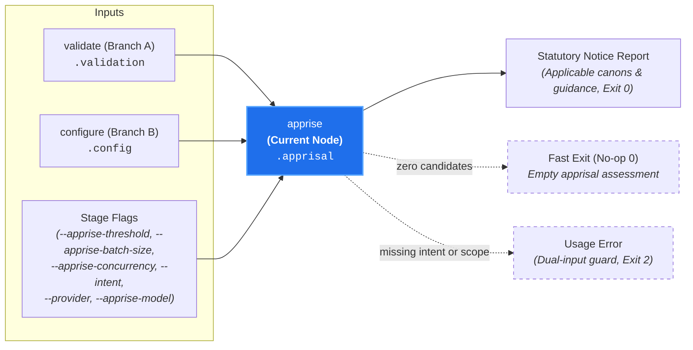

# Statutory Apprisal (`apprise`)

**Status:** Authoritative Architectural Standard  
**Core Domain Engine:** Caseload Domain Engine  
**Driving Adapter:** CLI (`apprise`)

---

## 1. Domain Concept & Role (`core`)

`apprise` performs **Prospective Jurisprudential Screening: Statutory Apprisal for Design-Time Guidance** across all candidate canons matching the prospective target scope.

In the court clerkship taxonomy, `apprise` represents the court exercising its **Apprisal Authority** (*Jurisdictio Notificatoria*). Rather than functioning as a trial judge hearing evidence on past infractions (the contentious `audit` path), `apprise` acts as the **Clerk of the Court apprising parties of governing rules**. It receives a prospective design inquiry—formulated as planned file targets and design intent—and determines which canons claim subject-matter jurisdiction over the planned work, providing contributors and AI coding agents with pre-flight notice of governing statutes before implementation begins.

- **Imperative Verb:** `apprise`
- **Court Clerkship Role:** Statutory apprisal, procedural notice, and jurisdictional applicability determination.
- **Metric Pair:** `apprisal_score` (number [0.0, 1.0]) and `apprisal_summary` (string rationale justifying prospective jurisdiction).
- **Core Question:** *"Given this prospective design intent and target scope, does this canon have a colorable claim of jurisdiction over the planned work?"*

---

## 2. Dependencies & Prerequisites (`core`)



- **Direct Prerequisites:**
  - `validate` (Branch A: validated candidate canons in `caseload.discovery.candidate_canons` and `caseload.validation`).
  - `configure` (Branch B: resolved `apprise` node model binding in `caseload.config.nodes.apprise` and verified provider credentials).
- **Transitive Prerequisites:** `intake`, `discover`.
- **The Dual-Input Invariant:** Statutory apprisal evaluates governing statutes against **both** a non-empty prospective design `intent` (`--intent <text>` or pre-populated `.intake.intent`) **and** an explicit target or canon scope (`TARGETS`, `-`, `--diff`, `--all-targets`, `--all-canons`, `--canon`, or pre-populated upstream `.discovery`). Omitting either input fails fast with exit code `2` rather than silently evaluating an empty scope.
- **Branch Independence & Pruning:**
  - Evaluates without requiring code diffs, patches, or work-in-progress (WIP) exhibits.
  - Decoupled from the contentious dispute track: completely prunes `docket`, `admit`, and `audit` from execution.
  - Diagnostic leaf `probe` is never scheduled.

---

## 3. Caseload Contribution & Data Plane Constraints

### Caseload Delta
`apprise` populates the `.apprisal` namespace on the cumulative `Caseload` envelope with prospective statutory notice records:

- **Per-Canon Apprisal Assessments (`assessments`):** A deterministic map keyed by candidate canon identifier. Each assessment captures the model's `apprisal_summary` (rationale explaining why the canon does or does not govern the planned design intent and target scope), continuous `apprisal_score` in `[0.0, 1.0]`, and deterministically derived `apprisal_status` (`"applicable"` when `apprisal_score >= threshold`, otherwise `"dismissed"`).

### Data Plane & Domain Short-Circuit Invariants
1. **Deterministic Status Derivation:** The `apprise` model emits only `apprisal_summary` and `apprisal_score`; the domain engine deterministically evaluates the score against `--apprise-threshold` (default `0.5`) to assign `apprisal_status` (`"applicable"` vs. `"dismissed"`).
2. **Completion-Order-Independent Deterministic Folding:** Whether candidate canons are evaluated in a single aggregate call or partitioned into concurrent batches, all per-canon assessments fold into a deterministic lexicographically ordered `assessments` map. Identical per-canon model outputs produce byte-for-byte identical `.apprisal` records regardless of batch partitioning or in-flight batch completion order.
3. **Empty Candidate Short-Circuit:** If `.discovery.candidate_canons` is empty, the engine attaches an empty `.apprisal` record (`assessments: {}`) and terminates immediately with exit code `0`, dispatching zero model calls.

---

## 4. Process & Domain Logic (`core`)

1. **Dual-Input Verification & Candidate Canon Early Exit:**  
   Verifies that non-empty prospective design intent is present on `caseload.intake.intent` alongside resolved discovery scope in `caseload.discovery`. Extracts `candidate_canons` from `caseload.discovery` (resolved from prospective target paths, globs, or explicit canon selection). If `candidate_canons` is empty after evaluating an explicit target or canon scope, attaches an empty `.apprisal` record (`assessments: {}`) and short-circuits immediately with exit code `0`.
2. **Discriminative `Noul` Screening (`Discriminator` Required):**  
   Evaluates candidate canons against the prospective design intent and target scope context using `caseload.config.nodes.apprise`, which strictly requires a `Discriminator` model (`google:gemini-decision-*`, e.g., default `google:gemini-decision-1`; `typesafe:jev-*`, e.g., `typesafe:jev-latest`; built-in `local:*`, e.g., `local:kev-4b`; or custom `gemini`/`systemone` discriminator profiles)—rejecting any `Generator` model binding with exit code `2` and actionable guidance:
   - **Shared-Context Parallel `Noul` Evaluation:** Encodes the prospective design intent and target scope once as shared filing context and evaluates parallel per-canon applicability hypotheses (`nouls`) in a single forward pass with zero output tokens, surfacing deterministic statutory invariant notices on applicable canons while automatically partitioning oversized candidate sweeps according to per-model decision budget profiles (`480,000`-character batch / `256` `nouls` per call on `google:gemini-decision-*`; `64,000`-character batch / `48` `nouls` per call on `typesafe:jev-*`; `32,000`-character batch / `2` screening `nouls` per call on `local:*`), overridable via `--apprise-batch-size`.
   - **Bounded In-Flight Concurrency, Telemetry & Contextual Diagnostics:** Executes batches concurrently up to `--apprise-concurrency` (default `4` on cloud profiles; `1` on `local:*`) over the shared pooled provider transport ([`../transport.md`](../transport.md)), emitting `ProviderRetry`, incremental `StageProgress`, and per-call `ModelCall` telemetry while deterministically merging per-batch assessments into `.apprisal.assessments` regardless of completion order and summing multi-batch token accounting into `StageFinish`. Unrecoverable or retry-exhausted batch failures fail fast and annotate `(batch k/N)` directly in the error diagnostic whenever multiple batches were scheduled.
3. **Deterministic Threshold Gating (`apprisal_score >= --apprise-threshold`, default: `0.5`):**  
   Each candidate canon's calibrated `Noul` probability is clamped into `[0.0, 1.0]` alongside a deterministic statutory notice summary (`apprisal_summary`), and the core domain engine deterministically evaluates the continuous score against the threshold to assign `apprisal_status`:
   - Canons scoring $\ge 0.5$ establish prospective jurisdiction and are marked `apprisal_status: "applicable"`.
   - Canons scoring $< 0.5$ are marked `apprisal_status: "dismissed"`.
4. **Latency & Token Economy:** Executes in ~150–400ms with zero output tokens across 20+ candidate canons, and scales across 40+ candidate canons via concurrent batches with reduced wall-clock latency and stabilized per-canon classifications.

---

## 5. Driving Adapter: CLI

The CLI exposes `apprise` as the primary entry point for design-time and pre-flight planning:

```bash
# 1. Inline design intent with prospective target paths:
canon-clerk apprise --intent "Refactor authentication to round-robin between providers" "src/auth" "src/frontend"

# 2. Streaming newline-delimited prospective target paths via standard input ('-'):
git diff origin/main --name-only | canon-clerk apprise --intent "Rotate auth provider" -

# 3. Running against an upstream Caseload file:
canon-clerk apprise --caseload upstream-discovery.json

# 4. Tab-separated compact records for shell scripting:
canon-clerk apprise --intent "Add CLI output flag" src/cli --format compact

# 5. Machine-readable JSON output for AI Agent prompt injection:
canon-clerk apprise --intent "Add Kafka event bus" src/events --json

# 6. Partition large candidate sets into concurrent batches of 15 canons:
canon-clerk apprise --intent "Add CLI output flag" src/cli --apprise-batch-size 15 --apprise-concurrency 4
```

### Dual-Input Guard (Missing Intent or Target Scope)
`canon-clerk apprise` enforces a strict **Dual-Input Guard**: invoking `apprise` requires **both** a non-empty prospective design `intent` (`--intent <TEXT>` or pre-populated `.intake.intent`) **and** an explicit target or canon scope (positional `TARGETS`, newline-delimited target paths via `-`, `--diff`, `--all-targets`, `--all-canons`, `--canon`, or pre-populated upstream `.discovery`). Omitting either input (naked invocation, supplying `--intent` without target/canon scope, or supplying target/canon scope without `--intent`) fails fast with exit code `2` (Usage Error) and prints actionable remediation guidance:
```text
error: Prospective apprisal requires both a non-empty design intent and an explicit target or canon scope.
  Hint: Pass '--intent <TEXT>' alongside target paths ('src/...', '-', '--diff <PATH|->', '--all-targets')
        or canon scope ('--all-canons', '--canon <PATH|GLOB>'), or supply '--caseload <PATH|->'.
```

Conversely, when both prospective design intent and an explicit target or canon scope are provided and `discover` matches zero candidate canons, the command attaches an empty `.apprisal` record (`assessments: {}`) and short-circuits cleanly with exit code `0` without invoking `validate` or requiring provider credentials (`GEMINI_API_KEY`).

### CLI Flags & Environment
- `TARGETS` / `-` (Positional): Prospective target file paths, directories, globs, or `-` to read newline-delimited target paths from standard input.
- `--intent <TEXT>`: Inline prospective architectural design intent or plan description.
- `--diff <PATH|->`, `--all-targets`, `--pr-title <TEXT>`, `--pr-body <TEXT>`, `--pr-body-file <PATH>`: Shared filing source and metadata flags.
- `--all-canons`, `--canon <PATH|GLOB>`: Shared canon selection scope flags.
- `--apprise-threshold <FLOAT>` (fallback env: `CANON_CLERK_APPRISE_THRESHOLD`; config key: `nodes.apprise.threshold`): Prospective applicability threshold in `[0.0, 1.0]` (default: `0.5`). Ambiguous unqualified `--threshold` and out-of-closure stage flags (`--docket-*`, `--admit-*`, `--vet-*`, `--audit-*`) are rejected with exit code `2` and guidance pointing to `--apprise-*`.
- `--apprise-batch-size <COUNT>` (fallback env: `CANON_CLERK_APPRISE_BATCH_SIZE`; config key: `nodes.apprise.batchSize`): Optional positive integer (`>= 1`) capping the maximum candidate canons evaluated per model call (default: `256` on `google:gemini-decision-*`, `48` on cloud `systemone` profiles, `2` on `local:*`). Follows standard precedence (explicit CLI flag $\to$ environment variable $\to$ `~/.config/canon-clerk/config.json` $\to$ built-in default).
- `--apprise-concurrency <COUNT>` (fallback env: `CANON_CLERK_APPRISE_CONCURRENCY`; config key: `nodes.apprise.concurrency`): Optional positive integer (`>= 1`) bounding the maximum concurrent in-flight model calls when candidate canons are partitioned into multiple batches (default: `4` on cloud profiles; `1` on `local:*`). Follows standard precedence (explicit CLI flag $\to$ environment variable $\to$ `~/.config/canon-clerk/config.json` $\to$ built-in default).
- `--provider <SLUG>` (`CANON_CLERK_PROVIDER`; config key: `defaults.provider`), `--apprise-model <PROVIDER:MODEL>` (`CANON_CLERK_APPRISE_MODEL`; config key: `nodes.apprise.model`), `--thinking-level <minimal|low|medium|high>` (`CANON_CLERK_THINKING_LEVEL`), `--reasoning-budget <TOKENS>` (`CANON_CLERK_REASONING_BUDGET`), `--gemini-api-key <KEY>` (`GEMINI_API_KEY`), `--typesafe-api-key <KEY>` (`TYPESAFE_API_KEY`), `--local-api-key <KEY>` (`LOCAL_API_KEY`), `--gemini-base-url <URL>`, `--typesafe-base-url <URL>`, `--local-base-url <URL>`: Provider, `apprise` node model, extended thinking, endpoint, and credential options (resolved JIT only when validated candidate canons exist).
- `--timeout <MS>` (`CANON_CLERK_TIMEOUT_MS`; config key: `defaults.timeoutMs`, default: `60000` cloud / `180000` `local:*`), `--max-retries <COUNT>` (`CANON_CLERK_MAX_RETRIES`; config key: `defaults.maxRetries`, default: `2`), `--max-backoff-ms <MS>` (`CANON_CLERK_MAX_BACKOFF_MS`; config key: `defaults.maxBackoffMs`, default: `90000`): Shared pooled transport timeout, retry, and per-origin rate-limit cooldown bounds ([`../transport.md` §6](../transport.md#6-out-of-band-telemetry--cli-transport-controls)).
- `-v` / `--verbose` (fallback env: `CANON_CLERK_VERBOSE`), `--log-file <PATH>` (fallback env: `CANON_CLERK_LOG_FILE`): Global diagnostic progress and structured JSONL telemetry stream options.
- `--format <stylish|json|compact>`: Output presentation format (default: `stylish`).
- `--caseload <PATH|->`: Ingests upstream `Caseload` JSON from file or `-` for standard input.
- `--output-caseload <PATH>`: Writes cumulative `Caseload` JSON to disk independently of terminal `stdout`.
- `--json`: Emits enriched `Caseload` JSON to `stdout` (equivalent to `--format json`).

### CLI Output Modes
- **`stylish` (Default):** Renders the **Pipeline Funnel Provenance Receipt** followed by the Statutory Apprisal summary listing applicable canons alongside their `apprisal_summary` rationales.
- **`compact`:** Emits unadorned tab-separated `<canon>\t<status>\t<score>\t<summary>` records (one candidate canon per line in deterministic lexicographical order).
- **`json` / `--json`:** Emits the cumulative `Caseload` JSON envelope containing the populated `.apprisal` container.

### CLI Exit Codes
- **0:** Successful statutory apprisal (including clean zero-candidate short-circuits).
- **1:** Candidate canon validation failure (`validation.has_errors` is `true`, evaluated before checking provider credentials) or local workspace I/O runtime error.
- **2:** Usage error, dual-input guard violation (missing design intent or missing target/canon scope), invalid or out-of-range `--apprise-threshold`, invalid or zero `--apprise-batch-size` / `--apprise-concurrency`, invalid `--max-retries` / `--max-backoff-ms`, invalid `<provider>:<model>` specifier, rejected unqualified or out-of-closure stage flag, conflicting `stdin` operands, missing API credentials, or model provider error.

