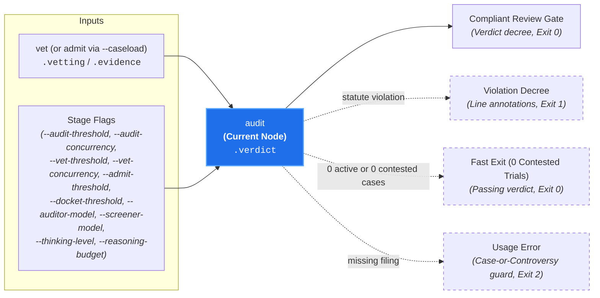

# Judicial Adjudication (`audit`)

**Status:** Authoritative Architectural Standard  
**Core Domain Engine:** Caseload Domain Engine  
**Driving Adapter:** CLI (`audit`)

---

## 1. Domain Concept & Role (`core`)

`audit` performs **Substantive Adjudication: Merits Evaluation & Verdict Generation** for contested active cases retaining admissible evidence. In the court clerkship taxonomy, it represents the Judge taking the bench after pre-trial vetting (`vet`), hearing arguments strictly on the admitted exhibits for contested cases, evaluating affirmative defenses (`Exception`), and rendering formal decrees with actionable remediation and line annotations.

- **Imperative Verb:** `audit`
- **Court Clerkship Role:** Judicial trial and decree rendering for contested cases.
- **Metric Pair:** `compliance_score` (number `[0.0, 1.0]`) and `compliance_summary` (string decree).
- **Core Question:** *"Given the admitted exhibits, statutory grounding references, and governing invariant/exceptions, does the evidence comply with canon statute?"*

---

## 2. Dependencies & Prerequisites (`core`)



- **Direct Prerequisites:**
  - `vet` (prima facie compliance partition in `caseload.vetting`, or `admit` in `caseload.evidence` when `vet` is deterministically skipped under a generative screener).
  - `configure` (Branch B: resolved generative `auditor_model` specifier, optional reasoning budget, and active provider credentials in `caseload.config`, evaluated JIT only when heuristic screening or contested trial adjudication is required).
- **Transitive Prerequisites:** `intake`, `discover`, `validate`, `docket`, `admit`.
- **Generative Auditor Requirement:** Because `audit` synthesizes natural-language `Exception` rulings, contributor `Remediation` prose, and 1-based `CodeAnnotation` spans, `auditor_model` strictly requires a generative structured model (`google:*`). Environments provisioned solely with discriminative classifier credentials (`TYPESAFE_API_KEY`) can execute through `canon-clerk vet`, whereas `canon-clerk audit` fails fast in `configure` with exit code `2` if generative auditor credentials are absent (unless `--caseload` already carries a pre-populated `.vetting` with zero `contested_cases`).
- **The Case or Controversy Invariant:** Like `docket`, `admit`, and `vet`, `audit` adjudicates compliance *as applied to a concrete filing*. Naked invocations or canon-only invocations lacking a concrete filing (e.g. `canon-clerk audit --all-canons` without targets or diff) fail fast with exit code `2`.
- **Pruned from Execution:** `probe`, `apprise`.

---

## 3. Caseload Contribution & Data Plane Constraints

### Caseload Delta
`audit` populates the `.verdict` namespace on the cumulative `Caseload` envelope with the final judicial decree and per-case outcomes across all active cases:

- **Overall Gate Verdict (`status` & `summary`):** Top-level review gate `status` (`"pass"` when all active cases pass or zero trials were required, or `"fail"` if any case fails) accompanied by a deterministically synthesized human-readable `summary`.
- **Per-Case Substantive Adjudications (`adjudications`):** Stably ordered list of decrees, one per active case (`canon_path`) from `.evidence.active_cases`—combining prima facie `vetted_cases` carried forward from `.vetting` alongside generative trial decrees for `contested_cases` (or all `.evidence.active_cases` when `.vetting` was skipped). Each record captures `compliance_summary`, continuous `compliance_score` in `[0.0, 1.0]`, deterministically derived case `status` (`"pass"` when `compliance_score >= --audit-threshold`, else `"fail"`), and stably sorted line-level `annotations`.
- **Violation Line Annotations (`CodeAnnotation`):** Structured source locations (`path`, `start_line`, `end_line`, optional `start_column` and `end_column`, `annotation_level` of `"failure"`, `"warning"`, or `"notice"`, `message`, and optional `title`) pinpointing non-compliant code spans on admitted file exhibits.

### Data Plane & Adjudication Invariants
1. **Vetted Fold-Forward & Slice-Scoped Contested Exhibit Pruning:** When `.vetting` is populated on the `Caseload`, `audit` carries `.vetting.vetted_cases` forward into `.verdict.adjudications` (`compliance_summary: vetting_summary`, `compliance_score: vetting_score`, `annotations: []`, and `status` derived against `--audit-threshold`) and schedules isolated generative `auditor_model` trials **exclusively** for `.vetting.contested_cases`. Furthermore, when a contested case's `.vetting` assessment records a partial `contested_exhibits` subset from multi-slice vetting, `audit` prunes summarily vetted file exhibits and evaluates strictly the contested file exhibit subset—while still injecting the governing canon statute and `Exception` clauses, static workspace `references:` resolved within `<scope>/` (including pinned diffs for any admitted companion files declared in `references:`), admitted filing metadata planes (`pr_title`, `pr_body`, `linked_issues`, `commit_messages`), and the complete manifest of all admitted file paths across the filing so companion-update invariants never false-positive. Excluded exhibits (`"excluded"`) never enter auditor prompts.
2. **Three-Tier Determinism & Annotation-Anchoring Guardrails:**
   - **Engine & Wire Determinism:** Vetted carry-forward entries and concurrent contested trial decrees (including multi-slice map-reduce folds ordered canonically by slice index) merge into `.verdict.adjudications` in strict lexicographical order by `canon_path`, and each case's `annotations` sort and deduplicate deterministically by `(path, start_line, end_line, start_column, end_column, annotation_level, message, title)`, guaranteeing byte-for-byte reproducible serialization regardless of async worker completion order.
   - **Gate Verdict Stability:** The domain engine deterministically derives each case's `status` against `--audit-threshold` (default: `0.5`, using the conjunctive minimum `compliance_score` across slices for multi-slice cases) and sets `.verdict.status` to `"fail"` if and only if at least one case has `status: "fail"`. Polarized score bands (`>= 0.80` vs. `<= 0.20`) anchor unanimous `pass`/`fail` stability across repeated trials.
   - **Bounded Guidance & Span Normalization:** While natural wording differences in `compliance_summary` or `message` and minor span granularity differences across live reasoning runs are expected and benign, all decoded annotations must obey strict structural invariants: `path` must match a file exhibit evaluated in that trial slice (never an un-touched file, excluded exhibit, or pruned/other-slice file), line coordinates are normalized to 1-based `start_line >= 1` and `end_line >= start_line`, file-level or missing-companion omission violations anchor to line `1` (`1..1`) of the primary evaluated file exhibit in that slice, and violations confined purely to admitted PR metadata planes (`pr_title`, `pr_body`, `linked_issues`, `commit_messages`) emit `annotations: []`.
3. **Empty-Evidence & Zero-Contested Short-Circuits:**
   - If `.evidence.active_cases` is empty, `audit` attaches a passing `.verdict` (`status: "pass"`, `adjudications: []`) and exits `0` immediately with zero model calls.
   - If `.vetting` is populated and `.vetting.contested_cases` is empty, `audit` folds all `.vetting.vetted_cases` directly into `.verdict` and returns immediately with zero `auditor_model` calls (and without requiring `GEMINI_API_KEY` when `.vetting` was pre-populated via `--caseload`).

---

## 4. Process & Domain Logic (`core`)

1. **Prerequisite Verification & Short-Circuit Checks:**  
   Verifies that `.intake`, `.discovery`, and `.evidence` are present and that static canon validation succeeded (`.validation.has_errors` is `false`). If `.evidence.active_cases` is empty, attaches an empty passing `.verdict` and returns immediately. If `.vetting` is present, partitions active cases into carried-forward `vetted_cases` and trial-bound `contested_cases` (returning immediately if `contested_cases` is empty); if `.vetting` is absent (e.g., generative-screener pass-through or direct `--caseload` from `admit`), binds all `.evidence.active_cases` for trial.
2. **Contested Exhibit Projection, Reference Pinning & Context-Budgeted Trial Slicing:**  
   For each trial-bound canon:
   - Projects strictly its `"admitted"` exhibits from `.evidence.exhibits[canon_path]`—and when `.vetting.cases[canon_path].contested_exhibits` is non-empty, prunes summarily vetted sliceable file exhibits so only un-cleared contested file exhibits enter substantive adjudication.
   - Formats evaluated file exhibits with explicit 1-based target-file line coordinates (annotated unified diff hunks from `.intake.diffs` when present, or numbered UTF-8 file snapshots from the workspace for path-only / `--all-targets` sweeps) alongside admitted filing metadata blocks (`pr_title`, `pr_body`, `linked_issues`, `commit_messages`), resolved static frontmatter `references:` within `<scope>/` (including pinned diffs for any admitted companion files declared in `references:`), and the complete filing-wide admitted file path manifest (`All Admitted File Exhibit Paths in Filing`).
   - Partitions oversized multi-file cases into deterministic, context-budgeted trial slices—repeating the shared case header (governing statute, `Exception` clauses, grounding and pinned companion `references:`, admitted metadata planes, and complete filing path manifest) on every slice while scoping each slice's annotatable file path list strictly to that slice's evaluated exhibits (and admitting an individual oversized exhibit as a singleton slice so no contested exhibit is ever dropped).
3. **Concurrent Isolated Generative Trial Slices, Bounded Reasoning & Map-Reduce Decree Folding (`google:*`, e.g., `gemini-4-carbon`):**  
   - Dispatches all prepared trial slices across the shared `--audit-concurrency` worker pool (default: `4`) in **independent, isolated prompt turns** at `temperature: 0.0` with a fast-fail `60,000ms` per-slice timeout ceiling, forwarding `caseload.config.thinking_level` or `caseload.config.reasoning_budget` when explicitly configured and otherwise applying a bounded default thinking level of `"medium"` (`thinkingLevel: "MEDIUM"` with `includeThoughts: true`) so Canon A's exceptions and references never bleed into Canon B's trial and no ambiguous canon can enter an unbounded reasoning spiral. Each completed slice immediately emits a per-call `ModelCall` telemetry record (with `canon_path` / slice label, `resolved_model`, `latency_ms`, and `TokenUsage` including `reasoning_tokens`) alongside incremental `StageProgress` ticks and `Thought` deltas, while any timeout, transport, HTTP, or decoding failure annotates the active `canon_path` (and `slice k/N` when multi-slice) directly in the error diagnostic.
   - Deterministically folds each case's slice decrees in canonical slice order back into a single per-case adjudication (Map-Reduce): taking the conjunctive minimum `compliance_score` (`min` across slices), deriving `status` against `--audit-threshold`, emitting `annotations: []` when `"pass"` or the deduplicated, canonically sorted union of slice annotations when `"fail"`, and preserving single-slice `compliance_summary` verbatim while deterministically synthesizing failing or passing/excused slice summaries on multi-slice cases.
4. **The Four-Step Judicial Decision Tree & Polarized Score Rubric:**
   - **Step 1 (Invariant Evaluation):** Evaluates admitted exhibits strictly against the normative invariant (What), treating `Rationale` (Why) as disambiguating intent context and `Remediation` (How) as post-violation repair guidance rather than extra syntactic mandates (`SPEC.md` §5). If compliant $\implies$ score in `[0.80, 1.0]`, `annotations: []`.
   - **Step 2 (Exception Screening):** If a prima facie violation is detected, evaluates declared `Exception` clauses against the admitted exhibits. If an exception's verifiable conditions are satisfied $\implies$ short-circuits to conditional `pass` (`compliance_score` in `[0.80, 0.95]`, `annotations: []`), citing the matched exception in `compliance_summary`.
   - **Step 3 (Remediation Formulation):** If no exception applies $\implies$ violation stands (`compliance_score` in `[0.0, 0.20]`), formulating concise, actionable contributor remediation (How) in `compliance_summary`.
   - **Step 4 (Line Annotations):** Emits 1-based file, line, and optional column coordinates on admitted file exhibits for each violation (anchoring file-level or missing-companion omission violations at line `1`, or emitting `[]` when the violation resides solely in PR metadata).
5. **Constrained Decoding Schema (Reason-First):**  
   Enforces a constant-size structured JSON schema generating `compliance_summary` before `compliance_score` and `annotations`:
   ```json
   {
     "compliance_summary": "The added command flags adhere strictly to kebab-case formatting.",
     "compliance_score": 0.96,
     "annotations": []
   }
   ```
   Generating `compliance_summary` before `compliance_score` provides a contrastive reasoning scratchpad anchoring stable probability distributions away from the `0.5` threshold. The domain engine validates annotation paths and line bounds, merges carried-forward `vetted` records with contested trial decrees in lexicographical `canon_path` order, derives per-case `status`, and aggregates overall `.verdict.status`.

---

## 5. Driving Adapter: CLI

The CLI exposes `audit` as its flagship review gate command:

```bash
# 1. Evaluate in-flight diff in telescoping mode:
git diff origin/main | canon-clerk audit --diff -

# 2. Audit explicit target paths or newline-delimited stdin paths:
canon-clerk audit src/cli src/admit
git diff origin/main --name-only | canon-clerk audit -

# 3. Adjudicate contested cases from an upstream vetted Caseload:
canon-clerk audit --caseload caseload-7.json

# 4. Run in GitHub Actions mode while archiving the full Caseload JSON artifact:
git diff origin/main | canon-clerk audit --diff - --format github --output-caseload caseload.json

# 5. Use TypeSafe Jev across docket, admit, and vet before escalating contested cases to Gemini 4 Carbon:
git diff origin/main | canon-clerk audit --diff - --screener-model jev
```

### Missing Input Source & Case-or-Controversy Guard
`canon-clerk audit` requires an underlying filing (positional `TARGETS`, newline-delimited target paths via `-`, `--diff <PATH|->`, `--all-targets`, pull request metadata flags, or an incoming `--caseload <PATH|->` with `.intake` populated). Naked invocations or canon-only invocations lacking a concrete filing fail fast with exit code `2` (Usage Error) and print actionable remediation guidance:
```text
error: No filing source provided for `audit`.
  Hint: Pipe a diff via standard input ('--diff -'), specify target paths ('src/...', '-', '--all-targets'),
        or pass an upstream caseload ('--caseload <PATH|->') with '.intake' populated.
```
Conversely, if an explicitly designated stream yields zero changes, `discover` matches zero candidate canons, `docket` opens zero colorable cases, `admit` admits zero exhibits, or `vet` clears 100% of active cases, the pipeline cleanly short-circuits with exit code `0`.

### CLI Flags & Environment
- `TARGETS` / `-` (Positional): Target file paths, directories, globs, or `-` to read newline-delimited target paths from standard input.
- `--diff <PATH|->`, `--all-targets`, `--intent <TEXT>`, `--pr-title <TEXT>`, `--pr-body <TEXT>`, `--pr-body-file <PATH>`: Shared filing source and metadata flags.
- `--all-canons`, `--canon <PATH|GLOB>`: Shared canon selection scope flags (evaluated against the underlying filing).
- `--audit-threshold <FLOAT>` (fallback env: `CANON_CLERK_AUDIT_THRESHOLD`): Substantive compliance threshold in `[0.0, 1.0]` (default: `0.5`). Ambiguous unqualified `--threshold` and out-of-closure `--apprise-*` flags are rejected with exit code `2` and guidance pointing to `--audit-threshold`, `--vet-threshold`, `--admit-threshold`, and `--docket-threshold`.
- `--audit-concurrency <COUNT>` (fallback env: `CANON_CLERK_AUDIT_CONCURRENCY`; config file key: `auditConcurrency`): Optional positive integer (`>= 1`) bounding maximum concurrent in-flight contested trial slice calls (default: `4`). Follows standard precedence (explicit CLI flag $\to$ environment variable $\to$ `~/.config/canon-clerk/config.json` $\to$ built-in default).
- `--vet-threshold <FLOAT>` (`CANON_CLERK_VET_THRESHOLD`, default: `0.80`), `--vet-concurrency <COUNT>` (`CANON_CLERK_VET_CONCURRENCY`, default: `4`): Upstream prima facie compliance vetting options accepted transitively for telescoping runs.
- `--admit-threshold <FLOAT>` (`CANON_CLERK_ADMIT_THRESHOLD`), `--admit-concurrency <COUNT>` / `--max-concurrent-calls <COUNT>` (`CANON_CLERK_ADMIT_CONCURRENCY`): Upstream micro evidentiary admissibility options accepted transitively for telescoping runs.
- `--docket-threshold <FLOAT>` (`CANON_CLERK_DOCKET_THRESHOLD`), `--docket-batch-size <COUNT>` / `--max-canons-per-call <COUNT>` (`CANON_CLERK_DOCKET_BATCH_SIZE`), `--docket-concurrency <COUNT>` (`CANON_CLERK_DOCKET_CONCURRENCY`): Upstream macro jurisdiction triage options accepted transitively for telescoping runs.
- `--auditor-model <MODEL>` (`CANON_CLERK_AUDITOR_MODEL`), `--screener-model <MODEL>` (`CANON_CLERK_SCREENER_MODEL`), `--thinking-level <minimal|low|medium|high>` (`CANON_CLERK_THINKING_LEVEL`), `--reasoning-budget <TOKENS>` (`CANON_CLERK_REASONING_BUDGET`), `--gemini-api-key <KEY>` (`GEMINI_API_KEY`), `--typesafe-api-key <KEY>` (`TYPESAFE_API_KEY`): Shared model configuration and credential options (resolved JIT only when heuristic evaluation is required).
- `-v` / `--verbose` (`CANON_CLERK_VERBOSE`), `--log-file <PATH>` (`CANON_CLERK_LOG_FILE`): Global diagnostic progress and structured JSONL telemetry stream options.
- `--format <stylish|json|compact|github>`: Output formatting choice (defaults to `github` when `GITHUB_ACTIONS=true`, otherwise `stylish`).
- `--caseload <PATH|->`: Ingests upstream `Caseload` JSON from file or `-` for standard input.
- `--output-caseload <PATH>`: Writes cumulative `Caseload` JSON to disk independently of terminal `stdout` on both passing and failing runs (ideal for CI workflow artifact archiving with `if: always()`).
- `--json`: Emits enriched `Caseload` JSON to `stdout` (equivalent to `--format json`).

### CLI Output Modes & GitHub Actions Integration
- **`stylish` (Default Interactive):** Renders the complete 8-stage **Pipeline Funnel Provenance Receipt** (`intake` $\to$ `discover` $\to$ `validate` $\to$ `configure` $\to$ `docket` $\to$ `admit` $\to$ `vet` $\to$ `audit`) followed by the Verdict summary (`PASS` / `FAIL`), per-case compliance decrees, and indented `CodeAnnotation` source diagnostics.
- **`compact`:** Emits deterministic tab-separated adjudication and diagnostic lines suitable for shell scripts and editor integrations.
- **`github` (CI Tripartite Output Model):** Auto-selected when `GITHUB_ACTIONS=true` (unless overridden by `--format` or `--json`):
  1. Emits native GitHub Actions workflow command annotations (`::error file=...,line=...,endLine=...,col=...,title=...::...`, `::warning ...`, `::notice ...`) for each `CodeAnnotation` on `stdout`.
  2. Appends the rendered Markdown Funnel Provenance Receipt and Verdict Report to `$GITHUB_STEP_SUMMARY` when configured.
  3. Persists the full cumulative `Caseload` JSON via `--output-caseload <PATH>` independently of exit status.
- **`json` / `--json`:** Emits the cumulative `Caseload` JSON envelope containing structured `.verdict` adjudications and annotations.

### CLI Exit Codes
- **0:** All active cases pass (`status: "pass"`, `compliance_score >= --audit-threshold`), or 0 contested trials required due to clean upstream short-circuits (0 changes, 0 candidate canons, empty docket, 0 admitted exhibits, or all active cases cleared by `vet`).
- **1:** Substantive canon violation detected (`.verdict.status == "fail"`), candidate canon static validation failure (`validation.has_errors` is `true`, evaluated before checking API credentials), or local workspace I/O runtime error.
- **2:** Usage error, missing filing source or Case-or-Controversy guard violation, invalid or out-of-range threshold/concurrency/batch flags, rejected `--threshold` or `--apprise-*` flag, conflicting `stdin` operands, discriminative `--auditor-model` specifier, missing API credentials, or model provider error.
