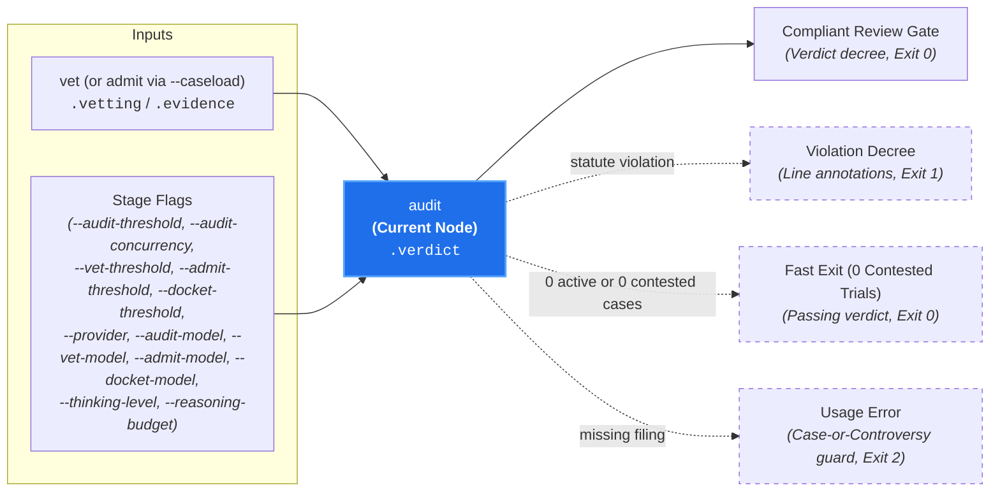

# Judicial Adjudication (`audit`)

**Status:** Authoritative Architectural Standard  
**Core Domain Engine:** Caseload Domain Engine  
**Driving Adapter:** CLI (`audit`)

---

## 1. Domain Concept & Role (`core`)

`audit` performs **Substantive Adjudication: Merits Evaluation & Verdict Generation** for contested active cases retaining admissible evidence. In the court clerkship taxonomy, it represents the Judge taking the bench after pre-trial vetting (`vet`), hearing arguments strictly on the admitted exhibits for contested cases, evaluating affirmative defenses (`Exception`), and rendering formal decrees with actionable remediation and line annotations.

- **Imperative Verb:** `audit`
- **Court Clerkship Role:** Judicial trial and decree rendering for contested cases.
- **Metric Pair:** `compliance_score` (number `[0.0, 1.0]`) and `compliance_summary` (string decree).
- **Core Question:** *"Given the admitted exhibits, statutory grounding references, and governing invariant/exceptions, does the evidence comply with canon statute?"*

---

## 2. Dependencies & Prerequisites (`core`)



- **Direct Prerequisites:**
  - `vet` (prima facie compliance partition in `caseload.vetting`, or `admit` in `caseload.evidence` when chaining a pre-populated `--caseload` directly from `admit`).
  - `configure` (Branch B: resolved `Generator` binding in `caseload.config.nodes.audit`, optional reasoning controls, and verified provider credentials across executed closure nodes, evaluated JIT only when heuristic evaluation is required).
- **Transitive Prerequisites:** `intake`, `discover`, `validate`, `docket`, `admit`.
- **Generative `audit` Model Requirement:** Because `audit` synthesizes natural-language `Exception` rulings, contributor `Remediation` prose, and 1-based `CodeAnnotation` spans, it strictly requires a `Generator` model ([`../providers.md` §2–§3](../providers.md#2-canonical-providermodel-grammar--protocol-bound-capabilities)). Selecting a discriminator-only provider without pinning `audit` fails fast in `configure` with exit code `2` whenever generative `audit` execution is required (unless `--caseload` already carries a pre-populated `.vetting` with zero `contested_cases`).
- **The Case or Controversy Invariant:** Like `docket`, `admit`, and `vet`, `audit` adjudicates compliance *as applied to a concrete filing*. Naked invocations or canon-only invocations lacking a concrete filing (e.g. `canon-clerk audit --all-canons` without targets or diff) fail fast with exit code `2`.
- **Pruned from Execution:** `probe`, `apprise`.

---

## 3. Caseload Contribution & Data Plane Constraints

### Caseload Delta
`audit` populates the `.verdict` namespace on the cumulative `Caseload` envelope with the final judicial decree and per-case outcomes across all active cases:

- **Overall Gate Verdict (`status` & `summary`):** Top-level review gate `status` (`"pass"` when all active cases pass or zero trials were required, or `"fail"` if any case fails) accompanied by a deterministically synthesized human-readable `summary`.
- **Per-Case Substantive Adjudications (`adjudications`):** Stably ordered list of decrees, one per active case (`canon_path`) from `.evidence.active_cases`—combining prima facie `vetted_cases` carried forward from `.vetting` alongside generative trial decrees for `contested_cases` (or all `.evidence.active_cases` when `.vetting` was skipped). Each record captures `compliance_summary`, continuous `compliance_score` in `[0.0, 1.0]`, deterministically derived case `status` (`"pass"` when `compliance_score >= --audit-threshold`, else `"fail"`), and stably sorted line-level `annotations`.
- **Violation Line Annotations (`CodeAnnotation`):** Structured source locations (`path`, `start_line`, `end_line`, optional `start_column` and `end_column`, `annotation_level` of `"failure"`, `"warning"`, or `"notice"`, `message`, and optional `title`) pinpointing non-compliant code spans on admitted file exhibits.

### Data Plane & Adjudication Invariants
1. **Vetted Fold-Forward, Contested Exhibit Pruning & Strategy D Breadcrumb Elision:** When `.vetting` is populated on the `Caseload`, `audit` carries `.vetting.vetted_cases` forward into `.verdict.adjudications` (`compliance_summary: vetting_summary`, `compliance_score: vetting_score`, `annotations: []`, and `status` derived against `--audit-threshold`) and schedules isolated generative `audit` trials **exclusively** for `.vetting.contested_cases`. Furthermore, when a contested case's `.vetting` assessment records a partial `contested_exhibits` subset, `audit` prunes summarily vetted file exhibits and evaluates strictly the contested file exhibit subset; independently of whether `contested_exhibits` pruned any files (including single-file or all-files-contested cases), whenever `.vetting.cases[canon_path].contested_spans` contains localized spans for an evaluated file exhibit, `audit` renders that file using a **Strategy D breadcrumb skeleton**—expanding hot `contested_spans` verbatim while retaining top-of-file imports/preamble, enclosing structural ancestor scopes (along with their attached attributes, decorators, or doc comments), fence-aware Markdown heading stacks, and configuration section headers, replacing cold regions with line-range elision markers while preserving exact 1-based target-file line numbers for `CodeAnnotation` anchoring—while falling back to the full contested exhibit for files without span entries. Strategy D operates purely on the exhibit text already present in the `Caseload` (annotated unified diff hunks or numbered workspace snapshots, tracking structural nesting strictly on post-image lines and ignoring deleted diff lines) and runs before enforcing the per-exhibit prompt truncation ceiling. In all cases, `audit` continues to inject the governing canon statute and `Exception` clauses, workspace `references:` resolved within `<scope>/` (applying `.intake.diffs` in memory onto base-branch files when `.intake.workspace_state` is `"base"`, failing fast with exit code `2` on any patch conflict or omitted patch for a modified reference file, and pinning diffs for any admitted companion files declared in `references:`), admitted [filing metadata planes](intake.md#caseload-delta), and the complete manifest of all admitted file paths across the filing so companion-update invariants never false-positive. Excluded exhibits (`"excluded"`) never enter `audit` prompts.
2. **Three-Tier Determinism & Annotation-Anchoring Guardrails:**
   - **Engine & Wire Determinism:** Vetted carry-forward entries and concurrent contested trial decrees (including multi-slice map-reduce folds ordered canonically by slice index) merge into `.verdict.adjudications` in strict lexicographical order by `canon_path`, and each case's `annotations` sort and deduplicate deterministically by `(path, start_line, end_line, start_column, end_column, annotation_level, message, title)`, guaranteeing byte-for-byte reproducible serialization regardless of async worker completion order.
   - **Gate Verdict Stability:** The domain engine deterministically derives each case's `status` against `--audit-threshold` (default: `0.5`, using the conjunctive minimum `compliance_score` across slices for multi-slice cases) and sets `.verdict.status` to `"fail"` if and only if at least one case has `status: "fail"`. Polarized score bands (`>= 0.80` vs. `<= 0.20`) anchor unanimous `pass`/`fail` stability across repeated trials.
   - **Bounded Guidance & Span Normalization:** While natural wording differences in `compliance_summary` or `message` and minor span granularity differences across live reasoning runs are expected and benign, all decoded annotations must obey strict structural invariants: `path` must match a file exhibit evaluated in that trial slice (never an un-touched file, excluded exhibit, or pruned/other-slice file), line coordinates are normalized to 1-based `start_line >= 1` and `end_line >= start_line`, file-level or missing-companion omission violations anchor to line `1` (`1..1`) of the primary evaluated file exhibit in that slice, and violations confined purely to admitted [filing metadata planes](intake.md#caseload-delta) emit `annotations: []`.
3. **Empty-Evidence & Zero-Contested Short-Circuits:**
   - If `.evidence.active_cases` is empty, `audit` attaches a passing `.verdict` (`status: "pass"`, `adjudications: []`) and exits `0` immediately with zero model calls.
   - If `.vetting` is populated and `.vetting.contested_cases` is empty, `audit` folds all `.vetting.vetted_cases` directly into `.verdict` and returns immediately with zero `audit` model calls (and without requiring `GEMINI_API_KEY` when `.vetting` was pre-populated via `--caseload`).

---

## 4. Process & Domain Logic (`core`)

1. **Prerequisite Verification & Short-Circuit Checks:**  
   Verifies that `.intake`, `.discovery`, and `.evidence` are present and that static canon validation succeeded (`.validation.has_errors` is `false`). If `.evidence.active_cases` is empty, attaches an empty passing `.verdict` and returns immediately. If `.vetting` is present, partitions active cases into carried-forward `vetted_cases` and trial-bound `contested_cases` (returning immediately if `contested_cases` is empty); if `.vetting` is absent (e.g., direct `--caseload` from `admit`), binds all `.evidence.active_cases` for trial.
2. **Contested Exhibit Projection, Reference Pinning & Context-Budgeted Trial Slicing:**  
   For each trial-bound canon:
   - Projects strictly its `"admitted"` exhibits from `.evidence.exhibits[canon_path]`—and when `.vetting.cases[canon_path].contested_exhibits` is non-empty, prunes summarily vetted sliceable file exhibits so only un-cleared contested file exhibits enter substantive adjudication.
   - Formats evaluated file exhibits with explicit 1-based target-file line coordinates (annotated unified diff hunks from `.intake.diffs` when present, or numbered UTF-8 file snapshots from the workspace for path-only / `--all-targets` sweeps)—rendering Strategy D breadcrumb skeletons for any evaluated file with entries in `.vetting.cases[canon_path].contested_spans` before enforcing the per-exhibit prompt truncation ceiling, and rendering full exhibits for files without span entries—alongside admitted [filing metadata planes](intake.md#caseload-delta), resolved static frontmatter `references:` within `<scope>/` (including pinned diffs for any admitted companion files declared in `references:`), and the complete filing-wide admitted file path manifest (`All Admitted File Exhibit Paths in Filing`).
   - Partitions oversized multi-file cases into deterministic, context-budgeted trial slices—repeating the shared case header (governing statute, `Exception` clauses, grounding and pinned companion `references:`, admitted metadata planes, and complete filing path manifest) on every slice while scoping each slice's annotatable file path list strictly to that slice's evaluated exhibits (and admitting an individual oversized exhibit as a singleton slice so no contested exhibit is ever dropped).
3. **Concurrent Isolated Generative Trial Slices, Bounded Reasoning & Map-Reduce Decree Folding ([`Generator`](../providers.md#2-canonical-providermodel-grammar--protocol-bound-capabilities) Required):**  
   - Dispatches all prepared trial slices across the shared `--audit-concurrency` worker pool (default: `4`) using `caseload.config.nodes.audit` over the shared pooled provider transport ([`../transport.md`](../transport.md)) in **independent, isolated prompt turns** at `temperature: 0.0` with a wire-only `60,000ms` per-attempt timeout ceiling, forwarding `caseload.config.nodes.audit.thinking_level` or `caseload.config.nodes.audit.reasoning_budget` when explicitly configured and otherwise applying a bounded default thinking level of `"low"` (`thinkingLevel: "LOW"` with `includeThoughts: true`) so Canon A's exceptions and references never bleed into Canon B's trial and no ambiguous canon can enter an unbounded reasoning spiral. Each slice emits `ProviderRetry` events on cooldown/backoff waits and a per-call `ModelCall` telemetry record (with `canon_path` / slice label, `resolved_model`, `latency_ms`, and `TokenUsage` including `reasoning_tokens`) alongside incremental `StageProgress` ticks and `Thought` deltas, while any unrecoverable or retry-exhausted failure annotates the active `canon_path` (and `slice k/N` when multi-slice) directly in the error diagnostic.
   - Deterministically folds each case's slice decrees in canonical slice order back into a single per-case adjudication (Map-Reduce): taking the conjunctive minimum `compliance_score` (`min` across slices), deriving `status` against `--audit-threshold`, emitting `annotations: []` when `"pass"` or the deduplicated, canonically sorted union of slice annotations when `"fail"`, and preserving single-slice `compliance_summary` verbatim while deterministically synthesizing failing or passing/excused slice summaries on multi-slice cases.
4. **The Four-Step Judicial Decision Tree & Polarized Score Rubric:**
   - **Step 1 (Invariant Evaluation):** Evaluates admitted exhibits strictly against the normative invariant (What), treating `Precedent` (Which) as non-normative standard-anchoring context, `Rationale` (Why) as disambiguating intent context, and `Remediation` (How) as post-violation repair guidance rather than extra syntactic mandates (`SPEC.md` §5). If compliant $\implies$ score in `[0.80, 1.0]`, `annotations: []`.
   - **Step 2 (Exception Screening):** If a prima facie violation is detected, evaluates declared `Exception` clauses against the admitted exhibits. If an exception's verifiable conditions are satisfied $\implies$ short-circuits to conditional `pass` (`compliance_score` in `[0.80, 0.95]`, `annotations: []`), citing the matched exception in `compliance_summary`.
   - **Step 3 (Remediation Formulation):** If no exception applies $\implies$ violation stands (`compliance_score` in `[0.0, 0.20]`), formulating concise, actionable contributor remediation (How) in `compliance_summary`.
   - **Step 4 (Line Annotations):** Emits 1-based file, line, and optional column coordinates on admitted file exhibits for each violation (anchoring file-level or missing-companion omission violations at line `1`, or emitting `[]` when the violation resides solely in PR metadata).
5. **Constrained Decoding Schema (Reason-First):**  
   Enforces a constant-size structured JSON schema generating `compliance_summary` before `compliance_score` and `annotations`:
   ```json
   {
     "compliance_summary": "The added command flags adhere strictly to kebab-case formatting.",
     "compliance_score": 0.96,
     "annotations": []
   }
   ```
   Generating `compliance_summary` before `compliance_score` provides a contrastive reasoning scratchpad anchoring stable probability distributions away from the `0.5` threshold. The domain engine validates annotation paths and line bounds, merges carried-forward `vetted` records with contested trial decrees in lexicographical `canon_path` order, derives per-case `status`, and aggregates overall `.verdict.status`.

---

## 5. Driving Adapter: CLI

The CLI exposes `audit` as its flagship review gate command:

```bash
# 1. Evaluate in-flight diff in telescoping mode:
git diff origin/main | canon-clerk audit --diff -

# 2. Audit explicit target paths or newline-delimited stdin paths:
canon-clerk audit src/cli src/admit
git diff origin/main --name-only | canon-clerk audit -

# 3. Adjudicate contested cases from an upstream vetted Caseload:
canon-clerk audit --caseload caseload-7.json

# 4. Run in GitHub Actions mode while archiving the full Caseload JSON artifact:
git diff origin/main | canon-clerk audit --diff - --format github --output-caseload caseload.json

# 5. Publish all findings via the GitHub Checks REST API (batched 50/request) with forensics archiving:
git diff origin/main | canon-clerk audit --diff - --publish-github-check --output-caseload caseload.json

# 6. Native GitHub Actions PR audit with Check Run publication and graceful credential-skip:
canon-clerk audit --github-pr --publish-github-check --on-missing-credentials skip --output-caseload caseload.json

# 7. Replay a recorded Caseload to publish a GitHub Check Run with zero LLM spend:
canon-clerk audit --caseload caseload.json --publish-github-check

# 8. Use TypeSafe Jev across docket, admit, and vet before escalating contested cases to Gemini 4 Carbon:
git diff origin/main | canon-clerk audit --diff - --provider typesafe --audit-model google:gemini-4-carbon
```

### Missing Input Source & Case-or-Controversy Guard
`canon-clerk audit` requires an underlying filing (positional `TARGETS`, newline-delimited target paths via `-`, `--diff <PATH|->`, `--github-pr [<NUMBER>]`, `--all-targets`, pull request metadata flags, or an incoming `--caseload <PATH|->` with `.intake` populated). Naked invocations or canon-only invocations lacking a concrete filing fail fast with exit code `2` (Usage Error) and print actionable remediation guidance:
```text
error: No filing source provided for `audit`.
  Hint: Pipe a diff via standard input ('--diff -'), specify target paths ('src/...', '-', '--all-targets'),
        or pass an upstream caseload ('--caseload <PATH|->') with '.intake' populated.
```
Conversely, if an explicitly designated stream yields zero changes, `discover` matches zero candidate canons, `docket` opens zero colorable cases, `admit` admits zero exhibits, or `vet` clears 100% of active cases, the pipeline cleanly short-circuits with exit code `0`.

### CLI Flags & Environment
- `TARGETS` / `-` (Positional): Target file paths, directories, globs, or `-` to read newline-delimited target paths from standard input.
- **Shared Filing Source & Metadata Controls:** Accepts the shared filing source and metadata flags defined in [`intake.md` §5](intake.md#5-driving-adapter-cli) and [`../github.md` §3](../github.md#3-pull-request-diff--metadata-ingestion---github-pr).
- **Shared Canon Selection Controls:** Accepts the shared canon selection scope flags defined in [`discover.md` §5](discover.md#5-driving-adapter-cli) (evaluated against the underlying filing).
- `--audit-threshold <FLOAT>` (fallback env: `CANON_CLERK_AUDIT_THRESHOLD`; config key: `nodes.audit.threshold`): Substantive compliance threshold in `[0.0, 1.0]` (default: `0.5`). Ambiguous unqualified `--threshold` and out-of-closure `--apprise-*` flags are rejected with exit code `2` and guidance pointing to `--audit-*`, `--vet-*`, `--admit-*`, and `--docket-*`.
- `--audit-concurrency <COUNT>` (`CANON_CLERK_AUDIT_CONCURRENCY`; config key: `nodes.audit.concurrency`): Positive integer (`>= 1`) bounding concurrent in-flight contested trial slice calls (default and cascade in [`../providers.md` §4](../providers.md#4-decisionbudgetprofile--per-profile-execution-defaults)).
- `--vet-threshold <FLOAT>` (`CANON_CLERK_VET_THRESHOLD`), `--vet-concurrency <COUNT>` (`CANON_CLERK_VET_CONCURRENCY`), `--vet-model <PROVIDER:MODEL>` (`CANON_CLERK_VET_MODEL`): Upstream prima facie compliance vetting options accepted transitively for telescoping runs.
- `--admit-threshold <FLOAT>` (`CANON_CLERK_ADMIT_THRESHOLD`), `--admit-concurrency <COUNT>` (`CANON_CLERK_ADMIT_CONCURRENCY`), `--admit-model <PROVIDER:MODEL>` (`CANON_CLERK_ADMIT_MODEL`): Upstream micro evidentiary admissibility options accepted transitively for telescoping runs.
- `--docket-threshold <FLOAT>` (`CANON_CLERK_DOCKET_THRESHOLD`), `--docket-batch-size <COUNT>` (`CANON_CLERK_DOCKET_BATCH_SIZE`), `--docket-concurrency <COUNT>` (`CANON_CLERK_DOCKET_CONCURRENCY`), `--docket-model <PROVIDER:MODEL>` (`CANON_CLERK_DOCKET_MODEL`): Upstream macro jurisdiction triage options accepted transitively for telescoping runs.
- **Shared Provider, Model, Credential, Endpoint & Thinking Controls:** Accepts `--audit-model` and shared provider/credential/endpoint/thinking overrides per [`../providers.md` §5](../providers.md#5-shared-provider-credential-endpoint--thinking-controls) (resolved JIT only when heuristic evaluation is required).
- `--on-missing-credentials <fail|skip>`: Behavior when heuristic evaluation is required but configured provider API credentials are absent (default: `fail`, exiting `2`). Deterministic pre-credential stages (`intake` $\to$ `discover` $\to$ `validate`) always execute first so static canon validation errors continue to fail with exit code `1`. When set to `skip`:
  1. Flushes `--output-caseload <PATH>` (if configured) with the deterministic partial `Caseload` (`.intake`, `.discovery`, `.validation`).
  2. Appends a `SKIPPED` Markdown summary to `$GITHUB_STEP_SUMMARY` when set.
  3. Publishes a `CheckRunConclusion::Skipped` Check Run via the GitHub adapter when `--publish-github-check` is active.
  4. Exits `0`.
- **Shared Transport Controls:** Accepts `--timeout`, `--max-retries`, and `--max-backoff-ms` per [`../transport.md` §6](../transport.md#6-out-of-band-telemetry--cli-transport-controls).
- `-v` / `--verbose` (`CANON_CLERK_VERBOSE`), `--log-file <PATH>` (`CANON_CLERK_LOG_FILE`): Global diagnostic progress and structured JSONL telemetry stream options; in `--format stylish`, `-v` additionally expands passing (`[pass]`) per-case detail blocks on `stdout`.
- `--format <stylish|json|compact|github>`: Output formatting choice (defaults to `github` when `GITHUB_ACTIONS=true` unless `--publish-github-check` is active, otherwise `stylish`).
- `--publish-github-check`, `--github-head-sha <SHA>` (`GITHUB_EVENT_PATH` $\to$ fetched PR API `head.sha` $\to$ `GITHUB_SHA`), `--github-check-name <NAME>` (default: `"Canon Clerk Audit"`): Opt-in GitHub Checks REST API publication controls (shares `--github-repo` / `GITHUB_REPOSITORY`, auth via `GITHUB_TOKEN` / `GH_TOKEN`, endpoint via `GITHUB_API_URL`; see [`../github.md`](../github.md) for target resolution, batching, and pre-flight validation).
- `--caseload <PATH|->`: Ingests upstream `Caseload` JSON from file or `-` for standard input.
- `--output-caseload <PATH>`: Writes cumulative `Caseload` JSON to disk independently of terminal `stdout` on both passing and failing runs (ideal for CI workflow artifact archiving with `if: always()`); flushed prior to GitHub Checks publication when `--publish-github-check` is enabled.
- `--json`: Emits enriched `Caseload` JSON to `stdout` (equivalent to `--format json`).

### CLI Output Modes & GitHub Actions Integration
- **`stylish` (Default Interactive):** Renders the **Pipeline Funnel Provenance Receipt** ([`../scheduling.md` §6](../scheduling.md#6-the-pipeline-funnel-provenance-contract-terminal-receipts)) followed by the Verdict summary banner (`PASS` / `FAIL` with aggregate pass/fail counts). By default, per-case compliance decrees and indented `CodeAnnotation` source diagnostics are listed **strictly for failing cases (`status: "fail"`)**; passing (`[pass]`) per-case detail blocks are omitted unless `-v` (`--verbose` / `CANON_CLERK_VERBOSE`) is active.
- **`compact`:** Emits deterministic tab-separated violation diagnostic lines (`<path>\t<line>:<col>\t<level>\t<canon>\t<message>`) strictly for failing cases—anchoring PR-metadata-only failures lacking file spans (`annotations: []`) at `<canon_path>\t0:0\tfailure\t<canon_path>\t<summary>` and omitting passing cases completely (exiting `0` with empty `stdout` when all active cases pass).
- **`github` (Workflow Command Annotations):** Auto-selected when `GITHUB_ACTIONS=true` (unless overridden by `--format`, `--json`, or `--publish-github-check`), suited for zero-setup workflows lacking `checks: write`:
  1. Emits native GitHub Actions workflow command annotations (`::error file=...,line=...,endLine=...,col=...,title=...::...`, `::warning ...`, `::notice ...`) for each `CodeAnnotation` on `stdout`.
  2. Appends the rendered Markdown Funnel Provenance Receipt and Verdict Report to `$GITHUB_STEP_SUMMARY` when configured—displaying failing case decrees in the primary Markdown table while collapsing passing case decrees inside a `<details>` disclosure block.
  3. Persists the full cumulative `Caseload` JSON via `--output-caseload <PATH>` independently of exit status.
- **GitHub Checks Publication (`--publish-github-check`):** Delegates Check Run delivery to the shared GitHub adapter ([`../github.md`](../github.md)), mapping `audit` outcomes as follows: `VerdictStatus::Pass` (including zero-candidate short-circuits) $\to$ `success`, `VerdictStatus::Fail` $\to$ `failure`, candidate canon static validation failures (`validation.has_errors == true`) $\to$ `failure` (attaching validation diagnostics as inline annotations), and missing provider credentials under `--on-missing-credentials skip` $\to$ `skipped`, with the Funnel Provenance receipt and Markdown decree table in `output.summary` and the complete per-finding list in `output.text`.
- **`json` / `--json`:** Emits the complete cumulative `Caseload` JSON envelope containing all structured `.verdict` adjudications (both passing and failing) and annotations.

### CLI Exit Codes
- **0:** All active cases pass (`status: "pass"`, `compliance_score >= --audit-threshold`), 0 contested trials required due to clean upstream short-circuits (0 changes, 0 candidate canons, empty docket, 0 admitted exhibits, or all active cases cleared by `vet`), or live evaluation cleanly skipped via `--on-missing-credentials skip` after passing deterministic `validate`.
- **1:** Substantive canon violation detected (`.verdict.status == "fail"`), candidate canon static validation failure (`validation.has_errors` is `true`, evaluated before checking API credentials), or local workspace I/O runtime error.
- **2:** Usage error, missing filing source or Case-or-Controversy guard violation, invalid or out-of-range threshold/concurrency/batch flags, invalid `--max-retries` / `--max-backoff-ms`, invalid `<provider>:<model>` specifier, rejected unqualified or out-of-closure `--apprise-*` flag, conflicting `stdin` operands, unprovisioned or `Discriminator` `--audit-model`, missing API credentials (under default `--on-missing-credentials fail`), GitHub PR ingestion or Checks target validation/API failure ([`../github.md`](../github.md)), or model provider error.
