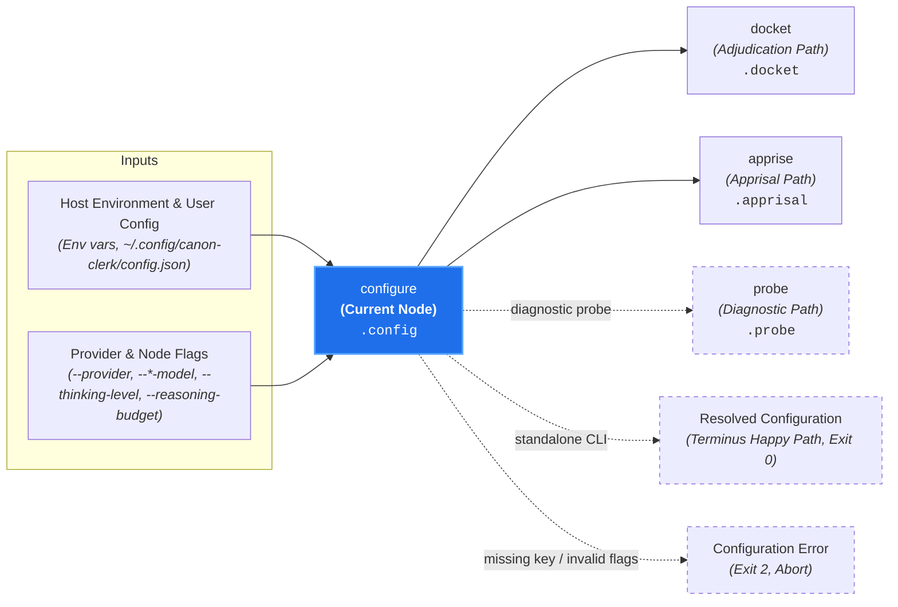

# Configuration & Environment (`configure`)

**Status:** Authoritative Architectural Standard  
**Core Domain Engine:** Caseload Domain Engine  
**Driving Adapter:** CLI (`configure`)

---

## 1. Domain Concept & Role (`core` / `configuration`)

`configure` serves as the **Operational Environment Normalizer** for Canon Clerk. In the court clerkship taxonomy, it represents the administrative court officer ensuring the courtroom facilities, judicial roster, and bailiff credentials are established before the court goes into session.

- **Imperative Verb:** `configure`
- **Court Clerkship Role:** Active provider selection, per-node model and thinking resolution, and closure-exact credential validation.
- **Metric Pair:** N/A (Deterministic offline configuration resolution).

---

## 2. Dependencies & Prerequisites (`core`)



- **Direct Prerequisites:** None (Root node of Branch B).
- **Transitive Prerequisites:** None.
- **Independence:** Resolves active provider defaults, per-node model bindings, and credentials with zero dependencies on diffs or canons.
- **Lazy Evaluation in Cascades:** When executed within a review cascade (`apprise`, `docket`, `admit`, `vet`, `audit`), `configure` is evaluated lazily *after* `discover` confirms matching candidate canons and `validate` confirms valid canon syntax, guaranteeing that un-governed PRs pass cleanly without checking credentials.

---

## 3. Caseload Contribution & Data Plane Constraints

### Caseload Delta
`configure` populates the `.config` namespace on the cumulative `Caseload` envelope with resolved provider and per-node runtime bindings:

- **Default Provider (`provider`):** Canonical slug of the resolved active default provider (`"google"` or `"typesafe"`).
- **Resolved Heuristic Node Bindings (`nodes`):** Deterministic map ordered by canonical DAG stage (`apprise`, `docket`, `admit`, `vet`, `audit`) across the heuristic nodes resolved for the active closure. Each node entry records:
  - **Model Specifier (`model`):** Canonical `<provider>:<model>` identifier bound to that node (for example, `"google:gemini-decision-1"`, `"typesafe:jev-latest"`, or `"google:gemini-4-carbon"`).
  - **Thinking Level (`thinking_level`):** Optional qualitative reasoning effort tier (`"minimal"`, `"low"`, `"medium"`, `"high"`) resolved for a `Generator`-bound node (mutually exclusive with `reasoning_budget`; omitted when unset or when the node binds to a `Discriminator` model).
  - **Reasoning Budget (`reasoning_budget`):** Optional non-negative integer token ceiling resolved for a `Generator`-bound node (mutually exclusive with `thinking_level`; omitted when unset or when the node binds to a `Discriminator` model).

### Data Plane & Security Invariants
1. **Credential Non-Persistence & Zero Context Egress:** While `configure` verifies that required credentials (`GEMINI_API_KEY` / `providers.google.apiKey` and/or `TYPESAFE_API_KEY` / `providers.typesafe.apiKey`) are present for the providers referenced by the active closure, raw API keys and secret tokens are **never** serialized into `.config` on the `Caseload` envelope or echoed to terminal output, keeping `caseload.json` artifacts and AI coding assistant tool traces safe from credential exfiltration.
2. **Workspace-External Credential Sourcing:** File-based configuration and credentials are sourced exclusively from user-level configuration directories outside the repository workspace envelope (`$XDG_CONFIG_HOME/canon-clerk/config.json` or `~/.config/canon-clerk/config.json` on Unix/macOS; `%APPDATA%\canon-clerk\config.json` on Windows). Any configuration file located inside the repository workspace is rejected with exit code `2` so workspace-scoped AI coding agents cannot read local secret files.
3. **POSIX Owner-Only Permission Enforcement:** On POSIX platforms, `configure` inspects file mode permissions before reading the user configuration file and fails fast with exit code `2` (suggesting `chmod 600`) if group or world permissions are granted (`(mode & 0o077) != 0`; only `0600` or `0400` are accepted).
4. **Strict `<provider>:<model>` Specifier Grammar:** Every model specifier across CLI flags, environment variables, `config.json` node pins, and `.config.nodes` records must conform to canonical `<provider>:<model>` syntax with non-empty provider and model segments separated by a single `:` delimiter and no whitespace. Bare short-name prefix inference (`gemini-decision-1`, `gemini-*`, `jev-*`), retired pet-name aliases, unversioned `google:gemini-decision`, and structured `{ provider, model }` object shims are rejected with exit code `2` and an actionable remediation hint (for example, ``Invalid model specifier `gemini-decision-1`: expected `<provider>:<model>` format (for example, `google:gemini-decision-1`).``).
5. **Orthogonal `{ providers, defaults, nodes }` Configuration File Schema:** `~/.config/canon-clerk/config.json` is strictly restricted to three orthogonal top-level namespaces—`providers`, `defaults`, and `nodes`. Retired flat root keys (`screenerModel`, `auditorModel`, `thinkingLevel`, `reasoningBudget`, `<stage>BatchSize`, `<stage>Concurrency`, `maxCanonsPerCall`, `maxConcurrentCalls`, `maxRetries`, `maxBackoffMs`) and any unrecognized keys across root, `providers.<slug>`, `defaults`, or `nodes.<node>` fail fast with exit code `2` and an actionable migration `Hint:`.
6. **Mutual Exclusivity & Capability Scoping of Reasoning Controls:** `thinking_level` and `reasoning_budget` are mutually exclusive within any single configuration layer (CLI flags, environment variables, `nodes.<node>`, or `defaults`), failing fast with exit code `2` when both appear at the same layer; across distinct precedence layers, the higher-precedence layer supersedes and clears the lower-precedence alternative. Shared/ambient thinking controls (`--thinking-level`, `--reasoning-budget`, `CANON_CLERK_THINKING_LEVEL`, `CANON_CLERK_REASONING_BUDGET`, `defaults.thinkingLevel`, `defaults.reasoningBudget`) apply strictly to `Generator`-bound nodes and leave `Discriminator`-bound nodes unset, whereas explicitly declaring per-node `nodes.<node>.thinkingLevel` or `nodes.<node>.reasoningBudget` on a node whose resolved model is a `Discriminator` fails fast with exit code `2`.

---

## 4. Process & Domain Logic (`configuration`)

1. **Deterministic Active Provider Cascade (Zero Ambient Credential Sniffing):**  
   Ambient `*_API_KEY` environment variables never implicitly switch the active provider or models. Instead, the active default provider resolves deterministically along a strict specificity cascade:
   $$\texttt{--provider <slug>} \;\succ\; \texttt{CANON\_CLERK\_PROVIDER} \;\succ\; \texttt{config.json defaults.provider} \;\succ\; \texttt{"google"}$$
   Unrecognized provider slugs fail fast with exit code `2` and a remediation hint listing supported providers:

   | Provider Slug | Default `Discriminator` (`apprise`, `docket`, `admit`, `vet`) | Default `Generator` (`audit`) | Credential Source |
   | :--- | :--- | :--- | :--- |
   | `google` *(built-in default)* | `google:gemini-decision-1` | `google:gemini-4-carbon` | `--gemini-api-key` $\succ$ `GEMINI_API_KEY` $\succ$ `providers.google.apiKey` |
   | `typesafe` | `typesafe:jev-latest` | *(none)* | `--typesafe-api-key` $\succ$ `TYPESAFE_API_KEY` $\succ$ `providers.typesafe.apiKey` |

2. **4-Level Node Model Specificity Cascade (Per Heuristic Node `<node>`):**  
   Each heuristic DAG node (`apprise`, `docket`, `admit`, `vet`, `audit`) resolves its `<provider>:<model>` binding independently along a 4-level specificity cascade:
   - **Level 1 — Stage CLI Flag:** `--apprise-model`, `--docket-model`, `--admit-model`, `--vet-model`, `--audit-model` (scoped to closure on evaluation subcommands per [`../scheduling.md` §4](../scheduling.md#pattern-c-the-stage-prefixed-flag-scoping-contract); all five accepted on standalone `configure` and `probe`).
   - **Level 2 — Stage Environment Variable:** `CANON_CLERK_APPRISE_MODEL`, `CANON_CLERK_DOCKET_MODEL`, `CANON_CLERK_ADMIT_MODEL`, `CANON_CLERK_VET_MODEL`, `CANON_CLERK_AUDIT_MODEL`.
   - **Level 3 — User Configuration File Node Pin:** `nodes.<node>.model` in `~/.config/canon-clerk/config.json`.
   - **Level 4 — Active Provider Capability Default:**
     - **Screening & Vetting Nodes (`apprise`, `docket`, `admit`, `vet`):** Uses the active provider's default `Discriminator` if defined, otherwise its default `Generator` (both `Discriminator` models—`google:gemini-decision-*`, `typesafe:jev-*`—and `Generator` models—`google:gemini-*`—are valid on screening and vetting nodes).
     - **Judicial Adjudication Node (`audit`):** Uses the active provider's default `Generator`. Because `audit` synthesizes structured prose decrees, `Exception` rulings, `Remediation` guidance, and 1-based `CodeAnnotation` spans, configuring any `Discriminator` model on `audit` fails fast with exit code `2`. When the active provider defines no default `Generator` (such as `--provider typesafe`) and `audit` is unpinned across Levels 1–3, `audit` remains unprovisioned—allowing `apprise`..`vet` and standalone `configure`/`probe` to succeed cleanly while failing fast with exit code `2` and an actionable remediation hint if `audit` adjudication is invoked.

3. **Co-Located Operational Knobs (`defaults` & `nodes.<node>`):**  
   User-level `~/.config/canon-clerk/config.json` co-locates global operational defaults under `defaults` and stage-specific overrides under `nodes.<node>`:

   ```json
   {
     "providers": {
       "google":   { "apiKey": "..." },
       "typesafe": { "apiKey": "..." }
     },
     "defaults": {
       "provider": "google",
       "thinkingLevel": "low",
       "maxRetries": 6,
       "maxBackoffMs": 60000
     },
     "nodes": {
       "apprise": { "batchSize": 256, "concurrency": 4 },
       "docket":  { "model": "typesafe:jev-latest", "batchSize": 48, "concurrency": 4 },
       "admit":   { "model": "typesafe:jev-latest", "concurrency": 4 },
       "vet":     { "model": "google:gemini-decision-1", "threshold": 0.80, "concurrency": 4 },
       "audit":   { "model": "google:gemini-4-carbon", "thinkingLevel": "low", "concurrency": 4 }
     }
   }
   ```

   | Knob | Specificity Cascade | Built-In Default | Envelope Persistence |
   | :--- | :--- | :--- | :--- |
   | `threshold` | `--<node>-threshold` $\succ$ `CANON_CLERK_<NODE>_THRESHOLD` $\succ$ `nodes.<node>.threshold` $\succ$ default | `0.80` on `vet`; `0.50` on `apprise`, `docket`, `admit`, `audit` | Execution parameter (not in `.config`) |
   | `batchSize` *(`apprise`, `docket` only)* | `--<node>-batch-size` $\succ$ `CANON_CLERK_<NODE>_BATCH_SIZE` $\succ$ `nodes.<node>.batchSize` $\succ$ model default | `256` on `google:gemini-decision-*`, `48` on `typesafe:jev-*`, `25` on `Generator` | Execution parameter (not in `.config`; rejected on `admit`, `vet`, `audit`) |
   | `concurrency` | `--<node>-concurrency` $\succ$ `CANON_CLERK_<NODE>_CONCURRENCY` $\succ$ `nodes.<node>.concurrency` $\succ$ default | `4` | Execution parameter (not in `.config`) |
   | `thinkingLevel` / `reasoningBudget` | `--thinking-level` / `--reasoning-budget` $\succ$ `CANON_CLERK_THINKING_LEVEL` / `CANON_CLERK_REASONING_BUDGET` $\succ$ `nodes.<node>.*` $\succ$ `defaults.*` $\succ$ stage default | `"low"` (`includeThoughts: true`) on `audit`; minimal/`0` on `Generator` screening/vetting | Recorded on `.config.nodes.<node>` when explicitly set on a `Generator` node |
   | `maxRetries` / `maxBackoffMs` | `--max-retries` / `--max-backoff-ms` $\succ$ `CANON_CLERK_MAX_RETRIES` / `CANON_CLERK_MAX_BACKOFF_MS` $\succ$ `defaults.*` $\succ$ default | `2` retries, `90000` ms | Live transport parameter ([`../transport.md` §6](../transport.md#6-out-of-band-telemetry--cli-transport-controls)) |

4. **Closure-Exact Credential Validation & Partial-Closure `--caseload` Chaining:**
   - **Converged Evaluation Closures (`apprise`, `docket`, `admit`, `vet`, `audit`):** Resolve node bindings and verify provider credentials **strictly for the heuristic nodes executed in that subcommand's closure** (`{apprise}` on `apprise`; `{docket}` on `docket`; `{docket, admit}` on `admit`; `{docket, admit, vet}` on `vet`; `{docket, admit, vet, audit}` on telescoping `audit`).
   - **Partial-Closure Chaining (`--caseload`):** When an upstream command writes a partial `Caseload` that is piped into a downstream command (`canon-clerk vet --output-caseload c.json || canon-clerk audit --caseload c.json`), downstream `audit` preserves pre-populated upstream node bindings in `.config.nodes` without re-verifying credentials for already-completed upstream stages, resolves `audit` JIT, and verifies credentials strictly for the newly executed stage(s)—invalidating pre-populated upstream/downstream stages only when an upstream stage's model or active provider is explicitly overridden.
   - **Standalone `configure` and `probe`:** Resolve all provisioned heuristic nodes for the active configuration (all 5 nodes on `--provider google`, or the 4 discriminative nodes `apprise`, `docket`, `admit`, `vet` on `--provider typesafe` when `audit` is unpinned—or all 5 when `audit` is pinned via `--audit-model` / `CANON_CLERK_AUDIT_MODEL` / `nodes.audit.model`) and verify credentials strictly for the providers referenced by those provisioned nodes.

5. **Deterministic & Offline:** Executes locally in <5ms without sending network requests or spending tokens.

---

## 5. Driving Adapter: CLI

The CLI exposes `configure` as an imperative subcommand:

```bash
# 1. Default zero-config Google setup (verifies GEMINI_API_KEY and resolves all 5 nodes):
canon-clerk configure --json

# 2. Sole-provider TypeSafe setup (verifies TYPESAFE_API_KEY across apprise, docket, admit, vet):
canon-clerk configure --provider typesafe

# 3. Hybrid setup pairing TypeSafe Jev screening/vetting with Gemini 4 Carbon on audit:
canon-clerk configure --provider typesafe --audit-model google:gemini-4-carbon
```

### CLI Flags & Environment
- `--provider <SLUG>` (fallback env: `CANON_CLERK_PROVIDER`; config key: `defaults.provider`): Active default provider selector (`google`, `typesafe`; default: `google`).
- `--apprise-model <PROVIDER:MODEL>` (`CANON_CLERK_APPRISE_MODEL`), `--docket-model <PROVIDER:MODEL>` (`CANON_CLERK_DOCKET_MODEL`), `--admit-model <PROVIDER:MODEL>` (`CANON_CLERK_ADMIT_MODEL`), `--vet-model <PROVIDER:MODEL>` (`CANON_CLERK_VET_MODEL`), `--audit-model <PROVIDER:MODEL>` (`CANON_CLERK_AUDIT_MODEL`): Per-node canonical `<provider>:<model>` overrides (`Discriminator` models on `--audit-model` and retired `--screener-model` / `--auditor-model` flags are rejected with exit code `2`).
- `--thinking-level <minimal|low|medium|high>` (fallback env: `CANON_CLERK_THINKING_LEVEL`; config keys: `nodes.<node>.thinkingLevel`, `defaults.thinkingLevel`): Qualitative reasoning effort tier for `Generator`-bound nodes (mutually exclusive with `--reasoning-budget`).
- `--reasoning-budget <TOKENS>` (fallback env: `CANON_CLERK_REASONING_BUDGET`; config keys: `nodes.<node>.reasoningBudget`, `defaults.reasoningBudget`): Maximum reasoning budget tokens for `Generator`-bound nodes (mutually exclusive with `--thinking-level`).
- `--gemini-api-key <KEY>` (fallback env: `GEMINI_API_KEY`; config key: `providers.google.apiKey`): Google Gemini API key override.
- `--typesafe-api-key <KEY>` (fallback env: `TYPESAFE_API_KEY`; config key: `providers.typesafe.apiKey`): TypeSafe AI Jev API key override.
- `--format <stylish|json|compact>`: Output presentation format (default: `stylish`).
- `--caseload <PATH|->`: Ingests upstream `Caseload`.
- `--output-caseload <PATH>`: Writes cumulative `Caseload` JSON to disk independently of `stdout`.
- `--json`: Emits enriched `Caseload` JSON to `stdout`.

### CLI Output Modes
- **`stylish` (Default):** Renders a human-readable `Configuration Summary (READY):` listing the resolved default `Provider`, each provisioned node binding in canonical DAG order (and noting `audit` as unprovisioned on discriminator-only setups when unpinned), effective extended thinking controls, and redacted verified `Credentials`.
- **`compact`:** Emits unadorned tab-separated `<key>\t<value>` records in canonical order (`provider\t<slug>`, `<node>_model\t<provider:model>`, optional `<node>_thinking_level\t<level>` / `<node>_reasoning_budget\t<tokens>`, and `credentials\t<verified_env_vars>`).
- **`json` / `--json`:** Emits the cumulative `Caseload` JSON envelope with `.config` populated.

### CLI Exit Codes
- **0:** Configuration valid, node bindings resolved, and referenced provider credentials verified.
- **2:** Missing required provider credentials, bare or unrecognized `<provider>:<model>` specifier, unrecognized `--provider`, `Discriminator` model on `audit`, retired root or unknown `config.json` keys, insecure or workspace-resident configuration file, or conflicting extended thinking options.
