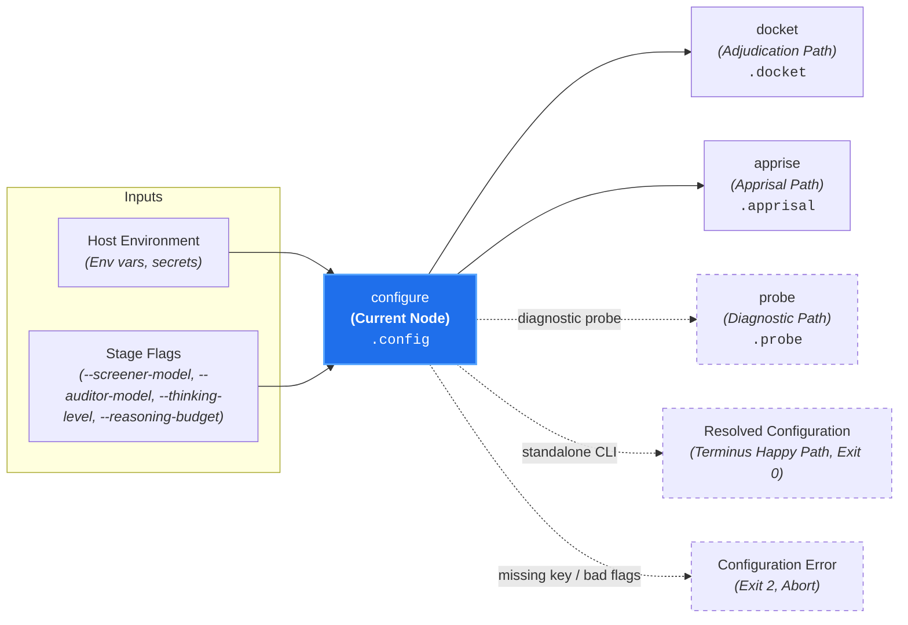

# Configuration & Environment (`configure`)

**Status:** Authoritative Architectural Standard  
**Core Domain Engine:** Caseload Domain Engine  
**Driving Adapter:** CLI (`configure`)

---

## 1. Domain Concept & Role (`core` / `configuration`)

`configure` serves as the **Operational Environment Normalizer** for Canon Clerk. In the court clerkship taxonomy, it represents the administrative court officer ensuring the courtroom facilities, judicial roster, and bailiff credentials are fully established before the court goes into session.

- **Imperative Verb:** `configure`
- **Court Clerkship Role:** Runtime environment resolution and provider credential validation.
- **Metric Pair:** N/A (Deterministic offline configuration resolution).

---

## 2. Dependencies & Prerequisites (`core`)



- **Direct Prerequisites:** None (Root node of Branch B).
- **Transitive Prerequisites:** None.
- **Independence:** Resolves environment credentials and models with zero dependencies on diffs or canons.
- **Lazy Evaluation in Cascades:** When executed within a review cascade (`docket`, `admit`, `vet`, `audit`), `configure` is evaluated lazily *after* `discover` confirms matching candidate canons, guaranteeing that un-governed PRs pass cleanly without checking credentials.

---

## 3. Caseload Contribution & Data Plane Constraints

### Caseload Delta
`configure` populates the `.config` namespace on the cumulative `Caseload` envelope with normalized runtime provider settings:

- **Screener Model Specifier (`screener_model`):** Canonical provider-prefixed model identifier used by fast heuristic screening and prima facie vetting stages (`apprise`, `docket`, `admit`, `vet`). When unpinned across CLI flags, environment variables, and `config.json`, `configure` auto-selects from the credential-aware default matrix (`"google:gemini-decision-1"` whenever Google Gemini credentials are present, or `"typesafe:jev-latest"` when only TypeSafe AI credentials are present).
- **Auditor Model Specifier (`auditor_model`):** Canonical provider-prefixed generative model identifier used for substantive trial adjudication (`audit`; defaults to `"google:gemini-4-carbon"` from the top-ranked generative provider). Discriminative decision models (`google:gemini-decision-*` and `typesafe:jev-*`) are never auto-selected and are disallowed on `auditor_model` because `audit` requires structured prose decrees, `Remediation` synthesis, and 1-based `CodeAnnotation` spans.
- **Thinking Level (`thinking_level`):** Optional discrete qualitative reasoning effort tier (`"minimal"`, `"low"`, `"medium"`, `"high"`) governing extended thinking during `audit` trials (mutually exclusive with `reasoning_budget`; when both are omitted on `.config`, both `audit` and `probe` default to bounded `"low"` thinking).
- **Reasoning Budget (`reasoning_budget`):** Optional integer token ceiling governing extended thinking during `audit` trials (mutually exclusive with `thinking_level`).

### Data Plane & Security Invariants
1. **Credential Non-Persistence & Zero Context Egress:** While `configure` verifies that required active-provider credentials (`GEMINI_API_KEY` / `providers.google.apiKey` and/or `TYPESAFE_API_KEY` / `providers.typesafe.apiKey`) are present, raw API keys and secret tokens are **never** serialized into `.config` on the `Caseload` envelope or echoed to terminal output, ensuring `caseload.json` artifacts and AI coding assistant tool traces remain safe from credential exfiltration.
2. **Workspace-External Credential Sourcing:** File-based configuration and credentials are sourced exclusively from user-level configuration directories outside the repository workspace envelope (`$XDG_CONFIG_HOME/canon-clerk/config.json` or `~/.config/canon-clerk/config.json` on Unix/macOS; `%APPDATA%\canon-clerk\config.json` on Windows). Any configuration file located inside the repository workspace is rejected with exit code `2` so workspace-scoped AI coding agents cannot read local secret files.
3. **POSIX Owner-Only Permission Enforcement:** On POSIX platforms, `configure` inspects file mode permissions before reading the user configuration file and fails fast with exit code `2` (suggesting `chmod 600`) if group or world permissions are granted (`(mode & 0o077) != 0`; only `0600` or `0400` are accepted).
4. **Canonical Multi-Provider Model Normalization:** Exact upstream model identifiers—either provider-omitted (`gemini-decision-1` $\implies$ `google:gemini-decision-1`, `gemini-*` $\implies$ `google:gemini-*`, `jev-*` $\implies$ `typesafe:jev-*`) or explicitly namespace-prefixed (`google:gemini-decision-1`, `google:gemini-*`, `typesafe:jev-*`)—are normalized into canonical `<provider>:<model>` specifiers prior to being recorded on `.config`, without pet-name alias indirection. Because Google's upstream API defines versioned `gemini-decision-*` model identifiers rather than an unversioned `gemini-decision` endpoint, bare `gemini-decision` and `google:gemini-decision` are rejected.
5. **Mutual Exclusivity of Reasoning Controls:** `thinking_level` and `reasoning_budget` are mutually exclusive on `.config`. Specifying both at the same precedence tier (e.g., passing `--thinking-level` alongside `--reasoning-budget`, setting both `CANON_CLERK_THINKING_LEVEL` and `CANON_CLERK_REASONING_BUDGET`, or declaring both `thinkingLevel` and `reasoningBudget` in `config.json`) fails fast with exit code `2` and actionable guidance; across distinct precedence tiers, the higher-precedence tier supersedes and clears the lower-precedence alternative.

---

## 4. Process & Domain Logic (`configuration`)

1. **4-Level Tier Specificity Cascade:** Resolves model specifiers, thinking levels / reasoning budgets, and provider credentials along a strict descending specificity cascade:
   - **Level 1 — Explicit CLI Flags:** `--screener-model`, `--auditor-model`, `--thinking-level`, `--reasoning-budget`, `--gemini-api-key`, `--typesafe-api-key`
   - **Level 2 — Environment Variables:** `CANON_CLERK_SCREENER_MODEL`, `CANON_CLERK_AUDITOR_MODEL`, `CANON_CLERK_THINKING_LEVEL`, `CANON_CLERK_REASONING_BUDGET`, `GEMINI_API_KEY`, `TYPESAFE_API_KEY`
   - **Level 3 — User-Level Configuration File (`~/.config/canon-clerk/config.json`):** Organized into orthogonal `providers` authentication blocks (`providers.google.apiKey`, `providers.typesafe.apiKey`) and optional tier, concurrency, and transport retry pins (`screenerModel`, `auditorModel`, `thinkingLevel`, `reasoningBudget`, `appriseBatchSize`, `appriseConcurrency`, `docketBatchSize`, `docketConcurrency`, `admitConcurrency`, `vetConcurrency`, `auditConcurrency`, `maxRetries`, `maxBackoffMs`; see [`../transport.md` §6](../transport.md#6-out-of-band-telemetry--cli-transport-controls)). Like stage concurrency and batch-size pins, operational retry and backoff limits govern live HTTP execution without being serialized onto `Caseload.config`.
   - **Level 4 — Credential-Aware Default Matrix:** When a tier is unpinned across Levels 1–3 (and not pre-populated on an incoming `--caseload`), `configure` inspects available non-empty provider credentials across CLI `--<provider>-api-key` flags, `<PROVIDER>_API_KEY` environment variables, and `providers.<provider>.apiKey` entries in `config.json`, selecting defaults deterministically:

   | Available Credentials | Auto-Selected `screener_model` | Auto-Selected `auditor_model` | Operational Outcome |
   | :--- | :--- | :--- | :--- |
   | `GEMINI_API_KEY` only | `google:gemini-decision-1` | `google:gemini-4-carbon` | Single-vendor Google setup unlocks zero-output-token discriminative `docket`, `admit`, and automatic pre-trial `vet` during `audit` alongside Gemini 4 Carbon adjudication |
   | `GEMINI_API_KEY` + `TYPESAFE_API_KEY` | `google:gemini-decision-1` | `google:gemini-4-carbon` | `google:gemini-decision-1` takes #1 screener priority when `GEMINI_API_KEY` is present; `--screener-model jev-latest` explicitly pins TypeSafe Jev |
   | `TYPESAFE_API_KEY` only | `typesafe:jev-latest` | `google:gemini-4-carbon` *(verified only on full-bench closures)* | Screener-only closures (`apprise`, `docket`, `admit`, `vet`) succeed with zero extra flags on TypeSafe Jev; full-bench closures (`configure`, `probe`, `audit`) exit `2` requesting a generative auditor credential |
   | Multiple generative providers present | Top-ranked discriminative screener (`google:gemini-decision-1` if `GEMINI_API_KEY` present, else `typesafe:jev-latest` if `TYPESAFE_API_KEY` present), else top-ranked generative screener | Top-ranked generative auditor in deterministic precedence order | Guarantees bit-for-bit deterministic `.config` resolution regardless of environment map ordering |

2. **Decoupled Provider Namespace vs. Evaluation Paradigm:**
   - **Provider Namespace (`google:*` vs. `typesafe:*`):** Governs authentication credential lookup (`GEMINI_API_KEY` vs. `TYPESAFE_API_KEY`) and upstream host transport (`generativelanguage.googleapis.com` vs. `api.typesafe.ai`).
   - **Evaluation Paradigm (Discriminative `Noul` vs. Generative Structured Output):** Orthogonal to provider namespace, `google:gemini-decision-*` and `typesafe:jev-*` classify as discriminative `Noul` decision models—ranked ahead of generative models for default `screener_model`, automatically activating pre-trial `vet` in telescoping `audit` runs, and disallowed on `auditor_model`—whereas generative models (`google:gemini-4-carbon`, `google:gemini-4-hydrogen`, etc.) support structured JSON generation across both `auditor_model` and explicit `--screener-model` overrides.
   - **Provider Role Capabilities:** Full-stack providers (`google`) supply both a discriminative screener (`google:gemini-decision-1`) and a generative auditor (`google:gemini-4-carbon`) under a single API key, while discriminative-only providers (`typesafe`) supply `screener_model` (`typesafe:jev-latest`) and are never auto-selected as `auditor_model`.
3. **Explicit Override Validation & Closure-Aware Tier Sufficiency:** Explicit upstream model specifiers—both provider-omitted (`gemini-*` $\implies$ `google:gemini-*`, `jev-*` $\implies$ `typesafe:jev-*`) and canonical (`google:gemini-*`, `typesafe:jev-*`)—are normalized and validated, rejecting unsupported provider prefixes, malformed or unrecognized model identifiers (including bare `gemini-decision` and retired pet-name aliases), conflicting thinking controls, or any discriminative model (`google:gemini-decision-*` or `typesafe:jev-*`) on `auditor_model` *before* inspecting credentials, and never silently fall back to another provider if their required credential is missing. `configure` then verifies credentials strictly for the tiers required by the invoked closure:
   - **Screener-Only Closures (`apprise`, `docket`, `admit`, `vet`):** Verify only `screener_model`'s provider credential (unless `--auditor-model` was explicitly overridden), allowing an environment provisioned solely with `TYPESAFE_API_KEY` to execute `canon-clerk apprise`, `docket`, `admit`, and `vet` with zero extra flags.
   - **Full-Bench Closures (`configure`, `probe`, `audit`):** Verify credentials for both `screener_model` and `auditor_model` so standalone readiness checks and substantive `audit` trials never silently pass without a verified generative auditor credential. When only `TYPESAFE_API_KEY` is present on a full-bench closure, `configure` fails fast with exit code `2` and an actionable remediation hint explaining that `TYPESAFE_API_KEY` covers discriminative screening and `vet`, while full readiness and substantive adjudication require a generative auditor credential (`GEMINI_API_KEY`).
4. **Deterministic & Offline:** Executes locally in <5ms without sending network requests or spending tokens.

---

## 5. Driving Adapter: CLI

The CLI exposes `configure` as an imperative subcommand:

```bash
# Auto-select optimal tiers from ambient credentials and print normalized Caseload JSON:
canon-clerk configure --json

# Explicitly pin model tiers from flags (overrides credential-inferred defaults):
canon-clerk configure --screener-model gemini-4-hydrogen --auditor-model gemini-4-carbon
```

### CLI Flags & Environment
- `--screener-model <model>` (fallback env: `CANON_CLERK_SCREENER_MODEL`): Custom screener model specifier (`gemini-decision-1`, `gemini-*`, `jev-*`, `google:gemini-*`, `typesafe:jev-*`).
- `--auditor-model <model>` (fallback env: `CANON_CLERK_AUDITOR_MODEL`): Custom generative auditor model specifier (generative `gemini-*` / `google:gemini-*`; discriminative models are rejected with exit code `2`).
- `--thinking-level <minimal|low|medium|high>` (fallback env: `CANON_CLERK_THINKING_LEVEL`; config file key: `thinkingLevel`): Qualitative reasoning effort tier for `audit` trials (mutually exclusive with `--reasoning-budget`).
- `--reasoning-budget <tokens>` (fallback env: `CANON_CLERK_REASONING_BUDGET`; config file key: `reasoningBudget`): Maximum reasoning budget tokens (mutually exclusive with `--thinking-level`).
- `--gemini-api-key <key>` (fallback env: `GEMINI_API_KEY`): Google Gemini API key override.
- `--typesafe-api-key <key>` (fallback env: `TYPESAFE_API_KEY`): TypeSafe AI Jev API key override.
- `--format <stylish|json|compact>`: Output presentation format.
- `--caseload <path|->`: Ingests upstream Caseload.
- `--output-caseload <path>`: Writes cumulative `Caseload` JSON to disk independently of stdout.
- `--json`: Emits enriched Caseload JSON.

### CLI Exit Codes
- **0:** Configuration valid and normalized.
- **2:** Missing required active-provider credentials (`GEMINI_API_KEY` / `TYPESAFE_API_KEY`), insecure or workspace-resident configuration file, or invalid model/budget identifiers.
