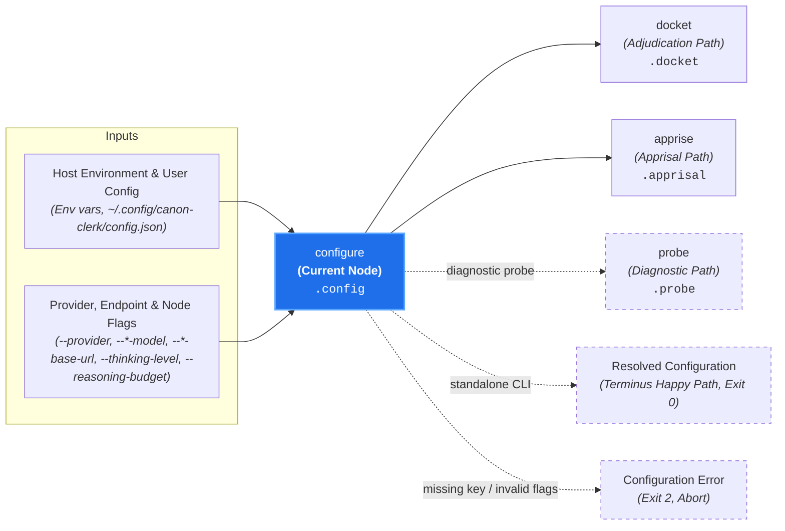

# Configuration & Environment (`configure`)

**Status:** Authoritative Architectural Standard  
**Core Domain Engine:** Caseload Domain Engine  
**Driving Adapter:** CLI (`configure`)

---

## 1. Domain Concept & Role (`core` / `configuration`)

`configure` serves as the **Operational Environment Normalizer** for Canon Clerk. In the court clerkship taxonomy, it represents the administrative court officer ensuring the courtroom facilities, judicial roster, and bailiff credentials are established before the court goes into session.

- **Imperative Verb:** `configure`
- **Court Clerkship Role:** Active provider selection, per-node model and thinking resolution, and closure-exact credential validation.
- **Metric Pair:** N/A (Deterministic offline configuration resolution).

---

## 2. Dependencies & Prerequisites (`core`)



- **Direct Prerequisites:** None (Root node of Branch B).
- **Transitive Prerequisites:** None.
- **Independence:** Resolves active provider defaults, per-node model bindings, and credentials with zero dependencies on diffs or canons.
- **Lazy Evaluation in Cascades:** When executed within a [heuristic evaluation cascade](../overview.md#5-the-caseload-pipeline-nodes), `configure` is evaluated lazily *after* `discover` confirms matching candidate canons and `validate` confirms valid canon syntax, guaranteeing that un-governed PRs pass cleanly without checking credentials.

---

## 3. Caseload Contribution & Data Plane Constraints

### Caseload Delta
`configure` populates the `.config` namespace on the cumulative `Caseload` envelope with resolved provider and per-node runtime bindings:

- **Default Provider (`provider`):** Canonical slug of the resolved active default provider (`"google"`, `"typesafe"`, `"local"`, or a custom profile slug declared under `providers.<slug>` in `config.json`).
- **Resolved Heuristic Node Bindings (`nodes`):** Deterministic map ordered by canonical DAG stage (`apprise`, `docket`, `admit`, `vet`, `audit`) across the heuristic nodes resolved for the active closure. Each node entry records:
  - **Model Specifier (`model`):** Canonical `<provider>:<model>` identifier bound to that node (for example, `"google:gemini-decision-1"`, `"typesafe:jev-latest"`, `"local:kev-4b"`, or `"google:gemini-4-carbon"`).
  - **Thinking Level (`thinking_level`):** Optional qualitative reasoning effort tier (`"minimal"`, `"low"`, `"medium"`, `"high"`) resolved for a `Generator`-bound node (mutually exclusive with `reasoning_budget`; omitted when unset or when the node binds to a `Discriminator` model).
  - **Reasoning Budget (`reasoning_budget`):** Optional non-negative integer token ceiling resolved for a `Generator`-bound node (mutually exclusive with `thinking_level`; omitted when unset or when the node binds to a `Discriminator` model).

### Data Plane & Security Invariants
1. **Credential & Endpoint Non-Persistence (Zero Context Egress):** While `configure` validates endpoint base URLs and verifies required credentials across the providers referenced by the active closure, resolved API keys and `baseUrl` transport endpoints live strictly in memory for runtime adapter construction and are **never** serialized into `.config` on the `Caseload` envelope or echoed to terminal output, keeping `caseload.json` artifacts portable and free of internal gateway URLs or secret material.
2. **Workspace-External Credential Sourcing:** File-based runtime provider configuration and credentials are sourced exclusively from user-level configuration directories outside the repository workspace envelope (`$XDG_CONFIG_HOME/canon-clerk/config.json` or `~/.config/canon-clerk/config.json` on Unix/macOS; `%APPDATA%\canon-clerk\config.json` on Windows). Any runtime credential/provider configuration file (`config.json`) located inside the repository workspace is rejected with exit code `2` so workspace-scoped AI coding agents cannot read local secret files. *(Declarative canon/exhibit policy files at `<scope>/.canons/config.yaml` are strictly Branch A `discover` inputs carrying zero credentials, endpoints, or model bindings; see [`discover.md`](discover.md) and [`SPEC.md` §7](../../../SPEC.md#7-workspace-policy-configuration-canonsconfigyaml)).*
3. **POSIX Owner-Only Permission Enforcement:** On POSIX platforms, `configure` inspects file mode permissions before reading the user configuration file and fails fast with exit code `2` (suggesting `chmod 600`) if group or world permissions are granted (`(mode & 0o077) != 0`; only `0600` or `0400` are accepted).
4. **Canonical Specifier & Capability Enforcement:** Every model specifier across CLI flags, environment variables, `config.json`, and `.config.nodes` is validated against the canonical `<provider>:<model>` grammar and protocol-bound `Discriminator`/`Generator` capability rules defined in [`../providers.md` §2](../providers.md#2-canonical-providermodel-grammar--protocol-bound-capabilities), failing fast with exit code `2` on legacy aliases, malformed specifiers, or capability mismatches.
5. **Orthogonal `{ providers, defaults, nodes }` Configuration File Schema:** `~/.config/canon-clerk/config.json` is strictly restricted to three orthogonal top-level namespaces—`providers`, `defaults`, and `nodes`. Profile declarations under `providers.<slug>` obey the built-in and custom profile invariants in [`../providers.md` §3](../providers.md#3-built-in--custom-provider-profiles). Retired flat root keys (`screenerModel`, `auditorModel`, `thinkingLevel`, `reasoningBudget`, `<stage>BatchSize`, `<stage>Concurrency`, `maxCanonsPerCall`, `maxConcurrentCalls`, `maxRetries`, `maxBackoffMs`) and any unrecognized keys across root, `providers.<slug>`, `defaults`, or `nodes.<node>` fail fast with exit code `2` and an actionable migration `Hint:`.
6. **Reasoning Control Scoping:** Mutual exclusivity and `Generator`-only capability scoping of `thinking_level` and `reasoning_budget` follow [`../providers.md` §5](../providers.md#reasoning-control-mutual-exclusivity--capability-scoping).

---

## 4. Process & Domain Logic (`configuration`)

1. **Active Provider, Credential & Endpoint Resolution:**  
   Resolves the active default provider profile, per-profile API keys, and normalized `baseUrl` endpoints along the deterministic specificity cascades and built-in/custom profile matrix in [`../providers.md` §3 & §5](../providers.md#3-built-in--custom-provider-profiles).

2. **4-Level Node Model Specificity Cascade (Per Heuristic Node `<node>`):**  
   Each heuristic DAG node (`apprise`, `docket`, `admit`, `vet`, `audit`) resolves its `<provider>:<model>` binding independently along a 4-level specificity cascade:
   - **Level 1 — Stage CLI Flag:** `--apprise-model`, `--docket-model`, `--admit-model`, `--vet-model`, `--audit-model` (scoped to closure on evaluation subcommands per [`../scheduling.md` §4](../scheduling.md#pattern-c-the-stage-prefixed-flag-scoping-contract); all heuristic node overrides accepted on standalone `configure` and `probe`).
   - **Level 2 — Stage Environment Variable:** `CANON_CLERK_APPRISE_MODEL`, `CANON_CLERK_DOCKET_MODEL`, `CANON_CLERK_ADMIT_MODEL`, `CANON_CLERK_VET_MODEL`, `CANON_CLERK_AUDIT_MODEL`.
   - **Level 3 — User Configuration File Node Pin:** `nodes.<node>.model` in `~/.config/canon-clerk/config.json`.
   - **Level 4 — Active Provider Capability Default:** Screening and vetting nodes (`apprise`, `docket`, `admit`, `vet`) use the active profile's `defaultDiscriminator` (failing fast with exit code `2` if unpinned on a profile without one), while `audit` uses `defaultGenerator` (remaining unprovisioned on discriminator-only profiles until `audit` is invoked; see [`../providers.md` §2–§3](../providers.md#2-canonical-providermodel-grammar--protocol-bound-capabilities)).

3. **Co-Located Provider Profiles & Operational Knobs (`providers`, `defaults` & `nodes.<node>`):**  
   User-level `~/.config/canon-clerk/config.json` co-locates built-in and custom provider profiles under `providers`, global defaults under `defaults`, and stage-specific overrides under `nodes.<node>`:

   ```json
   {
     "providers": {
       "google": { "apiKey": "..." },
       "local-dev": {
         "protocol": "systemone",
         "baseUrl": "http://127.0.0.1:8080/v1",
         "defaultDiscriminator": "local-dev:kev-0.8b"
       },
       "google-corp": {
         "protocol": "gemini",
         "baseUrl": "https://gemini-gateway.corp.example.com/v1beta",
         "apiKey": "...",
         "defaultDiscriminator": "google-corp:gemini-decision-1",
         "defaultGenerator": "google-corp:gemini-4-carbon"
       }
     },
     "defaults": {
       "provider": "google",
       "thinkingLevel": "low",
       "maxRetries": 6,
       "maxBackoffMs": 60000
     },
     "nodes": {
       "apprise": { "model": "local-dev:kev-0.8b", "concurrency": 4 },
       "docket":  { "model": "local-dev:kev-0.8b", "batchSize": 48, "concurrency": 4 },
       "admit":   { "model": "local-dev:kev-0.8b", "concurrency": 4 },
       "vet":     { "model": "local-dev:kev-0.8b", "threshold": 0.80, "concurrency": 4 },
       "audit":   { "model": "google:gemini-4-carbon", "thinkingLevel": "low", "concurrency": 4 }
     }
   }
   ```

   Per-profile execution knob cascades (`threshold`, `batchSize`, `concurrency`, `thinkingLevel`/`reasoningBudget`) are defined authoritatively in [`../providers.md` §4](../providers.md#4-decisionbudgetprofile--per-profile-execution-defaults), live transport controls (`timeoutMs`, `maxRetries`, `maxBackoffMs`) in [`../transport.md` §6](../transport.md#6-out-of-band-telemetry--cli-transport-controls), and the runtime diff head-context budget (`defaults.diffHeadLines`) in [`../exhibits.md` §2](../exhibits.md#2-diff-exhibit-head-context-budget).

4. **Closure-Exact Credential Validation & Partial-Closure `--caseload` Chaining:**
   - **Converged Evaluation Closures (`apprise`, `docket`, `admit`, `vet`, `audit`):** Resolve node bindings and verify provider credentials **strictly for the heuristic nodes executed in that subcommand's closure** (`{apprise}` on `apprise`; `{docket}` on `docket`; `{docket, admit}` on `admit`; `{docket, admit, vet}` on `vet`; `{docket, admit, vet, audit}` on telescoping `audit`).
   - **Partial-Closure Chaining (`--caseload`):** When an upstream command writes a partial `Caseload` that is piped into a downstream command (`canon-clerk vet --output-caseload c.json || canon-clerk audit --caseload c.json`), downstream `audit` preserves pre-populated upstream node bindings in `.config.nodes` without re-verifying credentials for already-completed upstream stages, resolves `audit` JIT, and verifies credentials strictly for the newly executed stage(s)—invalidating pre-populated upstream/downstream stages only when an upstream stage's model is explicitly overridden or `--provider <slug>` selects a provider slug different from the already-recorded `.config.provider` (passing a matching `--provider <slug>` is idempotent and preserves pre-populated upstream `.docket`/`.evidence`/`.vetting` stages).
   - **Standalone `configure` and `probe`:** Resolve all provisioned heuristic nodes for the active configuration (all heuristic nodes on `--provider google`, or the discriminative nodes on `--provider typesafe` or `--provider local` when `audit` is unpinned—or all heuristic nodes when `audit` is pinned via `--audit-model` / `CANON_CLERK_AUDIT_MODEL` / `nodes.audit.model`) and verify credentials strictly for the providers referenced by those provisioned nodes.

5. **Deterministic & Offline:** Executes locally in <5ms without sending network requests or spending tokens.

---

## 5. Driving Adapter: CLI

The CLI exposes `configure` as an imperative subcommand:

```bash
# 1. Default zero-config Google setup (verifies GEMINI_API_KEY and resolves all heuristic nodes):
canon-clerk configure --json

# 2. Sole-provider TypeSafe setup (verifies TYPESAFE_API_KEY across apprise, docket, admit, vet):
canon-clerk configure --provider typesafe

# 3. Zero-config local System One daemon setup (keyless by default; resolves apprise..vet to local:kev-4b):
canon-clerk configure --provider local

# 4. Hybrid setup pairing local System One screening/vetting with Gemini 4 Carbon on audit:
canon-clerk configure --provider local --audit-model google:gemini-4-carbon
```

### CLI Flags & Environment
- **Shared Provider, Model, Credential, Endpoint & Thinking Controls:** Accepts `--provider`, all `--<node>-model` overrides, `--thinking-level` / `--reasoning-budget`, and built-in/custom API-key and `baseUrl` overrides as specified in [`../providers.md` §5](../providers.md#5-shared-provider-credential-endpoint--thinking-controls).
- `--format <stylish|json|compact>`: Output presentation format (default: `stylish`).
- `--caseload <PATH|->`: Ingests upstream `Caseload`.
- `--output-caseload <PATH>`: Writes cumulative `Caseload` JSON to disk independently of `stdout`.
- `--json`: Emits enriched `Caseload` JSON to `stdout`.

### CLI Output Modes
- **`stylish` (Default):** Renders a human-readable `Configuration Summary (READY):` listing the resolved default `Provider`, each provisioned node binding in canonical DAG order (and noting `audit` as unprovisioned on discriminator-only setups when unpinned), effective extended thinking controls, and redacted `Credentials` (`<env_vars> (verified)` when credentials resolve, or `none (optional — unauthenticated)` when all provisioned nodes target keyless `systemone` profiles).
- **`compact`:** Emits unadorned tab-separated `<key>\t<value>` records in canonical order (`provider\t<slug>`, `<node>_model\t<provider:model>`, optional `<node>_thinking_level\t<level>` / `<node>_reasoning_budget\t<tokens>`, and `credentials\t<verified_env_vars_or_none>`).
- **`json` / `--json`:** Emits the cumulative `Caseload` JSON envelope with `.config` populated.

### CLI Exit Codes
- **0:** Configuration valid, node bindings and endpoint URLs resolved, and referenced provider credentials verified.
- **2:** Missing required provider credentials, malformed `baseUrl` or missing custom-profile `protocol`/`baseUrl`, bare or unrecognized `<provider>:<model>` specifier, unrecognized `--provider`, `Generator` model on a screening/vetting node (`apprise`, `docket`, `admit`, `vet`), `Discriminator` model on `audit`, retired root or unknown `config.json` keys, insecure or workspace-resident runtime `config.json` file, or conflicting extended thinking options.
