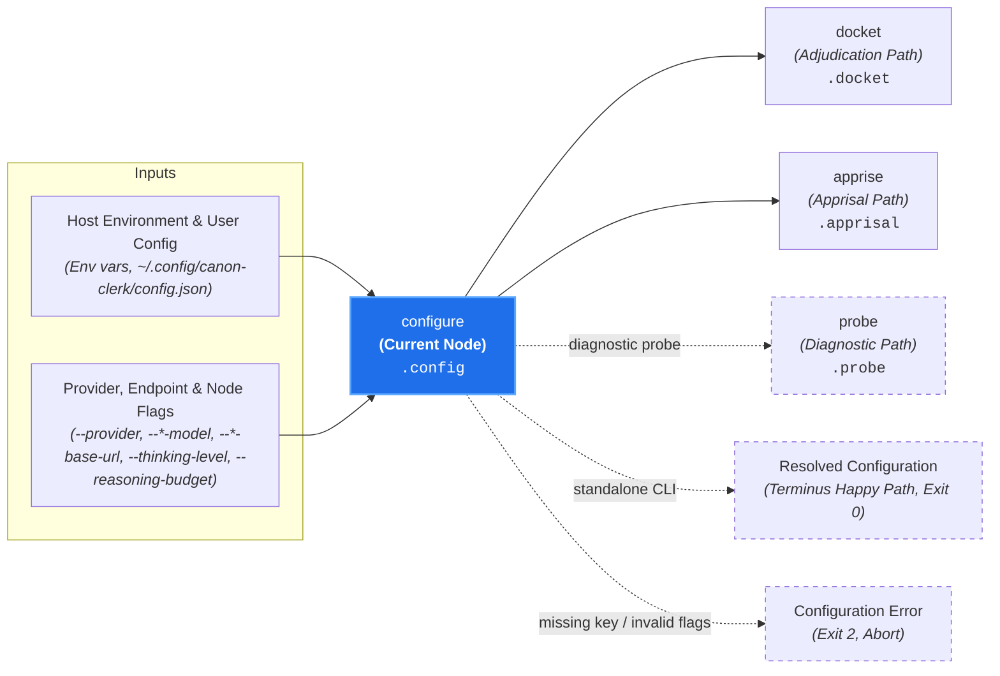

# Configuration & Environment (`configure`)

**Status:** Authoritative Architectural Standard  
**Core Domain Engine:** Caseload Domain Engine  
**Driving Adapter:** CLI (`configure`)

---

## 1. Domain Concept & Role (`core` / `configuration`)

`configure` serves as the **Operational Environment Normalizer** for Canon Clerk. In the court clerkship taxonomy, it represents the administrative court officer ensuring the courtroom facilities, judicial roster, and bailiff credentials are established before the court goes into session.

- **Imperative Verb:** `configure`
- **Court Clerkship Role:** Active provider selection, per-node model and thinking resolution, and closure-exact credential validation.
- **Metric Pair:** N/A (Deterministic offline configuration resolution).

---

## 2. Dependencies & Prerequisites (`core`)



- **Direct Prerequisites:** None (Root node of Branch B).
- **Transitive Prerequisites:** None.
- **Independence:** Resolves active provider defaults, per-node model bindings, and credentials with zero dependencies on diffs or canons.
- **Lazy Evaluation in Cascades:** When executed within a review cascade (`apprise`, `docket`, `admit`, `vet`, `audit`), `configure` is evaluated lazily *after* `discover` confirms matching candidate canons and `validate` confirms valid canon syntax, guaranteeing that un-governed PRs pass cleanly without checking credentials.

---

## 3. Caseload Contribution & Data Plane Constraints

### Caseload Delta
`configure` populates the `.config` namespace on the cumulative `Caseload` envelope with resolved provider and per-node runtime bindings:

- **Default Provider (`provider`):** Canonical slug of the resolved active default provider (`"google"`, `"typesafe"`, `"local"`, or a custom profile slug declared under `providers.<slug>` in `config.json`).
- **Resolved Heuristic Node Bindings (`nodes`):** Deterministic map ordered by canonical DAG stage (`apprise`, `docket`, `admit`, `vet`, `audit`) across the heuristic nodes resolved for the active closure. Each node entry records:
  - **Model Specifier (`model`):** Canonical `<provider>:<model>` identifier bound to that node (for example, `"google:gemini-decision-1"`, `"typesafe:jev-latest"`, `"local:kev-4b"`, or `"google:gemini-4-carbon"`).
  - **Thinking Level (`thinking_level`):** Optional qualitative reasoning effort tier (`"minimal"`, `"low"`, `"medium"`, `"high"`) resolved for a `Generator`-bound node (mutually exclusive with `reasoning_budget`; omitted when unset or when the node binds to a `Discriminator` model).
  - **Reasoning Budget (`reasoning_budget`):** Optional non-negative integer token ceiling resolved for a `Generator`-bound node (mutually exclusive with `thinking_level`; omitted when unset or when the node binds to a `Discriminator` model).

### Data Plane & Security Invariants
1. **Credential & Endpoint Non-Persistence (Zero Context Egress):** While `configure` validates endpoint base URLs and verifies required credentials across the providers referenced by the active closure, resolved API keys and `baseUrl` transport endpoints live strictly in memory for runtime adapter construction and are **never** serialized into `.config` on the `Caseload` envelope or echoed to terminal output, keeping `caseload.json` artifacts portable and free of internal gateway URLs or secret material.
2. **Workspace-External Credential Sourcing:** File-based runtime provider configuration and credentials are sourced exclusively from user-level configuration directories outside the repository workspace envelope (`$XDG_CONFIG_HOME/canon-clerk/config.json` or `~/.config/canon-clerk/config.json` on Unix/macOS; `%APPDATA%\canon-clerk\config.json` on Windows). Any runtime credential/provider configuration file (`config.json`) located inside the repository workspace is rejected with exit code `2` so workspace-scoped AI coding agents cannot read local secret files. *(Declarative canon/exhibit policy files at `<scope>/.canons/config.yaml` are strictly Branch A `discover` inputs carrying zero credentials, endpoints, or model bindings; see [`discover.md`](discover.md) and [`SPEC.md` §7](../../../SPEC.md#7-workspace-policy-configuration-canonsconfigyaml)).*
3. **POSIX Owner-Only Permission Enforcement:** On POSIX platforms, `configure` inspects file mode permissions before reading the user configuration file and fails fast with exit code `2` (suggesting `chmod 600`) if group or world permissions are granted (`(mode & 0o077) != 0`; only `0600` or `0400` are accepted).
4. **Strict `<provider>:<model>` Specifier Grammar & Protocol-Bound Capabilities:** Every model specifier across CLI flags, environment variables, `config.json` defaults/node pins, and `.config.nodes` records must conform to canonical `<provider>:<model>` syntax with non-empty provider and model segments separated by a single `:` delimiter and no whitespace. Bare short-name prefix inference (`gemini-decision-1`, `gemini-*`, `jev-*`), retired pet-name aliases (`google:carbon`, `google:hydrogen`, `typesafe:jev`), unversioned `google:gemini-decision`, and structured `{ provider, model }` object shims are rejected with exit code `2` and an actionable remediation hint. Model syntax validation, `<provider>:` prefix stripping, `Discriminator` vs. `Generator` capability classification, and discriminative context/question-batching budgets bind to the profile's wire protocol (`gemini` or `systemone`) rather than hardcoded vendor slugs:
   - **`gemini` Protocol Profiles (`google` and custom `"protocol": "gemini"` profiles):** Classify `<slug>:gemini-decision-*` as `Discriminator` (`240,000` state chars / `256` questions per call) and other `<slug>:gemini-*` identifiers as `Generator`.
   - **`systemone` Protocol Profiles (`typesafe`, `local`, and custom `"protocol": "systemone"` profiles):** Classify `<slug>:<model>` as `Discriminator` (`36,000` state chars / `64,000` batch chars / `48` questions per call on cloud `typesafe` and custom `systemone` profiles; `24,000` state chars / `32,000` batch chars / `16` max `nouls` per call with `2`-item screening batches on built-in `local`); built-in `typesafe` validates `jev-*` model identifiers, while built-in `local` and custom `systemone` profiles accept any non-empty `[A-Za-z0-9._/-]+` `<model>` identifier (such as `local:kev-4b`, `local:kev-0.8b`, or `lan-gpu:clef-flash`, rejecting generative `gemini-*` names).
5. **Orthogonal `{ providers, defaults, nodes }` Configuration File Schema & Custom Profiles:** `~/.config/canon-clerk/config.json` is strictly restricted to three orthogonal top-level namespaces—`providers`, `defaults`, and `nodes`. Each `providers.<slug>` object accepts `{ protocol?, baseUrl?, apiKey?, defaultDiscriminator?, defaultGenerator? }`:
   - **Built-In Profiles (`google`, `typesafe`, `local`):** Inherit their built-in wire protocol, default `baseUrl`, authentication policy (`RequiredApiKey` on `google`/`typesafe`; `OptionalApiKey` on `local`), and default per-capability models when omitted, and reject conflicting `protocol` overrides with exit code `2`.
   - **Zero-Code Custom Profiles (e.g., `local-dev`, `lan-gpu`, `google-corp`):** Must use lowercase kebab-case `<slug>` identifiers (`[a-z0-9]+(-[a-z0-9]+)*`) and explicitly declare both `protocol` (`"gemini"` or `"systemone"`) and `baseUrl` (`http://` or `https://` URL), exiting `2` with an actionable `Hint:` when omitted or malformed. When `defaultDiscriminator` or `defaultGenerator` is declared on a profile, it must carry the matching `<slug>:` prefix and satisfy the corresponding capability (`systemone` profiles reject `defaultGenerator` with exit code `2`).
   - Retired flat root keys (`screenerModel`, `auditorModel`, `thinkingLevel`, `reasoningBudget`, `<stage>BatchSize`, `<stage>Concurrency`, `maxCanonsPerCall`, `maxConcurrentCalls`, `maxRetries`, `maxBackoffMs`) and any unrecognized keys across root, `providers.<slug>`, `defaults`, or `nodes.<node>` fail fast with exit code `2` and an actionable migration `Hint:`.
6. **Mutual Exclusivity & Capability Scoping of Reasoning Controls:** `thinking_level` and `reasoning_budget` are mutually exclusive within any single configuration layer (CLI flags, environment variables, `nodes.<node>`, or `defaults`), failing fast with exit code `2` when both appear at the same layer; across distinct precedence layers, the higher-precedence layer supersedes and clears the lower-precedence alternative. Shared/ambient thinking controls (`--thinking-level`, `--reasoning-budget`, `CANON_CLERK_THINKING_LEVEL`, `CANON_CLERK_REASONING_BUDGET`, `defaults.thinkingLevel`, `defaults.reasoningBudget`) apply strictly to `Generator`-bound nodes and leave `Discriminator`-bound nodes unset, whereas explicitly declaring per-node `nodes.<node>.thinkingLevel` or `nodes.<node>.reasoningBudget` on a node whose resolved model is a `Discriminator` fails fast with exit code `2`.

---

## 4. Process & Domain Logic (`configuration`)

1. **Decoupled Provider Profiles, Wire Protocols & Deterministic Active Provider Cascade:**  
   Canon Clerk separates **who hosts an endpoint** (provider profile `<slug>`) from **what wire protocol it speaks** (`gemini` or `systemone`) and **what domain capability port a model satisfies** (`Discriminator` or `Generator`). Ambient `*_API_KEY` environment variables never implicitly switch the active provider or models; instead, the active default provider resolves deterministically along a strict specificity cascade:
   $$\texttt{--provider <slug>} \;\succ\; \texttt{CANON\_CLERK\_PROVIDER} \;\succ\; \texttt{config.json defaults.provider} \;\succ\; \texttt{"google"}$$
   Unrecognized provider slugs (not matching a built-in profile or a configured `providers.<slug>` profile in `config.json`) fail fast with exit code `2` and an actionable remediation hint:

   | Profile Slug | Wire Protocol | Default `baseUrl` | Auth Policy | Default `Discriminator` (`apprise`..`vet`) | Default `Generator` (`audit`) |
   | :--- | :--- | :--- | :--- | :--- | :--- |
   | `google` *(built-in default)* | `gemini` | `https://generativelanguage.googleapis.com/v1beta` | Required API key (`x-goog-api-key`) | `google:gemini-decision-1` | `google:gemini-4-carbon` |
   | `typesafe` *(built-in)* | `systemone` | `https://api.typesafe.ai/v1` | Required API key (`Bearer`) | `typesafe:jev-latest` | *(none)* |
   | `local` *(built-in)* | `systemone` | `http://127.0.0.1:8080/v1` | **Optional API key** (`Bearer` when set; unauthenticated otherwise) | `local:kev-4b` | *(none)* |
   | Custom `<slug>` (`"protocol": "systemone"`) | `systemone` | Explicit `providers.<slug>.baseUrl` | **Optional API key** (`Bearer` when set; unauthenticated otherwise) | `providers.<slug>.defaultDiscriminator` *(optional)* | *(none)* |
   | Custom `<slug>` (`"protocol": "gemini"`) | `gemini` | Explicit `providers.<slug>.baseUrl` | Required API key (`x-goog-api-key`) | `providers.<slug>.defaultDiscriminator` *(optional)* | `providers.<slug>.defaultGenerator` *(optional)* |

   For any referenced profile `<slug>` (with `<UPPER_SLUG>` formed by uppercasing `<slug>` and replacing `-` with `_`), transport credentials and endpoint URLs resolve independently along deterministic specificity cascades:
   - **API Key Precedence:** Built-in CLI flag (`--gemini-api-key` on `google`, `--typesafe-api-key` on `typesafe`, `--local-api-key` on `local`) $\succ$ `CANON_CLERK_<UPPER_SLUG>_API_KEY` $\succ$ `<UPPER_SLUG>_API_KEY` (plus `GEMINI_API_KEY` on `google`) $\succ$ `providers.<slug>.apiKey` in `config.json`. Profiles with a required API-key policy fail fast with exit code `2` when no key resolves; `local` and custom `systemone` profiles omit the `Authorization` header when no key resolves so keyless localhost `/v1/systemone` daemons work without dummy tokens.
   - **Base URL Precedence:** Built-in CLI flag (`--gemini-base-url` on `google`, `--typesafe-base-url` on `typesafe`, `--local-base-url` on `local`) $\succ$ `CANON_CLERK_<UPPER_SLUG>_BASE_URL` $\succ$ `<UPPER_SLUG>_BASE_URL` (plus `GEMINI_BASE_URL` on `google`) $\succ$ `providers.<slug>.baseUrl` in `config.json` $\succ$ built-in profile default. Resolved URLs must begin with `http://` or `https://` and name a non-empty host authority, failing fast with exit code `2` during `configure` when malformed.

2. **4-Level Node Model Specificity Cascade (Per Heuristic Node `<node>`):**  
   Each heuristic DAG node (`apprise`, `docket`, `admit`, `vet`, `audit`) resolves its `<provider>:<model>` binding independently along a 4-level specificity cascade:
   - **Level 1 — Stage CLI Flag:** `--apprise-model`, `--docket-model`, `--admit-model`, `--vet-model`, `--audit-model` (scoped to closure on evaluation subcommands per [`../scheduling.md` §4](../scheduling.md#pattern-c-the-stage-prefixed-flag-scoping-contract); all five accepted on standalone `configure` and `probe`).
   - **Level 2 — Stage Environment Variable:** `CANON_CLERK_APPRISE_MODEL`, `CANON_CLERK_DOCKET_MODEL`, `CANON_CLERK_ADMIT_MODEL`, `CANON_CLERK_VET_MODEL`, `CANON_CLERK_AUDIT_MODEL`.
   - **Level 3 — User Configuration File Node Pin:** `nodes.<node>.model` in `~/.config/canon-clerk/config.json`.
   - **Level 4 — Active Provider Capability Default:**
     - **Screening & Vetting Nodes (`apprise`, `docket`, `admit`, `vet`):** Strictly require a `Discriminator` model and use the active provider profile's `defaultDiscriminator`. Configuring any `Generator` model on `apprise`, `docket`, `admit`, or `vet` fails fast with exit code `2` and an actionable remediation hint pointing to supported discriminator providers (`google:gemini-decision-*`, `typesafe:jev-*`, or `local:*`). If a custom profile defines no `defaultDiscriminator` and a required screening node is unpinned across Levels 1–3, `configure` exits `2` with an actionable `Hint:`.
     - **Judicial Adjudication Node (`audit`):** Uses the active provider profile's `defaultGenerator`. Because `audit` synthesizes structured prose decrees, `Exception` rulings, `Remediation` guidance, and 1-based `CodeAnnotation` spans, configuring any `Discriminator` model on `audit` fails fast with exit code `2`. When the active profile defines no `defaultGenerator` (such as `typesafe` or a custom `systemone` profile) and `audit` is unpinned across Levels 1–3, `audit` remains unprovisioned—allowing `apprise`..`vet` and standalone `configure`/`probe` to succeed cleanly while failing fast with exit code `2` and an actionable remediation hint if `audit` adjudication is invoked.

3. **Co-Located Provider Profiles & Operational Knobs (`providers`, `defaults` & `nodes.<node>`):**  
   User-level `~/.config/canon-clerk/config.json` co-locates built-in and custom provider profiles under `providers`, global defaults under `defaults`, and stage-specific overrides under `nodes.<node>`:

   ```json
   {
     "providers": {
       "google": { "apiKey": "..." },
       "local-dev": {
         "protocol": "systemone",
         "baseUrl": "http://127.0.0.1:8080/v1",
         "defaultDiscriminator": "local-dev:kev-0.8b"
       },
       "google-corp": {
         "protocol": "gemini",
         "baseUrl": "https://gemini-gateway.corp.example.com/v1beta",
         "apiKey": "...",
         "defaultDiscriminator": "google-corp:gemini-decision-1",
         "defaultGenerator": "google-corp:gemini-4-carbon"
       }
     },
     "defaults": {
       "provider": "google",
       "thinkingLevel": "low",
       "maxRetries": 6,
       "maxBackoffMs": 60000
     },
     "nodes": {
       "apprise": { "model": "local-dev:kev-0.8b", "concurrency": 4 },
       "docket":  { "model": "local-dev:kev-0.8b", "batchSize": 48, "concurrency": 4 },
       "admit":   { "model": "local-dev:kev-0.8b", "concurrency": 4 },
       "vet":     { "model": "local-dev:kev-0.8b", "threshold": 0.80, "concurrency": 4 },
       "audit":   { "model": "google:gemini-4-carbon", "thinkingLevel": "low", "concurrency": 4 }
     }
   }
   ```

   | Knob | Specificity Cascade | Built-In Default | Envelope Persistence |
   | :--- | :--- | :--- | :--- |
   | `threshold` | `--<node>-threshold` $\succ$ `CANON_CLERK_<NODE>_THRESHOLD` $\succ$ `nodes.<node>.threshold` $\succ$ default | `0.80` on `vet`; `0.50` on `apprise`, `docket`, `admit`, `audit` | Execution parameter (not in `.config`) |
   | `batchSize` *(`apprise`, `docket` only)* | `--<node>-batch-size` $\succ$ `CANON_CLERK_<NODE>_BATCH_SIZE` $\succ$ `nodes.<node>.batchSize` $\succ$ model default | `256` on `gemini` `Discriminator`, `48` on cloud `systemone` `Discriminator`, `2` on `local:*` | Execution parameter (not in `.config`; rejected on `admit`, `vet`, `audit`) |
   | `concurrency` | `--<node>-concurrency` $\succ$ `CANON_CLERK_<NODE>_CONCURRENCY` $\succ$ `nodes.<node>.concurrency` $\succ$ profile default | `4` on cloud profiles; `1` on `local:*` nodes | Execution parameter (not in `.config`) |
   | `thinkingLevel` / `reasoningBudget` | `--thinking-level` / `--reasoning-budget` $\succ$ `CANON_CLERK_THINKING_LEVEL` / `CANON_CLERK_REASONING_BUDGET` $\succ$ `nodes.<node>.*` $\succ$ `defaults.*` $\succ$ stage default | `"low"` (`includeThoughts: true`) on `audit` | Recorded on `.config.nodes.audit` when explicitly set |
   | `timeoutMs` | `--timeout` $\succ$ `CANON_CLERK_TIMEOUT_MS` $\succ$ `defaults.timeoutMs` $\succ$ profile default | `60000` ms on cloud profiles; `180000` ms on `local:*` nodes | Live transport parameter ([`../transport.md` §6](../transport.md#6-out-of-band-telemetry--cli-transport-controls)) |
   | `maxRetries` / `maxBackoffMs` | `--max-retries` / `--max-backoff-ms` $\succ$ `CANON_CLERK_MAX_RETRIES` / `CANON_CLERK_MAX_BACKOFF_MS` $\succ$ `defaults.*` $\succ$ default | `2` retries, `90000` ms | Live transport parameter ([`../transport.md` §6](../transport.md#6-out-of-band-telemetry--cli-transport-controls)) |

4. **Closure-Exact Credential Validation & Partial-Closure `--caseload` Chaining:**
   - **Converged Evaluation Closures (`apprise`, `docket`, `admit`, `vet`, `audit`):** Resolve node bindings and verify provider credentials **strictly for the heuristic nodes executed in that subcommand's closure** (`{apprise}` on `apprise`; `{docket}` on `docket`; `{docket, admit}` on `admit`; `{docket, admit, vet}` on `vet`; `{docket, admit, vet, audit}` on telescoping `audit`).
   - **Partial-Closure Chaining (`--caseload`):** When an upstream command writes a partial `Caseload` that is piped into a downstream command (`canon-clerk vet --output-caseload c.json || canon-clerk audit --caseload c.json`), downstream `audit` preserves pre-populated upstream node bindings in `.config.nodes` without re-verifying credentials for already-completed upstream stages, resolves `audit` JIT, and verifies credentials strictly for the newly executed stage(s)—invalidating pre-populated upstream/downstream stages only when an upstream stage's model is explicitly overridden or `--provider <slug>` selects a provider slug different from the already-recorded `.config.provider` (passing a matching `--provider <slug>` is idempotent and preserves pre-populated upstream `.docket`/`.evidence`/`.vetting` stages).
   - **Standalone `configure` and `probe`:** Resolve all provisioned heuristic nodes for the active configuration (all 5 nodes on `--provider google`, or the 4 discriminative nodes `apprise`, `docket`, `admit`, `vet` on `--provider typesafe` or `--provider local` when `audit` is unpinned—or all 5 when `audit` is pinned via `--audit-model` / `CANON_CLERK_AUDIT_MODEL` / `nodes.audit.model`) and verify credentials strictly for the providers referenced by those provisioned nodes.

5. **Deterministic & Offline:** Executes locally in <5ms without sending network requests or spending tokens.

---

## 5. Driving Adapter: CLI

The CLI exposes `configure` as an imperative subcommand:

```bash
# 1. Default zero-config Google setup (verifies GEMINI_API_KEY and resolves all 5 nodes):
canon-clerk configure --json

# 2. Sole-provider TypeSafe setup (verifies TYPESAFE_API_KEY across apprise, docket, admit, vet):
canon-clerk configure --provider typesafe

# 3. Zero-config local System One daemon setup (keyless by default; resolves apprise..vet to local:kev-4b):
canon-clerk configure --provider local

# 4. Hybrid setup pairing local System One screening/vetting with Gemini 4 Carbon on audit:
canon-clerk configure --provider local --audit-model google:gemini-4-carbon
```

### CLI Flags & Environment
- `--provider <SLUG>` (fallback env: `CANON_CLERK_PROVIDER`; config key: `defaults.provider`): Active default provider profile slug (`google`, `typesafe`, `local`, or any custom `providers.<slug>` profile in `config.json`; default: `google`).
- `--apprise-model <PROVIDER:MODEL>` (`CANON_CLERK_APPRISE_MODEL`), `--docket-model <PROVIDER:MODEL>` (`CANON_CLERK_DOCKET_MODEL`), `--admit-model <PROVIDER:MODEL>` (`CANON_CLERK_ADMIT_MODEL`), `--vet-model <PROVIDER:MODEL>` (`CANON_CLERK_VET_MODEL`), `--audit-model <PROVIDER:MODEL>` (`CANON_CLERK_AUDIT_MODEL`): Per-node canonical `<provider>:<model>` overrides (`Generator` models on `--apprise-model`/`--docket-model`/`--admit-model`/`--vet-model`, `Discriminator` models on `--audit-model`, and retired `--screener-model` / `--auditor-model` flags are rejected with exit code `2`).
- `--thinking-level <minimal|low|medium|high>` (fallback env: `CANON_CLERK_THINKING_LEVEL`; config keys: `nodes.<node>.thinkingLevel`, `defaults.thinkingLevel`): Qualitative reasoning effort tier for `Generator`-bound nodes (mutually exclusive with `--reasoning-budget`).
- `--reasoning-budget <TOKENS>` (fallback env: `CANON_CLERK_REASONING_BUDGET`; config keys: `nodes.<node>.reasoningBudget`, `defaults.reasoningBudget`): Maximum reasoning budget tokens for `Generator`-bound nodes (mutually exclusive with `--thinking-level`).
- `--gemini-api-key <KEY>` (fallback env: `CANON_CLERK_GOOGLE_API_KEY`, `GEMINI_API_KEY`; config key: `providers.google.apiKey`): Google Gemini API key override.
- `--typesafe-api-key <KEY>` (fallback env: `CANON_CLERK_TYPESAFE_API_KEY`, `TYPESAFE_API_KEY`; config key: `providers.typesafe.apiKey`): TypeSafe AI Jev API key override.
- `--local-api-key <KEY>` (fallback env: `CANON_CLERK_LOCAL_API_KEY`, `LOCAL_API_KEY`; config key: `providers.local.apiKey`): Optional Bearer token override for the built-in `local` System One profile.
- `--gemini-base-url <URL>` (fallback env: `CANON_CLERK_GOOGLE_BASE_URL`, `GEMINI_BASE_URL`; config key: `providers.google.baseUrl`): Google Generative Language API base URL override.
- `--typesafe-base-url <URL>` (fallback env: `CANON_CLERK_TYPESAFE_BASE_URL`, `TYPESAFE_BASE_URL`; config key: `providers.typesafe.baseUrl`): TypeSafe AI System One API base URL override.
- `--local-base-url <URL>` (fallback env: `CANON_CLERK_LOCAL_BASE_URL`, `LOCAL_BASE_URL`; config key: `providers.local.baseUrl`): Local System One daemon base URL override (default: `http://127.0.0.1:8080/v1`).
- *(Custom `providers.<slug>` profiles additionally support `CANON_CLERK_<UPPER_SLUG>_API_KEY` / `<UPPER_SLUG>_API_KEY` and `CANON_CLERK_<UPPER_SLUG>_BASE_URL` / `<UPPER_SLUG>_BASE_URL` environment overrides.)*
- `--format <stylish|json|compact>`: Output presentation format (default: `stylish`).
- `--caseload <PATH|->`: Ingests upstream `Caseload`.
- `--output-caseload <PATH>`: Writes cumulative `Caseload` JSON to disk independently of `stdout`.
- `--json`: Emits enriched `Caseload` JSON to `stdout`.

### CLI Output Modes
- **`stylish` (Default):** Renders a human-readable `Configuration Summary (READY):` listing the resolved default `Provider`, each provisioned node binding in canonical DAG order (and noting `audit` as unprovisioned on discriminator-only setups when unpinned), effective extended thinking controls, and redacted `Credentials` (`<env_vars> (verified)` when credentials resolve, or `none (optional — unauthenticated)` when all provisioned nodes target keyless `systemone` profiles).
- **`compact`:** Emits unadorned tab-separated `<key>\t<value>` records in canonical order (`provider\t<slug>`, `<node>_model\t<provider:model>`, optional `<node>_thinking_level\t<level>` / `<node>_reasoning_budget\t<tokens>`, and `credentials\t<verified_env_vars_or_none>`).
- **`json` / `--json`:** Emits the cumulative `Caseload` JSON envelope with `.config` populated.

### CLI Exit Codes
- **0:** Configuration valid, node bindings and endpoint URLs resolved, and referenced provider credentials verified.
- **2:** Missing required provider credentials, malformed `baseUrl` or missing custom-profile `protocol`/`baseUrl`, bare or unrecognized `<provider>:<model>` specifier, unrecognized `--provider`, `Generator` model on a screening/vetting node (`apprise`, `docket`, `admit`, `vet`), `Discriminator` model on `audit`, retired root or unknown `config.json` keys, insecure or workspace-resident runtime `config.json` file, or conflicting extended thinking options.
