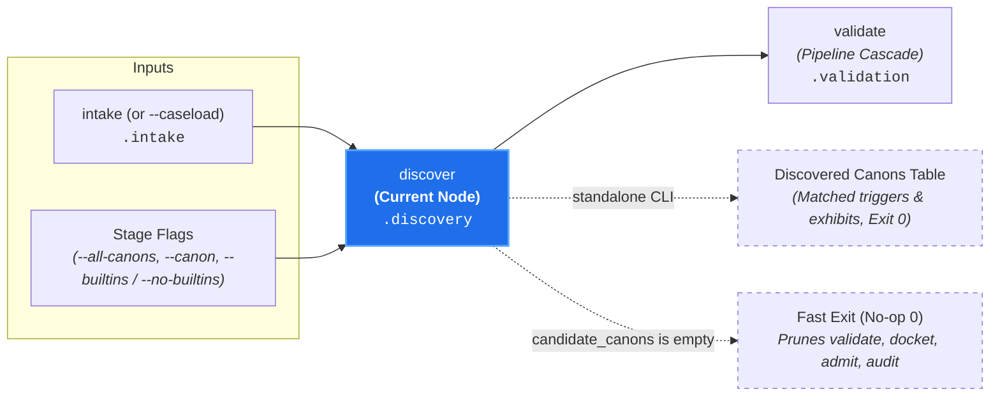

# Candidate Identification (`discover`)

**Status:** Authoritative Architectural Standard  
**Core Domain Engine:** Caseload Domain Engine  
**Driving Adapter:** CLI (`discover`)

---

## 1. Domain Concept & Role (`core`)

`discover` acts as the **Multi-Plane Relevance Sieve & Dual Pruning Gate** of the pipeline. In the court clerkship taxonomy, it represents the clerk reviewing tendered filings to resolve referenced files, verify state preconditions, enforce monorepo jurisdictional boundaries, and compare all tendered exhibits against the court's codified canons:

1. **Exhibit Materialization:** Resolves exhibit discovery directives (expanding directory recursion roots, matching globs against workspace checkout into concrete file exhibits).
2. **State Precondition Verification:** Evaluates `exists:` path patterns against the Target File Tree to ensure baseline environment dependencies exist before admitting candidate canons.
3. **Subordination & Scope Containment:** Enforces monorepo boundaries, ensuring scoped canons evaluate strictly within their enclosing `<scope>/`.
4. **Workspace Policy Filtering:** Loads `<scope>/.canons/config.yaml` declarative policy files and filters `(canon, exhibit)` pairs through an ordered, first-match-wins, nearest-scope-first allow/deny chain.
5. **Two-Sided Mutual Pruning:**
   - **Prunes Inapplicable Canons:** Canons with unmet `exists` preconditions, policy denials, or zero matching surviving exhibits are dropped $\implies$ `candidate_canons`.
   - **Prunes Un-inspected Exhibits:** Exhibits not inspected or triggered by any surviving candidate canon are dropped $\implies$ `active_exhibits` (preserving context-window hygiene).

- **Imperative Verb:** `discover`
- **Court Clerkship Role:** Exhibit materialization, precondition verification, scope containment, candidate canon identification, and mutual exhibit pruning.
- **Metric Pair:** N/A (Deterministic multi-plane intersection).

---

## 2. Dependencies & Prerequisites (`core`)



- **Direct Prerequisites:** `intake` (requires parsed target paths, diffs, or scope in `caseload.intake`, OR receives plenary `--all-canons` flag).
- **Transitive Prerequisites:** None.
- **Incoming Caseload:** Requires `caseload.intake` to be present (unless executing with `--all-canons`).

---

## 3. Caseload Contribution & Data Plane Constraints

### Caseload Delta
`discover` populates the `.discovery` namespace on the cumulative `Caseload` envelope with the resolved target scope and candidate canon intersection records:

- **Discovery Mode & Target Files:** Records the active discovery `mode` (`"triggered"` vs. `"all-canons"`) and the resolved list of repository-relative `target_files` materialized from `.intake` directives and diffs.
- **Discovered Policy Configs (`config_files`):** Optional stably sorted list of workspace-relative paths of discovered `<scope>/.canons/config.yaml` policy files in deterministic lexicographical order (omitted when no policy config files are present).
- **Candidate Canons (`candidate_canons`):** Stably sorted list of discovered canon file paths or qualified realm references (e.g. `.canons/...`, `builtin:...`, `inline:...`, `<pack>:...`) whose state preconditions (`exists:`), path `triggers:`, required `inspect:` planes, and resolved `<scope>/.canons/config.yaml` policy rules admit the canon (or the policy-filtered repository corpus when `mode` is `"all-canons"`).
- **Inline Canons (`inline_canons`):** Optional deterministic map (`BTreeMap<String, String>`, omitted when empty) from ephemeral `inline:<name>` source references to their raw Markdown source text, enabling downstream stages resuming via `--caseload` to rehydrate inline canons without disk files and keeping archived `caseload.json` records forensically self-contained.
- **Retained Active Exhibits (`active_exhibits`):** The pruned subset of materialized exhibits (`files`, `pr_title`, `pr_body`, `commit_messages`, `linked_issues`) triggered or inspected by at least one surviving candidate canon.
- **Trigger Intersection Map (`triggers_join`):** Deterministic mapping from each candidate canon identifier to the specific matched target file paths and inspected exhibit planes that activated it.

### Data Plane & Domain Short-Circuit Invariants
1. **Envelope Immutability & Deterministic Ordering:** Executing `discover` enriches `.discovery` without mutating upstream `.intake` records, maintaining `target_files`, `config_files`, `candidate_canons`, `active_exhibits.files`, and `triggers_join` keys in deterministic lexicographical order.
2. **Trust Boundary (`--workspace-state base`):** Under `--workspace-state base` (e.g., GitHub Actions `pull_request_target`), `<scope>/.canons/config.yaml` files are always read strictly from the trusted workspace checkout on disk and are never patched from `.intake.diffs`, preventing untrusted pull requests from disabling enforcement via `- deny: all`.
3. **Diagnostic Warning Isolation:** Non-fatal warnings for ignored nested config files inside `.canons/` subdirectories (e.g., `.canons/security/config.yaml`) are emitted to diagnostic/telemetry output (`stderr` / `--log-file`) without mutating the `Caseload` envelope.
4. **Mutual Pruning & Token Hygiene:** Any tendered exhibit not referenced by a surviving candidate canon is excluded from `active_exhibits`, guaranteeing that downstream heuristic stages never serialize un-inspected files or metadata into model prompts.
5. **Empty Candidate Short-Circuit:** If `candidate_canons` is empty (`[]`), the engine attaches the empty `.discovery` record and halts downstream cascade execution immediately with a clean pass, bypassing provider configuration and spending zero tokens.

---

## 4. Process & Domain Logic (`core`)

1. **Exhibit Materialization:** Resolves exhibit discovery directives from `caseload.intake` (e.g. expanding directory recursion roots and matching target glob patterns against workspace checkout into concrete file exhibits).
2. **Plenary Canon Discovery (`--all-canons`):** When `all_canons: true` is passed (via `--all-canons`), path trigger intersection is bypassed. Every discoverable canon in the workspace that survives unconditional `<scope>/.canons/config.yaml` policy rules (rules with omitted `exhibits:`) is placed directly into `candidate_canons` with `mode: "all-canons"`. This establishes the active statutory corpus for downstream `validate --all-canons` ("Codex Audit").
   - **Two Hemispheres Invariant:** `--all-canons` operates exclusively on the *governing rule packs*, distinct from `--all-targets` (in `intake`), which operates on the *subject-matter codebase*.
3. **Canon Corpus Enumeration & Sourcing:** Discovers all candidate canons across active realms:
   - **Local Workspace Canons:** Discovered via the default pattern `**/.canons/**/*.canon.md`, retaining workspace-relative file paths while ignoring non-canon documents (such as `.canons/README.md`, `.canons/AGENTS.md`, and `.canons/config.yaml`).
   - **Embedded Built-in Standard Canons:** Curated `builtin:<domain>/<stem>` canons compiled directly into the binary are loaded by default alongside local workspace canons (unless disabled via `--no-builtins`, or omitted by default when an inline canon is supplied without explicit `--canon` / `--builtins` / `--all-canons`).
   - **Ephemeral Inline Canons:** An ad-hoc `inline:<name>` canon supplied via `--canon-name <NAME>` (with optional `--canon-body <TEXT>` or `--canon-body-file <PATH|->`) is parsed in-memory with standard frontmatter defaults (`triggers: ["**/*"]`, `inspect: ["diff", "pr_title?", "pr_body?"]`). When supplied without explicit `--canon`, `--builtins`, or `--all-canons`, discovery evaluates *only* the inline canon; combining it with explicit `--canon` or `--builtins` composes additively. Explicitly supplied inline canons bypass `<scope>/.canons/config.yaml` `deny` rules, matching `--canon` precedence.
   - **Virtual Reference Isolation:** Embedded `builtin:*` and ephemeral `inline:*` references are loaded strictly into the canon corpus and are never inserted into the workspace file tree (`existing_files`), preventing virtual keys from polluting `exists:` preconditions or `--all-targets` filings.
   - **Cross-Realm Coexistence (`SPEC.md` §6.2):** Local workspace canons, `builtin:*` canons, and `inline:*` canons are disambiguated by their source-qualified references and co-exist without shadowing or colliding even when they share a derived `id`.
   - **Realm-Aware `--canon` Filtering:** Explicit `--canon` selectors support workspace paths/globs as well as `builtin:` selectors (exact references like `builtin:cli/<stem>`, domain prefixes like `builtin:cli`, and globs like `builtin:security/**`).
4. **Workspace Policy Discovery & Validation (`<scope>/.canons/config.yaml`):** Discovers, validates, and compiles declarative workspace policy files per [`SPEC.md` §7](../../../SPEC.md#7-workspace-policy-configuration-canonsconfigyaml):
   - **Scoped Discovery & Boundaries:** Loads direct-child `<scope>/.canons/config.yaml` files bounded strictly by the workspace root (never traversing above it). Nested `config.yaml` files inside topical `.canons/` subdirectories (e.g., `.canons/security/config.yaml`) are ignored with a non-fatal diagnostic warning. Discovered paths are recorded on `caseload.discovery.config_files` in deterministic lexicographical order.
   - **Fail-Fast Schema & Credential Isolation:** Malformed YAML, unrecognized top-level or rule keys (including runtime credential/provider keys such as `providers`, `defaults`, `nodes`, `apiKey`), rule entries missing or combining `allow` and `deny`, invalid glob syntax, or `../` directory traversal in selectors or `exhibits:` fail fast with exit code `2`. An empty file or `canon-policy-chain: []` is a valid no-op.
   - **Ordered Allow/Deny Chain & Lexical Cascade:** Evaluates `(canon, exhibit)` pairs through a nearest-scope-first, first-match-wins chain (`[child <scope>/.canons/config.yaml -> parent ... -> root .canons/config.yaml -> implicit allow]`). For metadata-only filings and `--all-canons`, evaluation anchors at the canon's own scope. Selectors support `all`, `builtin:<path-or-glob>`, `parents:<path-or-glob>` (matching strictly enclosing ancestor local canons by `.canons/`-relative diagnostic path), and `<scope>/.canons/`-relative `<path-or-glob>` with optional `.canon.md` suffix normalization. Omitted `exhibits:` matches unconditionally across all exhibit planes; present `exhibits:` filters matching file exhibits additively on top of default noise exclusions.
   - **CLI Precedence:** Explicit `--canon <selector>` flags override `config.yaml` `deny` rules for the targeted canon(s); `--no-builtins` excludes built-in canons regardless of `allow: "builtin:..."` rules; `--builtins` remains the corpus-loading toggle and does not bypass `config.yaml` `deny` rules.
5. **Monorepo Subordination & Scope Containment:** Enforces strict boundary encapsulation:
   - Global canons in `.canons/**` apply repository-wide.
   - Scoped canons located in `<scope>/.canons/**` automatically inherit an implicit `<scope>/**` boundary:
     - Scoped canons are never evaluated against files outside `<scope>/`. If zero modified target files reside in `<scope>/`, the canon is excluded from candidates.
      - All declared paths and glob patterns in `triggers:`, `exists:`, and `references:` are evaluated strictly relative to `<scope>/`. Any pattern attempting directory traversal superior to `<scope>/` (e.g. `../`) is rejected as a validation error.
      - Scoped canons requiring files outside `<scope>/` must be hoisted to a parent `.canons/` directory.
6. **State Precondition Verification (`exists:`):** Evaluates declared `exists:` path patterns against the **Target File Tree** representing the final state being tested (PR `HEAD` commit in CI, filesystem working directory in local CLI, or speculative plan in dry-run modes):
   - All patterns in `exists:` MUST match at least one file present in the Target File Tree. If any pattern matches zero files, the canon is skipped / pruned with a diagnostic notice.
   - For scoped canons, `exists:` preconditions are evaluated strictly against the Target File Tree within `<scope>/`.
7. **Bipartite Exhibit Matching (Required vs. Optional Exhibits):**
   - **Required Planes (Default, e.g. `diff`, `pr_body`):** Evaluated strictly. A canon is pruned unless all of its declared required exhibit planes are satisfied in the intake filing (e.g. modified files matching `triggers:` or present metadata).
   - **Optional Planes (`?` Suffix, e.g. `pr_title?`, `pr_body?`):** Evaluated opportunistically. If present on `caseload.intake`, they are retained as active exhibits for the canon; if absent (such as in local CLI diff-only audits), their absence never causes the canon to be pruned.
   - **Default Frontmatter Ergonomics:** Canons with omitted `inspect` frontmatter default to `["diff", "pr_title?", "pr_body?"]`, guaranteeing that standard code rules apply seamlessly in local CLI runs (where `diff` is present but PR metadata is absent) without requiring dummy metadata flags.
8. **Two-Sided Mutual Pruning & Token Hygiene:**
   - **Inapplicable Canons Pruned:** Any canon denied by workspace policy, whose `exists:` preconditions are unmet, whose surviving `triggers:` match 0 file exhibits after policy filtering, or whose required `inspect:` exhibit planes are unsatisfied is dropped $\implies$ `candidate_canons`.
   - **Un-inspected Exhibits Pruned:** Any tendered exhibit (file path, `pr_title`, `pr_body`, etc.) that is neither triggered nor inspected by any surviving candidate canon is dropped $\implies$ `active_exhibits`. Downstream screening (`docket`) and adjudication (`audit`) will never serialize un-inspected exhibits into model prompts.
9. **Join Calculation:** Computes `triggers_join` mapping each candidate canon to the specific active exhibits that activated it.

---

## 5. Driving Adapter: CLI

The CLI exposes `discover` as an imperative subcommand:

```bash
# Evaluate discovery on in-flight diff stream:
git diff origin/main | canon-clerk discover --diff -

# Enumerate all canons across the repository corpus:
canon-clerk discover --all-canons

# Evaluate discovery against an upstream Caseload:
canon-clerk discover --caseload caseload-1.json --json

# Predicate mode (-q):
git diff origin/main | canon-clerk discover -q -
```

### CLI Flags & Options
- `--all-canons`: Discovers and compiles all active canons (local workspace and embedded built-ins unless `--no-builtins` is set) into `candidate_canons`, bypassing path trigger matching.
- `--builtins` / `--no-builtins`: Include (default) or exclude embedded `builtin:*` standard canons (positive-polarity toggle cascading across `discover`, `validate`, `apprise`, `docket`, `admit`, `vet`, and `audit`).
- `-q, --quiet`: Predicate mode. Suppresses stdout and indicates match presence via exit code.
- `--canon <path|glob>`: Explicitly restrict candidate canons to a specific subset (workspace paths/globs or `builtin:` references/prefixes/globs).
- `--canon-name <name>`: Evaluate an ephemeral `inline:<name>` canon without writing files to disk (optional `.canon.md` suffix stripped; evaluates only the inline canon unless combined with explicit `--canon`, `--builtins`, or `--all-canons`).
- `--canon-body <text>`: Optional inline Markdown body (with optional YAML frontmatter) for `--canon-name`; mutually exclusive with `--canon-body-file`.
- `--canon-body-file <path|->`: Read the inline canon Markdown body from a file or `-` for stdin; requires `--canon-name` and is mutually exclusive with `--canon-body`.
- `--format <stylish|json|compact>`: Formats matched canons and triggering files.
- `--caseload <path|->`: Ingests upstream Caseload JSON.
- `--output-caseload <path>`: Writes cumulative `Caseload` JSON to disk independently of terminal stdout.
- `--json`: Emits enriched Caseload JSON to stdout.

### CLI Exit Codes
- **0:** Candidate canons matched and discovery attached (or `--all-canons` enumerated).
- **0 (Short-Circuit):** Zero candidate canons matched from diff stream; logs summary and exits immediately.
- **1 (Predicate Mode `-q`):** Exits 1 if zero candidate canons matched.
- **2:** Usage error, missing input source (naked invocation), invalid glob syntax, or malformed/invalid `<scope>/.canons/config.yaml` (YAML parse error, unrecognized or credential/provider keys, invalid rule entry, or `../` traversal).
