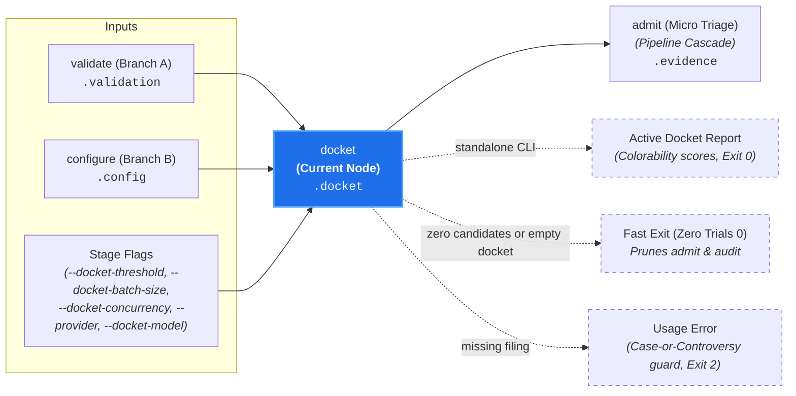

# Macro Jurisdiction Triage (`docket`)

**Status:** Authoritative Architectural Standard  
**Core Domain Engine:** Caseload Domain Engine  
**Driving Adapter:** CLI (`docket`)

---

## 1. Domain Concept & Role (`core`)

`docket` performs **Macro Triage: Subject-Matter Jurisdiction Screening** across all candidate canons. In the court clerkship taxonomy, it represents the clerk reviewing petitions against the court's subject-matter jurisdiction to determine whether a claim is legally colorable before opening a formal case file on the active docket.

- **Imperative Verb:** `docket`
- **Court Clerkship Role:** Macro triage establishing subject-matter jurisdiction.
- **Metric Pair:** `colorability_score` (number [0.0, 1.0]) and `colorability_summary` (string rationale).
- **Core Question:** *"Does this candidate canon have a colorable claim of jurisdiction over this PR as a whole?"*

---

## 2. Dependencies & Prerequisites (`core`)



- **Direct Prerequisites:**
  - `validate` (Branch A: validated candidate canons in `caseload.discovery.candidate_canons` and `caseload.validation`).
  - `configure` (Branch B: resolved `docket` node model binding in `caseload.config.nodes.docket` and verified provider credentials).
- **Transitive Prerequisites:** `intake`, `discover`.
- **The Case or Controversy Invariant:** `docket` evaluates the subject-matter jurisdiction of candidate canons *as applied to a change*. It strictly requires an underlying filing (`caseload.intake` populated from target paths, `-`, `--diff`, `--all-targets`, PR metadata, or an incoming `--caseload`). Invocations attempting to docket without a concrete filing (e.g. `canon-clerk docket --all-canons` without targets or an abstract corpus-only caseload from `validate --all-canons`) fail fast with exit code `2`: a court cannot open an active docket of cases without a complaint or controversy.
- **Pruned from Execution:** `probe`, `apprise`, downstream adjudication nodes (`admit`, `vet`, `audit`).

---

## 3. Caseload Contribution & Data Plane Constraints

### Caseload Delta
`docket` populates the `.docket` namespace on the cumulative `Caseload` envelope with macro subject-matter jurisdiction assessments:

- **Per-Canon Colorability Assessments (`cases`):** A deterministic map keyed by candidate canon identifier. Each assessment records the model's `colorability_summary` (rationale justifying whether jurisdiction applies to the filing), continuous `colorability_score` in `[0.0, 1.0]`, and deterministically derived `colorability_status` (`"docketed"` when `colorability_score >= threshold`, otherwise `"dismissed"`).
- **Active Docket (`active_docket`):** Stably sorted list of canon identifiers whose `colorability_status` is `"docketed"`, establishing the active cases that proceed to micro evidentiary screening (`admit`).
- **Diagnostic Anomalies (`anomalies`):** Optional manifest recording any non-fatal screening anomalies encountered during macro triage (omitted when empty).

### Data Plane & Domain Short-Circuit Invariants
1. **Deterministic Status Derivation:** The `docket` model emits only `colorability_summary` and `colorability_score`; the domain engine deterministically computes `colorability_status` and sorted `active_docket` membership against `--docket-threshold` (default `0.5`).
2. **Completion-Order-Independent Deterministic Folding:** Whether candidate canons are evaluated in a single aggregate call or partitioned into concurrent batches, all per-canon assessments fold into a deterministic lexicographically ordered `cases` map and stably sorted `active_docket`. Identical per-canon model outputs produce byte-for-byte identical `.docket` records regardless of batch partitioning or in-flight batch completion order.
3. **Empty Candidate Short-Circuit:** If `.discovery.candidate_canons` is empty, the engine attaches an empty `.docket` record (`cases: {}`, `active_docket: []`) and terminates immediately with exit code `0`, dispatching zero model calls and requiring zero provider credentials.
4. **Empty Docket Short-Circuit:** If `active_docket` is empty (`[]`), the engine attaches the populated `.docket` record and halts downstream cascade execution immediately with exit code `0`, scheduling zero `admit` or `audit` calls.

---

## 4. Process & Domain Logic (`core`)

1. **Case-or-Controversy Verification & Candidate Canon Early Exit:**  
   Verifies that an underlying filing is present on `caseload.intake` alongside resolved discovery scope in `caseload.discovery`. If `candidate_canons` is empty after evaluating an explicit filing scope, attaches an empty `.docket` record (`cases: {}`, `active_docket: []`) and short-circuits immediately with exit code `0`.
2. **Discriminative `Noul` Screening (`Discriminator` Required):**  
   Evaluates candidate canons against the filing context using `caseload.config.nodes.docket`, which strictly requires a `Discriminator` model (`google:gemini-decision-*`, e.g., default `google:gemini-decision-1`; `typesafe:jev-*`, e.g., `typesafe:jev-latest`; built-in `local:*`, e.g., `local:kev-4b`; or custom `gemini`/`systemone` discriminator profiles)—rejecting any `Generator` model binding with exit code `2` and actionable guidance:
   - **Shared-Context Parallel `Noul` Evaluation:** Encodes the bounded filing metadata and modified file exhibits once as shared context and evaluates parallel per-canon colorability hypotheses (`nouls`) in a single forward pass with zero output tokens—framing hypotheses specifically around the presence, modification, or deletion of the canon's governed domain construct, architectural boundary, or required companion omissions rather than broad subsystem directory presence—eliminating cross-canon autoregressive drift while automatically partitioning oversized candidate sweeps according to per-model context and question-batching budget profiles (`240,000`-character state / `480,000`-character batch / `256` `nouls` per call on `google:gemini-decision-*` under its `262,144`-token, `1,000`-question upstream ceiling; `36,000`-character state / `64,000`-character batch / `48` `nouls` per call on `typesafe:jev-*` under its `32,768`-token upstream ceiling; `24,000`-character state / `32,000`-character batch / `2` screening `nouls` per call on `local:*`), overridable via `--docket-batch-size`.
   - **Bounded In-Flight Concurrency, Telemetry & Contextual Diagnostics:** Executes batches concurrently up to `--docket-concurrency` (default `4` on cloud profiles; `1` on `local:*`) over the shared pooled provider transport ([`../transport.md`](../transport.md)), emitting `ProviderRetry`, incremental `StageProgress`, and per-call `ModelCall` telemetry while deterministically merging per-batch assessments into `.docket` regardless of completion order and summing multi-batch token accounting into `StageFinish`. Unrecoverable or retry-exhausted batch failures fail fast and annotate `(batch k/N)` directly in the error diagnostic whenever multiple batches were scheduled.
3. **Deterministic Threshold Gating (`colorability_score >= --docket-threshold`, default: `0.5`):**  
   Each candidate canon's calibrated `Noul` probability is clamped into `[0.0, 1.0]` alongside a deterministic score summary (`colorability_summary`), and the core domain engine deterministically evaluates the continuous score against the threshold to assign `colorability_status`:
   - Canons scoring $\ge 0.5$ establish jurisdiction, are marked `colorability_status: "docketed"`, and are entered into `active_docket`.
   - Canons scoring $< 0.5$ are marked `colorability_status: "dismissed"`.
4. **Latency & Token Economy:** Executes in ~150–400ms with zero output tokens across 20+ candidate canons, and scales across 40+ candidate canons via concurrent batches with reduced wall-clock latency and stabilized per-canon classifications.

---

## 5. Driving Adapter: CLI

The CLI exposes `docket` as an imperative subcommand:

```bash
# 1. Run telescoping pipeline stopping at docket from a unified diff on stdin:
git diff origin/main | canon-clerk docket --diff -

# 2. Screen explicit target paths or newline-delimited stdin paths:
canon-clerk docket src/cli src/docket
git diff origin/main --name-only | canon-clerk docket -

# 3. Execute macro triage against an upstream Caseload:
canon-clerk docket --caseload caseload-3.json --json

# 4. Emit tab-separated compact records for shell scripting:
git diff origin/main | canon-clerk docket --diff - --format compact

# 5. Partition large candidate sets into concurrent batches of 15 canons:
git diff origin/main | canon-clerk docket --diff - --docket-batch-size 15 --docket-concurrency 4
```

### Missing Input Source & Case-or-Controversy Guard
`canon-clerk docket` requires an underlying filing (positional `TARGETS`, newline-delimited target paths via `-`, `--diff <PATH|->`, `--all-targets`, pull request metadata flags, or an incoming `--caseload <PATH|->` with `.intake` populated). Naked invocations or canon-only invocations lacking a concrete filing (e.g. `canon-clerk docket --all-canons` without target paths or diff, or an abstract corpus-only `--caseload` without `.intake`) fail fast with exit code `2` (Usage Error) and print actionable remediation guidance:
```text
error: No filing source provided for `docket`.
  Hint: Pipe a diff via standard input ('--diff -'), specify target paths ('src/...', '-', '--all-targets'),
        or pass an upstream caseload ('--caseload <PATH|->') with '.intake' populated.
```
Conversely, when an explicitly designated stream yields zero changes or `discover` matches zero candidate canons (e.g. `git diff origin/main | canon-clerk docket --diff -` on an up-to-date branch), the command attaches an empty `.docket` record (`cases: {}`, `active_docket: []`) and short-circuits cleanly with exit code `0` without invoking `validate` or requiring provider credentials (`GEMINI_API_KEY`).

### CLI Flags & Environment
- `TARGETS` / `-` (Positional): Target file paths, directories, globs, or `-` to read newline-delimited target paths from standard input.
- `--diff <PATH|->`, `--all-targets`, `--intent <TEXT>`, `--pr-title <TEXT>`, `--pr-body <TEXT>`, `--pr-body-file <PATH>`, `--linked-issue <PATH|->`, `--commit-message <TEXT>`, `--commit-messages-file <PATH|->`: Shared filing source and metadata flags.
- `--all-canons`, `--canon <PATH|GLOB>`: Shared canon selection scope flags (evaluated against the underlying filing).
- `--docket-threshold <FLOAT>` (fallback env: `CANON_CLERK_DOCKET_THRESHOLD`; config key: `nodes.docket.threshold`): Subject-matter jurisdiction screening threshold in `[0.0, 1.0]` (default: `0.5`). Ambiguous unqualified `--threshold` and out-of-closure stage flags (`--apprise-*`, `--admit-*`, `--vet-*`, `--audit-*`) are rejected with exit code `2` and guidance pointing to `--docket-*`.
- `--docket-batch-size <COUNT>` (fallback env: `CANON_CLERK_DOCKET_BATCH_SIZE`; config key: `nodes.docket.batchSize`): Optional positive integer (`>= 1`) capping the maximum candidate canons evaluated per model call (default: `256` on `google:gemini-decision-*`, `48` on cloud `systemone` profiles, `2` on `local:*`). Follows standard precedence (explicit CLI flag $\to$ environment variable $\to$ `~/.config/canon-clerk/config.json` $\to$ built-in default).
- `--docket-concurrency <COUNT>` (fallback env: `CANON_CLERK_DOCKET_CONCURRENCY`; config key: `nodes.docket.concurrency`): Optional positive integer (`>= 1`) bounding the maximum concurrent in-flight model calls when candidate canons are partitioned into multiple batches (default: `4` on cloud profiles; `1` on `local:*`). Follows standard precedence (explicit CLI flag $\to$ environment variable $\to$ `~/.config/canon-clerk/config.json` $\to$ built-in default).
- `--provider <SLUG>` (`CANON_CLERK_PROVIDER`; config key: `defaults.provider`), `--docket-model <PROVIDER:MODEL>` (`CANON_CLERK_DOCKET_MODEL`; config key: `nodes.docket.model`), `--thinking-level <minimal|low|medium|high>` (`CANON_CLERK_THINKING_LEVEL`), `--reasoning-budget <TOKENS>` (`CANON_CLERK_REASONING_BUDGET`), `--gemini-api-key <KEY>` (`GEMINI_API_KEY`), `--typesafe-api-key <KEY>` (`TYPESAFE_API_KEY`), `--local-api-key <KEY>` (`LOCAL_API_KEY`), `--gemini-base-url <URL>`, `--typesafe-base-url <URL>`, `--local-base-url <URL>`: Provider, `docket` node model, extended thinking, endpoint, and credential options (resolved JIT only when validated candidate canons exist).
- `--timeout <MS>` (`CANON_CLERK_TIMEOUT_MS`; config key: `defaults.timeoutMs`, default: `60000` cloud / `180000` `local:*`), `--max-retries <COUNT>` (`CANON_CLERK_MAX_RETRIES`; config key: `defaults.maxRetries`, default: `2`), `--max-backoff-ms <MS>` (`CANON_CLERK_MAX_BACKOFF_MS`; config key: `defaults.maxBackoffMs`, default: `90000`): Shared pooled transport timeout, retry, and per-origin rate-limit cooldown bounds ([`../transport.md` §6](../transport.md#6-out-of-band-telemetry--cli-transport-controls)).
- `-v` / `--verbose` (fallback env: `CANON_CLERK_VERBOSE`), `--log-file <PATH>` (fallback env: `CANON_CLERK_LOG_FILE`): Global diagnostic progress and structured JSONL telemetry stream options.
- `--format <stylish|json|compact>`: Output presentation format (default: `stylish`).
- `--caseload <PATH|->`: Ingests upstream `Caseload` JSON from file or `-` for standard input.
- `--output-caseload <PATH>`: Writes cumulative `Caseload` JSON to disk independently of terminal `stdout`.
- `--json`: Emits enriched `Caseload` JSON to `stdout` (equivalent to `--format json`).

### CLI Output Modes
- **`stylish` (Default):** Renders the **Pipeline Funnel Provenance Receipt** followed by the Active Docket summary listing docketed cases (`active_docket`) alongside their `colorability_summary` rationales (including an explicit empty-docket watermark when zero cases are colorable).
- **`compact`:** Emits unadorned tab-separated `<canon>\t<status>\t<score>\t<summary>` records (one candidate canon per line in deterministic lexicographical order).
- **`json` / `--json`:** Emits the cumulative `Caseload` JSON envelope containing the populated `.docket` container.

### CLI Exit Codes
- **0:** Candidate canons screened and active docket established (including clean zero-change, zero-candidate, and empty-docket short-circuits).
- **1:** Candidate canon validation failure (`validation.has_errors` is `true`, evaluated before checking provider credentials) or local workspace I/O runtime error.
- **2:** Usage error, missing filing source or Case-or-Controversy guard violation, invalid or out-of-range `--docket-threshold`, invalid or zero `--docket-batch-size` / `--docket-concurrency`, invalid `--max-retries` / `--max-backoff-ms`, invalid `<provider>:<model>` specifier, rejected unqualified or out-of-closure stage flag, conflicting `stdin` operands, missing API credentials, or model provider error.
