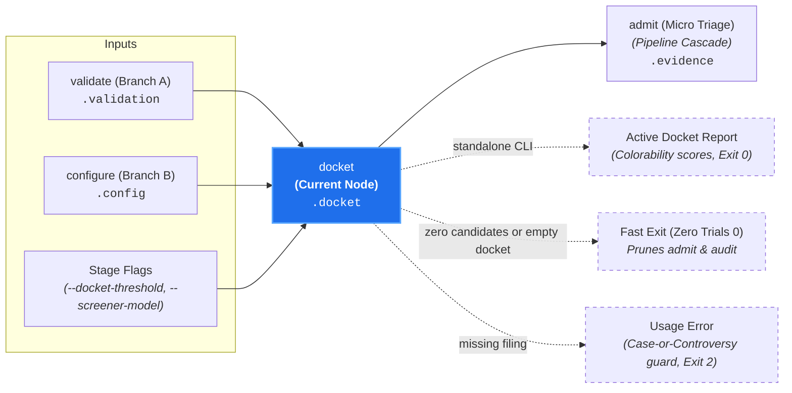

# Macro Jurisdiction Triage (`docket`)

**Status:** Authoritative Architectural Standard  
**Core Domain Engine:** Caseload Domain Engine  
**Driving Adapter:** CLI (`docket`)

---

## 1. Domain Concept & Role (`core`)

`docket` performs **Macro Triage: Subject-Matter Jurisdiction Screening** across all candidate canons. In the court clerkship taxonomy, it represents the clerk reviewing petitions against the court's subject-matter jurisdiction to determine whether a claim is legally colorable before opening a formal case file on the active docket.

- **Imperative Verb:** `docket`
- **Court Clerkship Role:** Macro triage establishing subject-matter jurisdiction.
- **Metric Pair:** `colorability_score` (number [0.0, 1.0]) and `colorability_summary` (string rationale).
- **Core Question:** *"Does this candidate canon have a colorable claim of jurisdiction over this PR as a whole?"*

---

## 2. Dependencies & Prerequisites (`core`)



- **Direct Prerequisites:**
  - `validate` (Branch A: validated candidate canons in `caseload.discovery.candidate_canons` and `caseload.validation`).
  - `configure` (Branch B: resolved provider credentials and model specifiers in `caseload.config`).
- **Transitive Prerequisites:** `intake`, `discover`.
- **The Case or Controversy Invariant:** `docket` evaluates the subject-matter jurisdiction of candidate canons *as applied to a change*. It strictly requires an underlying filing (`caseload.intake` populated from target paths, `-`, `--diff`, `--all-targets`, PR metadata, or an incoming `--caseload`). Invocations attempting to docket without a concrete filing (e.g. `canon-clerk docket --all-canons` without targets or an abstract corpus-only caseload from `validate --all-canons`) fail fast with exit code `2`: a court cannot open an active docket of cases without a complaint or controversy.
- **Pruned from Execution:** `probe`, `apprise`, downstream adjudication nodes (`admit`, `audit`).

---

## 3. Caseload Contribution & Data Plane Constraints

### Caseload Delta
`docket` populates the `.docket` namespace on the cumulative `Caseload` envelope with macro subject-matter jurisdiction assessments:

- **Per-Canon Colorability Assessments (`cases`):** A deterministic map keyed by candidate canon identifier. Each assessment records the model's `colorability_summary` (rationale justifying whether jurisdiction applies to the filing), continuous `colorability_score` in `[0.0, 1.0]`, and deterministically derived `colorability_status` (`"docketed"` when `colorability_score >= threshold`, otherwise `"dismissed"`).
- **Active Docket (`active_docket`):** Stably sorted list of canon identifiers whose `colorability_status` is `"docketed"`, establishing the active cases that proceed to micro evidentiary screening (`admit`).
- **Diagnostic Anomalies (`anomalies`):** Optional manifest recording any non-fatal screening anomalies encountered during macro triage (omitted when empty).

### Data Plane & Domain Short-Circuit Invariants
1. **Deterministic Status Derivation:** The screener model emits only `colorability_summary` and `colorability_score`; the domain engine deterministically computes `colorability_status` and sorted `active_docket` membership against `--docket-threshold` (default `0.5`).
2. **Empty Candidate Short-Circuit:** If `.discovery.candidate_canons` is empty, the engine attaches an empty `.docket` record (`cases: {}`, `active_docket: []`) and terminates immediately with exit code `0`, dispatching zero model calls and requiring zero provider credentials.
3. **Empty Docket Short-Circuit:** If `active_docket` is empty (`[]`), the engine attaches the populated `.docket` record and halts downstream cascade execution immediately with exit code `0`, scheduling zero `admit` or `audit` calls.

---

## 4. Process & Domain Logic (`core`)

1. **Case-or-Controversy Verification & Candidate Canon Early Exit:**  
   Verifies that an underlying filing is present on `caseload.intake` alongside resolved discovery scope in `caseload.discovery`. If `candidate_canons` is empty after evaluating an explicit filing scope, attaches an empty `.docket` record (`cases: {}`, `active_docket: []`) and short-circuits immediately with exit code `0`.
2. **Aggregate Single-Turn Screening (`gemini-flash-lite-latest`):**  
   Evaluates **all candidate canons against the filing context in a single aggregate prompt turn** using `caseload.config.screener_model`.
3. **Constrained Decoding Schema (Domain-Indirected, Reason-First):**  
   Enforces a constant-size structured JSON wire array pairing each `canon_path` with `colorability_summary` generated before `colorability_score`:
   ```json
   {
     "cases": [
       {
         "canon_path": ".canons/cli/cli-flags-kebab-case.md",
         "colorability_summary": "PR introduces new command flags in CLI.",
         "colorability_score": 0.95
       }
     ]
   }
   ```
   Generating `colorability_summary` before `colorability_score` provides a chain-of-thought scratchpad, anchoring reproducible probability distributions, while domain-indirected array items keep the wire grammar independent of candidate canon count. Each candidate canon must appear once without unknown or duplicate identifiers before folding into `.docket.cases`.
4. **Deterministic Threshold Gating (`colorability_score >= --docket-threshold`, default: `0.5`):**  
   The core domain engine deterministically evaluates the continuous score against the threshold to assign `colorability_status`:
   - Canons scoring $\ge 0.5$ establish jurisdiction, are marked `colorability_status: "docketed"`, and are entered into `active_docket`.
   - Canons scoring $< 0.5$ are marked `colorability_status: "dismissed"`.
5. **Latency & Token Economy:** Executes in ~400ms, expending only ~1,200 tokens across 20+ candidate canons.

---

## 5. Driving Adapter: CLI

The CLI exposes `docket` as an imperative subcommand:

```bash
# 1. Run telescoping pipeline stopping at docket from a unified diff on stdin:
git diff origin/main | canon-clerk docket --diff -

# 2. Screen explicit target paths or newline-delimited stdin paths:
canon-clerk docket src/cli src/docket
git diff origin/main --name-only | canon-clerk docket -

# 3. Execute macro triage against an upstream Caseload:
canon-clerk docket --caseload caseload-3.json --json

# 4. Emit tab-separated compact records for shell scripting:
git diff origin/main | canon-clerk docket --diff - --format compact
```

### Missing Input Source & Case-or-Controversy Guard
`canon-clerk docket` requires an underlying filing (positional `TARGETS`, newline-delimited target paths via `-`, `--diff <PATH|->`, `--all-targets`, pull request metadata flags, or an incoming `--caseload <PATH|->` with `.intake` populated). Naked invocations or canon-only invocations lacking a concrete filing (e.g. `canon-clerk docket --all-canons` without target paths or diff, or an abstract corpus-only `--caseload` without `.intake`) fail fast with exit code `2` (Usage Error) and print actionable remediation guidance:
```text
error: No filing source provided for `docket`.
  Hint: Pipe a diff via standard input ('--diff -'), specify target paths ('src/...', '-', '--all-targets'),
        or pass an upstream caseload ('--caseload <PATH|->') with '.intake' populated.
```
Conversely, when an explicitly designated stream yields zero changes or `discover` matches zero candidate canons (e.g. `git diff origin/main | canon-clerk docket --diff -` on an up-to-date branch), the command attaches an empty `.docket` record (`cases: {}`, `active_docket: []`) and short-circuits cleanly with exit code `0` without invoking `validate` or requiring provider credentials (`GEMINI_API_KEY`).

### CLI Flags & Environment
- `TARGETS` / `-` (Positional): Target file paths, directories, globs, or `-` to read newline-delimited target paths from standard input.
- `--diff <PATH|->`, `--all-targets`, `--intent <TEXT>`, `--pr-title <TEXT>`, `--pr-body <TEXT>`, `--pr-body-file <PATH>`: Shared filing source and metadata flags.
- `--all-canons`, `--canon <PATH|GLOB>`: Shared canon selection scope flags (evaluated against the underlying filing).
- `--docket-threshold <FLOAT>` (fallback env: `CANON_CLERK_DOCKET_THRESHOLD`): Subject-matter jurisdiction screening threshold in `[0.0, 1.0]` (default: `0.5`). Ambiguous unqualified `--threshold` and out-of-closure stage threshold flags (`--apprise-threshold`, `--admit-threshold`) are rejected with exit code `2` and guidance pointing to `--docket-threshold`.
- `--screener-model <MODEL>` (fallback env: `CANON_CLERK_SCREENER_MODEL`), `--auditor-model <MODEL>` (fallback env: `CANON_CLERK_AUDITOR_MODEL`), `--reasoning-budget <TOKENS>` (fallback env: `CANON_CLERK_REASONING_BUDGET`), `--gemini-api-key <KEY>` (fallback env: `GEMINI_API_KEY`): Shared model configuration and credential options (resolved JIT only when validated candidate canons exist).
- `-v` / `--verbose` (fallback env: `CANON_CLERK_VERBOSE`), `--log-file <PATH>` (fallback env: `CANON_CLERK_LOG_FILE`): Global diagnostic progress and structured JSONL telemetry stream options.
- `--format <stylish|json|compact>`: Output presentation format (default: `stylish`).
- `--caseload <PATH|->`: Ingests upstream `Caseload` JSON from file or `-` for standard input.
- `--output-caseload <PATH>`: Writes cumulative `Caseload` JSON to disk independently of terminal `stdout`.
- `--json`: Emits enriched `Caseload` JSON to `stdout` (equivalent to `--format json`).

### CLI Output Modes
- **`stylish` (Default):** Renders the **Pipeline Funnel Provenance Receipt** followed by the Active Docket summary listing docketed cases (`active_docket`) alongside their `colorability_summary` rationales (including an explicit empty-docket watermark when zero cases are colorable).
- **`compact`:** Emits unadorned tab-separated `<canon>\t<status>\t<score>\t<summary>` records (one candidate canon per line in deterministic lexicographical order).
- **`json` / `--json`:** Emits the cumulative `Caseload` JSON envelope containing the populated `.docket` container.

### CLI Exit Codes
- **0:** Candidate canons screened and active docket established (including clean zero-change, zero-candidate, and empty-docket short-circuits).
- **1:** Candidate canon validation failure (`validation.has_errors` is `true`, evaluated before checking `GEMINI_API_KEY`) or local workspace I/O runtime error.
- **2:** Usage error, missing filing source or Case-or-Controversy guard violation, invalid or out-of-range `--docket-threshold` / `CANON_CLERK_DOCKET_THRESHOLD`, rejected `--threshold` / `--apprise-threshold` / `--admit-threshold` flag, conflicting `stdin` operands, missing API credentials, or model provider error.
