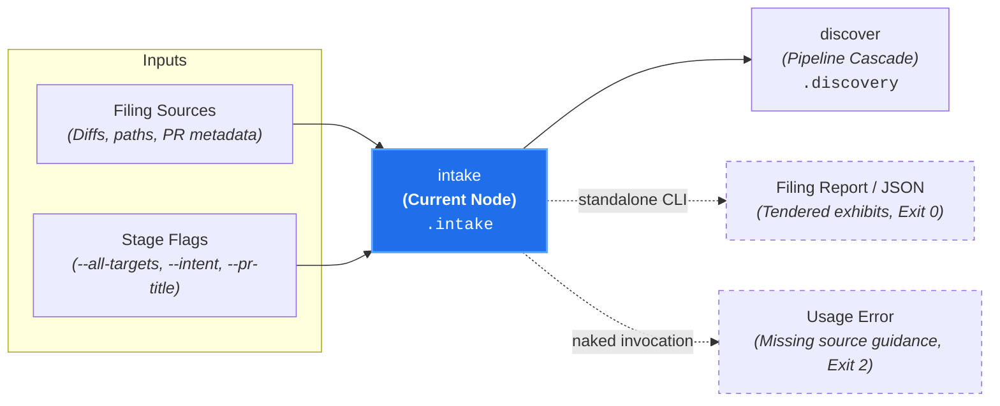

# Filing Intake (`intake`)

**Status:** Authoritative Architectural Standard  
**Core Domain Engine:** Caseload Domain Engine  
**Driving Adapter:** CLI (`intake`)

---

## 1. Domain Concept & Role (`core`)

`intake` serves as the **Universal Front Door** of the Canon Clerk evaluation pipeline. In the court clerkship taxonomy, it represents the formal clerk receiving in-flight filings at the intake counter. It catalogs the initial **tendered exhibits** (literal metadata such as `pr_title`, `pr_body`, `commit_messages`, `linked_issues`, and unified patch streams) alongside **exhibit discovery directives** (explicit file paths, directory pointers for recursive traversal, and glob patterns) into standardized, immutable structures on the `Caseload`.

- **Imperative Verb:** `intake`
- **Court Clerkship Role:** Filing intake, document receipt, and cataloging of tendered exhibits.
- **Metric Pair:** N/A (Deterministic filing track).

---

## 2. Dependencies & Prerequisites (`core`)



- **Direct Prerequisites:** None (Root node of Branch A).
- **Transitive Prerequisites:** None.
- **Incoming Caseload:** May accept an empty or existing `Caseload` record.
- **Subprocess Isolation:** **Zero child-process VCS execution.** The core domain engine does not run `git` subprocesses internally; driving adapters feed diffs and target paths directly via domain interfaces.

---

## 3. Caseload Contribution & Data Plane Constraints

### Caseload Delta
`intake` populates the `.intake` namespace on the cumulative `Caseload` envelope with three categories of filing records:

- **Tendered Metadata Exhibits:** Literal pull request or commit context (`pr_title`, `pr_body`), prospective architectural design `intent`, and optional `linked_issues` context (issue `number`, `title`, `author`, `labels`, `body`, and canonical `url`, excluding issue comments and reaction trails per `SPEC.md` §3.4).
- **Target Scope & Discovery Directives:** Normalized target scope (`"targeted"` vs. `"all-targets"`), explicit target path, directory, or glob pattern directives (`target_paths`) queued for downstream materialization in `discover`, and optional `workspace_state` (`"head"` vs. `"base"`, defaulting to `"head"` and omitted when `"head"`) declaring whether the checked-out workspace on disk already contains the diff's post-patch files (`"head"`) or represents the pre-patch base branch (`"base"`, as under GitHub Actions `pull_request_target`).
- **Parsed File Exhibits (`diffs`):** In-flight code modifications parsed from unified diff streams into immutable `FileArtifact` records keyed by repository-relative POSIX path. Each artifact captures file change `status` (`"added"`, `"modified"`, `"deleted"`, `"renamed"`, `"copied"`, `"unchanged"`), `previous_path` (when renamed or copied), insertion and deletion counts (`lines_added`, `lines_deleted`), unified hunk `patch` text, and explicit omission rationales.

### Data Plane Invariants
1. **Envelope Immutability:** Executing `intake` enriches `.intake` without mutating or discarding any pre-existing sections on an incoming `Caseload`.
2. **Deterministic Serialization:** Map keys (`diffs`) and directive lists (`target_paths`) are maintained in deterministic lexicographical order so identical filings serialize to bit-for-bit identical `Caseload` JSON.
3. **Explicit Omission Semantics:** When a `FileArtifact` omits its unified `patch` (e.g. `"unchanged"` for 100%-similarity renames, `"binary"`, `"oversized"`, `"not_requested"`) or full file `content` (`"not_requested"`, `"binary"`, `"oversized"`, `"deleted"`), it records an explicit omission reason (`patch_omission_reason`, `content_omission_reason`) rather than leaving absence ambiguous.

---

## 4. Process & Domain Logic (`core`)

1. **Input Source Resolution & Missing Source Invariant:** Requires an explicitly designated input source: positional target paths, unified diff (`--diff <path|->`), GitHub pull request (`--github-pr [<number>]`), stdin token stream (`-`), prospective `--intent`, `--all-targets`, PR metadata (`--pr-title`, `--pr-body`, `--pr-body-file`, `--linked-issue`), or an incoming `--caseload`.
   - **Missing Source Guard (Naked Invocation):** Invoking `canon-clerk intake` with zero sources fails fast with exit code `2` (Usage Error) and prints actionable remediation guidance. The CLI never silently hangs waiting for input on a TTY.
   - **Empty Stream Outcome (Legitimate No-op):** An explicitly designated source that yields zero changes (e.g. `git diff origin/main | canon-clerk intake --diff -` on a clean branch) successfully produces an empty filing (`diffs: {}`, `target_paths: []`) and exits `0`.
2. **Tendered Exhibits Cataloging:** Captures raw literal exhibits directly from the invocation context:
   - Metadata exhibits: `pr_title`, `pr_body`, design `intent`, and any `linked_issues`.
   - File exhibits: Unified patch hunks parsed into immutable `FileArtifact` objects (`lines_added`, `lines_deleted`, `patch`, `status`, `previous_path`, and omission reasons).
3. **Exhibit Discovery Directives Cataloging (Pure In-Memory Handoff):** When file paths, directory pointers, or glob patterns are provided, `intake` normalizes and catalogs them in `target_paths` without probing or statting the workspace filesystem. Workspace file materialization and existence verification belong strictly to `discover`, keeping `intake` 100% pure in memory and supporting prospective (not-yet-existing) target paths alongside `--intent`.
4. **Target Scope Normalization:** When `--all-targets` (`all_targets: true`) is passed, sets `scope: "all-targets"` to instruct `discover` to materialize the entire repository codebase as target exhibits; otherwise defaults to `scope: "targeted"`. (Note the crucial distinction: `--all-targets` operates on the *subject-matter codebase*, whereas `--all-canons` in `discover` operates on the *governing rule packs*).

---

## 5. Driving Adapter: CLI

The CLI exposes `intake` as an imperative subcommand that adapts terminal arguments and POSIX streams:

```bash
# Ingest via direct target paths:
canon-clerk intake src/main.rs
canon-clerk intake 'src/**/*.ts'

# Ingest via prospective design intent:
canon-clerk intake --intent "Implement round-robin auth provider rotation" src/auth

# Ingest via newline-delimited stdin path tokens:
git diff origin/main --name-only | canon-clerk intake -

# Ingest via unified diff stream:
git diff origin/main | canon-clerk intake --diff -

# Ingest natively from a GitHub pull request (Actions runner or explicit PR number):
canon-clerk intake --github-pr
canon-clerk intake --github-pr 42 --github-repo PAIR-code/canon-clerk

# Ingest all repository files as target artifacts:
canon-clerk intake --all-targets

# Ingest upstream caseload and attach intake:
canon-clerk intake --diff pr-42.patch --caseload existing.json --json
```

### CLI Flags & Environment
- `-` (Positional): Reads newline-delimited paths from stdin.
- `--diff <path|->`: Ingests unified diff patch from file or stdin (mutually exclusive with `--github-pr`).
- `--github-pr [<number>]`: Opt-in native GitHub pull request filing source (mutually exclusive with `--diff`; see [`../github.md` §3](../github.md#3-pull-request-diff--metadata-ingestion---github-pr)). Bare `--github-pr` extracts `pull_request.number`, `title`, `body`, and `head.sha` from `$GITHUB_EVENT_PATH`; `--github-pr <number>` fetches PR metadata via `GET /repos/{owner}/{repo}/pulls/{number}`. Both modes fetch the unified diff via `Accept: application/vnd.github.v3.diff` using `GITHUB_TOKEN` / `GH_TOKEN` and `GITHUB_API_URL`. Explicit `--pr-title`, `--pr-body`, and `--pr-body-file` override fetched metadata (`CLI flag > event/API metadata`).
- `--github-repo <owner/repo>`: Target GitHub repository slug (fallback env: `GITHUB_REPOSITORY`), shared across `--github-pr` ingestion and `--publish-github-check`.
- `--workspace-state <head|base>`: Declares whether the workspace on disk is already post-patch (`head`, default) or pre-patch (`base`, e.g., `pull_request_target` CI checkouts), instructing downstream stages to materialize `references:` files by applying `.intake.diffs` in memory onto base-branch files. When `--github-pr` is active and `--workspace-state` is omitted, defaults to `base` **iff** `GITHUB_EVENT_NAME == "pull_request_target"` (otherwise `head`); explicit `--workspace-state` always overrides.
- `--intent <text>`: Ingests prospective design intent or plan description.
- `--all-targets`: Ingests all repository files as target artifacts (used for full-repo sweeps).
- `--pr-title <text>`: Ingests PR title text (overrides title fetched by `--github-pr`).
- `--pr-body <text>` / `--pr-body-file <path>`: Ingests PR description (overrides body fetched by `--github-pr`).
- `--linked-issue <path|->`: Repeatable flag ingesting one or more linked issue records from JSON files or `-` for stdin (governed by the single-stdin guard). Strictly JSON (no raw Markdown fallback); accepts a single object or JSON array in native `LinkedIssueContext`, `gh issue view --json`, or GitHub REST API issue shape while ignoring comments/reactions (`SPEC.md` §3.4). Explicit `--linked-issue` flags override linked issues auto-fetched by `--github-pr` (`CLI flag > event/API metadata`).
- `--caseload <path|->`: Ingests existing Caseload JSON.
- `--output-caseload <path>`: Writes cumulative `Caseload` JSON to disk independently of terminal stdout.
- `--json`: Emits enriched Caseload JSON to stdout.

### CLI Exit Codes
- **0:** Successful intake (including an empty filing from a clean diff stream).
- **2:** Usage error, missing input source (naked invocation), conflicting `--diff` and `--github-pr`, conflicting multiple `-` stdin operands, unreadable flag input file (`--diff`, `--pr-body-file`, `--linked-issue`, `--caseload`), missing/invalid GitHub token, repository, PR number, or `$GITHUB_EVENT_PATH` payload, GitHub API fetch failure, or corrupted diff/JSON stream.
