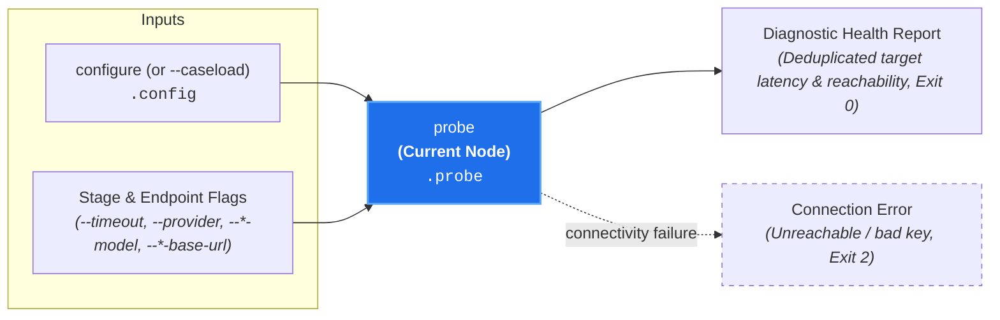

# Diagnostic Health Check (`probe`)

**Status:** Authoritative Architectural Standard  
**Core Domain Engine:** Caseload Domain Engine  
**Driving Adapter:** CLI (`probe`)

---

## 1. Domain Concept & Role (`core` / `configuration`)

`probe` serves as the **Diagnostic Network Health Check** for configured model endpoints. In the court clerkship taxonomy, it represents testing the teleconferencing equipment and audio-visual communication links before a remote hearing begins.

- **Imperative Verb:** `probe`
- **Court Clerkship Role:** Live connectivity and single-roundtrip latency verification across deduplicated configured model targets.
- **Metric Pair:** N/A (Live connectivity probe; reports per-target `status` and `latency_ms`).

---

## 2. Dependencies & Prerequisites (`core`)



- **Direct Prerequisites:** `configure` (requires resolved per-node model bindings in `caseload.config.nodes` and verified provider credentials).
- **Transitive Prerequisites:** None.
- **Pruned from Cascades:** `probe` is **never executed during review cascades** (`canon-clerk apprise`, `docket`, `admit`, `vet`, `audit`). This ensures evaluation runs never incur redundant health-check roundtrips prior to screening.

---

## 3. Caseload Contribution & Data Plane Constraints

### Caseload Delta
`probe` populates the `.probe` namespace on the cumulative `Caseload` envelope with live diagnostic health records across the deduplicated model targets bound in `.config.nodes`:

- **Deduplicated Probe Targets (`targets`):** Ordered list of endpoint probe records grouped by unique `(model, thinking_level, reasoning_budget)` tuple in canonical DAG stage encounter order (`apprise` $\to$ `docket` $\to$ `admit` $\to$ `vet` $\to$ `audit`). Each target record captures:
  - **Configured Model (`model`):** Canonical `<provider>:<model>` specifier probed.
  - **Bound Heuristic Nodes (`nodes`):** Ordered list of provisioned heuristic nodes sharing this target (for example, `["apprise", "docket", "admit", "vet"]` or `["audit"]`).
  - **Extended Thinking Controls (`thinking_level` / `reasoning_budget`):** Optional thinking configuration forwarded on the probe when explicitly configured on a `Generator` target (omitted when unset).
  - **Health Status (`status`):** `"ok"` when reachable and authenticated, or `"error"` on timeout, authentication rejection, or HTTP error.
  - **Roundtrip Latency (`latency_ms`):** Measured single-shot roundtrip latency in milliseconds.
  - **Resolved Upstream Model (`resolved_model`):** Concrete model identifier reported by the upstream provider when available (omitted when a transport failure occurs prior to upstream model resolution).
  - **Diagnostic Error (`error`):** Optional actionable error message and remediation hint when `status` is `"error"` (omitted when `"ok"`).

### Data Plane & Diagnostic Invariants
1. **Cascade Isolation:** `.probe` is an auxiliary diagnostic leaf namespace; because `probe` is pruned from all evaluation cascades (`apprise`, `docket`, `admit`, `vet`, `audit`), substantive review runs never populate or depend on `.probe`.
2. **Deduplicated Target Grouping:** Nodes sharing identical `(model, thinking_level, reasoning_budget)` bindings coalesce into a single probe target in canonical stage encounter order—issuing two concurrent probes on the default `google` configuration (`google:gemini-decision-1` for `[apprise, docket, admit, vet]` and `google:gemini-4-carbon` for `[audit]`) and a single probe on `--provider typesafe` (`typesafe:jev-latest` for `[apprise, docket, admit, vet]`) rather than firing five redundant requests at the same endpoint.
3. **Non-Throwing Diagnostic Capture:** Endpoint timeouts, HTTP 4xx/5xx responses, and authentication rejections are captured inside each target's health record (`status: "error"`, `error: "<reason>"`) on `.probe` and written to `stdout` / `--output-caseload` before the CLI adapter maps any unhealthy target to exit code `2`.
4. **Single-Shot Diagnostic Isolation:** Unlike heuristic evaluation stages, `probe` executes strictly single-shot (`0` retries), bypasses per-origin rate-limit cooldown gates, and rejects heuristic retry flags (`--max-retries`, `--max-backoff-ms`) with exit code `2` so health checks immediately measure raw single-roundtrip reachability and latency within `--timeout` ([`../transport.md` §5](../transport.md#5-single-shot-diagnostic-probe-isolation)).

---

## 4. Process & Domain Logic (`configuration`)

1. **Target Deduplication & Unified Connection Parity:** Reads provisioned node bindings from `caseload.config.nodes` in canonical DAG order, groups identical `(model, thinking_level, reasoning_budget)` tuples while preserving each target's ordered `nodes` list, and resolves each referenced `<provider>` profile against the exact same resolved provider connection map ([`../providers.md` §3 & §5](../providers.md#3-built-in--custom-provider-profiles), [`../transport.md` §2](../transport.md#2-persistent-reactor--connection-pool-lifecycle)) used by heuristic execution stages so `canon-clerk probe` and evaluation runs never drift.
2. **Protocol-Driven Ping Assembly:** Constructs minimal probe requests matched to each target profile's wire protocol and capability ([`../transport.md` §2](../transport.md#2-persistent-reactor--connection-pool-lifecycle))—a single-question `noul` decision ping for `gemini` and `systemone` `Discriminator` targets, and a lightweight `:generateContent` ping for `gemini` `Generator` targets (defaulting to `thinkingLevel: "LOW"` with `includeThoughts: false` on Gemini 4 models when unspecified, or honoring the target's explicit `thinking_level` / `reasoning_budget`)—verifying authentication, model resolution, and network reachability within the `5000ms` default probe ceiling.
3. **Concurrent Multi-Target Probe:** Dispatches all deduplicated probe targets concurrently in parallel, measuring roundtrip latency (`latency_ms`) and capturing each provider's concrete `resolved_model` identifier while preserving deterministic target ordering in `.probe.targets`.
4. **Diagnostic Record:** Attaches `.probe` to the `Caseload` envelope; the run is healthy if and only if every target in `.probe.targets` reports `status: "ok"`.

---

## 5. Driving Adapter: CLI

The CLI exposes `probe` as an imperative subcommand:

```bash
# 1. Probe default Google discriminator + generator targets concurrently:
canon-clerk probe

# 2. Probe TypeSafe Jev or a custom local-dev systemone profile from config.json:
canon-clerk probe --provider typesafe
canon-clerk probe --provider local-dev

# 3. Probe hybrid screening alongside Gemini 4 Carbon audit:
canon-clerk probe --provider typesafe --audit-model google:gemini-4-carbon

# 4. Emit structured Caseload JSON probe record:
canon-clerk probe --json
```

### CLI Flags & Options
- `--timeout <MS>` (fallback env: `CANON_CLERK_PROBE_TIMEOUT_MS`): Per-target request timeout in milliseconds (default: `5000ms`; `0` is rejected with exit code `2`). Isolated from `CANON_CLERK_TIMEOUT_MS` / `defaults.timeoutMs` ([`../transport.md` §6](../transport.md#domain-classified-timeouts--shared-cli-transport-controls)) so long local evaluation timeouts do not stall diagnostic health checks.
- **Shared Provider, Model, Credential, Endpoint & Thinking Controls:** Accepts `--provider`, all five `--<node>-model` overrides, `--thinking-level` / `--reasoning-budget`, and built-in/custom API-key and `baseUrl` overrides per [`../providers.md` §5](../providers.md#5-shared-provider-credential-endpoint--thinking-controls).
- `--format <stylish|json|compact>`: Output presentation format (default: `stylish`).
- `--caseload <PATH|->`: Ingests upstream `Caseload`.
- `--output-caseload <PATH>`: Writes cumulative `Caseload` JSON to disk independently of `stdout`.
- `--json`: Emits enriched `Caseload` JSON to `stdout`.

### CLI Output Modes
- **`stylish` (Default):** Renders `Endpoint Health Check (HEALTHY):` or `Endpoint Health Check (FAILED):` followed by one status line per deduplicated target displaying its configured `<provider>:<model>`, bound `[nodes]`, status, `latency_ms`, `resolved_model`, and error reason on failure.
- **`compact`:** Emits unadorned tab-separated `<model>\t<nodes_csv>\t<status>\t<latency_ms>ms\t<resolved_model_or_->` records (appending `\t<error>` when `status` is `"error"`), one line per deduplicated target in canonical encounter order.
- **`json` / `--json`:** Emits the cumulative `Caseload` JSON envelope with `.config` and `.probe` populated.

### CLI Exit Codes
- **0:** All deduplicated targets in `.probe.targets` are reachable, authenticated, and responsive (`status: "ok"`).
- **2:** Missing provider credentials, invalid configuration or `--timeout` options, rejected `--max-retries` / `--max-backoff-ms` flags, or any target probe failed (`401`/`403`, `404`, `429`, `5xx`, or request timeout).
