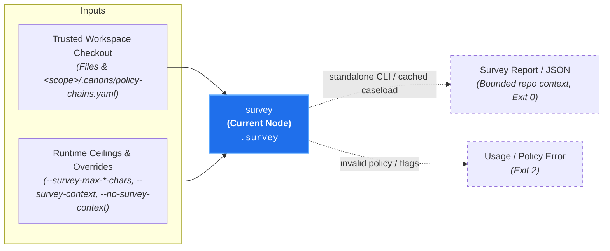

# Repository Context Survey (`survey`)

**Status:** Authoritative Architectural Standard  
**Core Domain Engine:** Caseload Domain Engine  
**Driving Adapter:** CLI (`survey`)

---

## 1. Domain Concept & Role (`core`)

`survey` serves as the **Repository Identity Cataloger** (Branch C: Repository Context Track) of the Canon Clerk evaluation pipeline. It deterministically gathers a bounded, workspace-rooted snapshot of **what the repository is**—its top-level documentation, manifests, and declared identity files—onto `.survey` on the cumulative `Caseload` envelope.

Downstream Apprisal Track stages (such as `classify` and `advise`) consume `.survey` to ground `in_scope` classification and pre-flight advisory guidance without re-probing the local workspace checkout during `--caseload` replays or violating `intake`'s pure-in-memory invariant.

- **Imperative Verb:** `survey`
- **Court Clerkship Role:** Repository identity survey and bounded contextualization (Branch C).
- **Metric Pair:** N/A (Deterministic, 100% local, 0 tokens, 0 credentials).

---

## 2. Dependencies & Prerequisites (`core`)



- **Direct Prerequisites:** None (Root node of Branch C: Repository Context Track).
- **Transitive Prerequisites:** None (Independent of `intake`, `.canon.md` rule packs, `discover`, `validate`, and `configure`).
- **Standalone Closure:** `{survey}` — supports naked invocation (`canon-clerk survey`) without `--intent`, diffs, or a `.canons/` directory (including greenfield repositories).
- **Adjudication Track Isolation:** Completely pruned from all [Adjudication Track](../overview.md#2-dag-topology-feeder-branches--adjudication-track--apprisal-track) closures as well as `intake`, `discover`, `validate`, `configure`, `probe`, and `apprise`.
- **Reusable Across Filings:** Because repository identity changes per commit/branch rather than per issue or PR, `canon-clerk survey --json` can be cached once and supplied to multiple downstream runs via `--caseload`.

---

## 3. Caseload Contribution & Data Plane Constraints

### Caseload Delta
`survey` populates the `.survey` namespace on the cumulative `Caseload` envelope with the following JSON wire fields:

- **`policy_files` (sorted array of strings, omitted when empty):** Stably sorted workspace-relative POSIX paths of direct `<scope>/.canons/policy-chains.yaml` files loaded from the trusted checkout (empty when none exist or when overridden by `--survey-context` / `--no-survey-context`).
- **`max_file_chars` (positive integer):** Effective per-file character ceiling applied during materialization (default: `4000`).
- **`max_total_chars` (positive integer):** Effective aggregate character ceiling across all materialized survey files (default: `12000`).
- **`total_chars` (non-negative integer):** Sum of `chars` across all materialized entries in `files` (`<= max_total_chars`).
- **`files` (lexicographically ordered object keyed by workspace-relative POSIX path):** Materialized UTF-8 repository identity file records, each containing:
  - `content` (string): Materialized UTF-8 text (truncated deterministically on a Unicode scalar boundary if exceeding the per-file or remaining aggregate budget).
  - `chars` (non-negative integer): Unicode scalar character count of the materialized `content`.
  - `original_chars` (non-negative integer): Unicode scalar character count of the full file before truncation.
  - `truncated` (boolean): `true` when `chars < original_chars`, `false` otherwise.
- **`omitted` (lexicographically ordered object keyed by workspace-relative POSIX path, omitted when empty):** Candidate matched files excluded from `files`, mapped to explicit machine-readable omission reason strings:
  - `"budget_exceeded"` — aggregate `max_total_chars` budget was exhausted by lexicographically earlier files.
  - `"binary"` — file contained NUL bytes (`0x00`) or invalid UTF-8 sequences.
  - `"outside_workspace"` — symlink resolved outside the canonical workspace root (or could not be canonically verified within the workspace root).

### Data Plane Invariants
1. **Envelope Immutability:** Executing `survey` enriches `.survey` without mutating or discarding any pre-existing sections on an incoming `Caseload`.
2. **Bit-for-Bit Determinism:** Both `files` and `omitted` serialize in strict lexicographical POSIX path order, and `policy_files` is stably sorted, so identical workspaces produce byte-for-byte identical `Caseload` JSON.
3. **Greenfield / Zero-Match Hygiene:** When zero files match (or `- deny: all` / `--no-survey-context` is active), `survey` populates an empty `.survey` record (`files: {}`, `total_chars: 0`, `omitted` omitted) and exits `0`.
4. **Trusted-Checkout Boundary:** `survey` reads strictly from the trusted workspace checkout on disk and never overlays untrusted patches from `.intake.diffs`.

---

## 4. Process & Domain Logic (`core`)

1. **Workspace Policy & Built-In Default Stack (`survey-context-chain:`):**
   - Consumes the shared workspace policy engine ([`../policy.md`](../policy.md), `SPEC.md` §7) to discover and validate direct `<scope>/.canons/policy-chains.yaml` files on disk (emitting non-fatal warnings for nested `policy-chains.yaml` inside `.canons/` subdirectories and failing fast with exit code `2` on invalid policy files).
   - Evaluates candidate workspace files (excluding default noise directories such as `.git`, `.bare`, `node_modules`, `dist`, `.turbo`, `target`, and `.canons/**`) nearest-scope-first across:
     `[child <scope>/.canons/policy-chains.yaml -> parent ... -> root .canons/policy-chains.yaml -> built-in root default allowlist -> implicit deny]`.
   - **Built-In Root Default Stack:**
     `README.md`, `README.txt`, `README`, `llms.txt`, `Cargo.toml`, `package.json`, `pyproject.toml`, `go.mod` (matched strictly at repository root).
   - Absent `.canons/policy-chains.yaml` files fall back cleanly to the built-in root default stack.
2. **Subordinate CLI Overrides:**
   - `--no-survey-context`: Skips context file collection and produces an empty `.survey` record (`files: {}`, `total_chars: 0`).
   - Repeatable `--survey-context <GLOB>`: Replaces workspace `survey-context-chain:` rules and built-in defaults with the supplied workspace-relative globs (validated fail-fast for empty patterns, invalid glob syntax, leading `/`, or `../` traversal).
3. **Workspace Containment & Symlink Verification:**
   - Every matched file path is verified against the canonicalized workspace root on disk. Symlinks resolving outside the workspace root (or dangling symlinks whose canonical target cannot be verified inside the root) are never read and are recorded in `.survey.omitted` with reason `"outside_workspace"`.
4. **Binary Detection & Deterministic Character Ceilings:**
   - Matched files are processed in strict lexicographical POSIX path order.
   - Files containing NUL bytes (`0x00`) or invalid UTF-8 are recorded in `.survey.omitted` as `"binary"`.
   - The remaining aggregate budget is $\max(0, \text{max\_total\_chars} - \text{total\_chars})$. If zero characters remain, the file is recorded in `.survey.omitted` as `"budget_exceeded"`.
   - Otherwise, the file is capped at $\min(\text{max\_file\_chars}, \text{remaining})$ Unicode scalar values. If `original_chars` exceeds that cap, `content` is truncated to the leading Unicode scalar values up to the cap and `truncated: true` is recorded.

---

## 5. Driving Adapter: CLI

```bash
# Run naked using <scope>/.canons/policy-chains.yaml + built-in root defaults:
canon-clerk survey

# Override character ceilings (defaults: 4000 per-file, 12000 total):
canon-clerk survey --survey-max-file-chars 2000 --survey-max-total-chars 8000

# Override policy chains and defaults with explicit workspace-relative globs:
canon-clerk survey --survey-context 'README.md' --survey-context 'docs/architecture.md'

# Produce an explicit empty survey:
canon-clerk survey --no-survey-context --json

# Cache survey output and inspect in compact TSV or Caseload JSON format:
canon-clerk survey --format compact
canon-clerk survey --output-caseload survey-caseload.json --json

# Fast-forward a pre-populated .survey caseload (or override with explicit --survey-* flags):
canon-clerk survey --caseload survey-caseload.json --json
```

### CLI Flags & Environment
- `--survey-max-file-chars <COUNT>`: Maximum materialized characters per file (fallback env: `CANON_CLERK_SURVEY_MAX_FILE_CHARS`; default: `4000`; positive integer `>= 1`).
- `--survey-max-total-chars <COUNT>`: Maximum aggregate materialized characters across all surveyed files (fallback env: `CANON_CLERK_SURVEY_MAX_TOTAL_CHARS`; default: `12000`; positive integer `>= 1`).
- `--survey-context <GLOB>`: Repeatable workspace-relative glob overriding `survey-context-chain:` and built-in defaults (mutually exclusive with `--no-survey-context`).
- `--no-survey-context`: Explicitly disable repository-identity context collection (mutually exclusive with `--survey-context`).
- `--caseload <PATH|->`: Ingests existing Caseload JSON. Fast-forwards pre-populated `.survey` without re-reading disk unless explicit `--survey-context`, `--no-survey-context`, `--survey-max-file-chars`, or `--survey-max-total-chars` overrides are passed.
- `--output-caseload <PATH>`: Writes cumulative `Caseload` JSON to disk independently of stdout.
- `--format <stylish|json|compact>` / `--json`: Selects human-readable stylish summary (default), cumulative Caseload JSON, or tab-separated compact lines.
- `-v` / `--verbose`, `--log-file <PATH>`: Global logging and out-of-band JSONL telemetry (`StageStart` / `StageFinish` with `stage: "survey"` and `PipelineFinish` with `total_tokens: 0`).

### Stage-Prefixed Flag Scoping
`--survey-context`, `--no-survey-context`, `--survey-max-file-chars`, and `--survey-max-total-chars` are accepted strictly on closures containing `survey` and rejected with **exit code `2`** on out-of-closure commands (`intake`, `discover`, `validate`, `configure`, `probe`, `docket`, `admit`, `vet`, `audit`, and `apprise`).

### Pipeline Funnel Provenance Watermarks
- Executed with matched files: `✓ survey    : 4 context files (3,820 chars)`
- Executed with zero matched files: `⊘ survey    : 0 context files matched`
- Fast-forwarded from `--caseload`: `↷ survey    : 4 context files (3,820 chars) (fast-forward: pre-populated)`

### CLI Exit Codes
- **0:** Successful survey (including greenfield zero-match, `- deny: all`, and `--no-survey-context`).
- **1:** Local workspace I/O runtime error.
- **2:** Usage error, malformed `<scope>/.canons/policy-chains.yaml` (bad YAML, unknown/credential/budget keys, bad glob, `../` or absolute path), invalid `--survey-context` glob or traversal, conflicting `--survey-context` / `--no-survey-context`, invalid or zero ceiling value, rejected out-of-closure `--survey-*` flag, malformed `--caseload`, or conflicting stdin operands.
