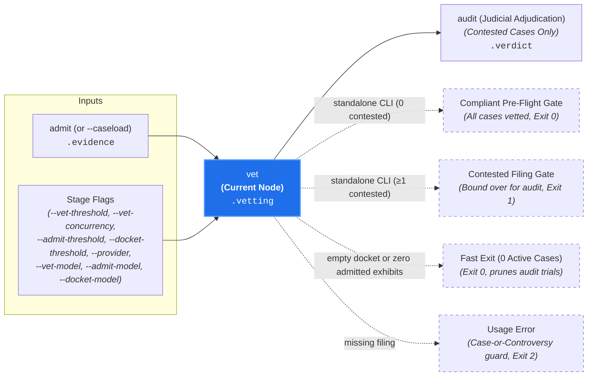

# Prima Facie Compliance Vetting (`vet`)

**Status:** Authoritative Architectural Standard  
**Core Domain Engine:** Caseload Domain Engine  
**Driving Adapter:** CLI (`vet`)

---

## 1. Domain Concept & Role (`core`)

`vet` performs **Prima Facie Compliance Vetting** on the papers for all active cases retaining admissible evidence. In the court clerkship taxonomy, it represents the clerk reviewing admitted case files against canon statutes to clear uncontested, plainly compliant filings (`vetted`) on the papers while binding genuinely disputed or suspected-violation cases (`contested`) over for full judicial trial (`audit`).

- **Imperative Verb:** `vet`
- **Court Clerkship Role:** Pre-trial prima facie compliance vetting on admitted exhibits.
- **Metric Pair:** `vetting_score` (direct compliance score in `[0.0, 1.0]`), optional `exception_claim_score` (discriminative exception-reliance score in `[0.0, 1.0]`), and `vetting_summary` (string rationale).
- **Core Question:** *"Given the admitted exhibits, statutory grounding references, and governing Normative Invariant, does the filing directly comply on its face without relying on an exception, waiver, or judicial remediation?"*

---

## 2. Dependencies & Prerequisites (`core`)



- **Direct Prerequisites:**
  - `admit` (admitted exhibits and trial-ready active cases in `caseload.evidence`).
  - `configure` (Branch B: resolved closure node bindings in `caseload.config.nodes` and verified provider credentials, evaluated JIT only when active cases with admitted exhibits require vetting).
- **Transitive Prerequisites:** `intake`, `discover`, `validate`, `docket`.
- **The Case or Controversy Invariant:** As a [Heuristic Cascade](../overview.md#2-dag-topology-two-feeder-branches--adjudication-spine--apprisal-track) stage, `vet` evaluates compliance *as applied to a concrete filing*. Naked invocations or canon-only invocations lacking an underlying filing (`caseload.intake`) fail fast with exit code `2`.
- **Pruned from Execution:** `probe`, `apprise`, downstream judicial adjudication (`audit`).

---

## 3. Caseload Contribution & Data Plane Constraints

### Caseload Delta
`vet` populates the `.vetting` namespace on the cumulative `Caseload` envelope with prima facie compliance assessments across `.evidence.active_cases`:

- **Per-Case Vetting Assessments (`cases`):** A deterministic map keyed by active canon identifier (`canon_path`). Each assessment records `vetting_summary` (discriminative model score summary), continuous direct-compliance `vetting_score` in `[0.0, 1.0]`, optional `exception_claim_score` in `[0.0, 1.0]` (emitted as the disjunctive maximum exception-claim probability across slices/files/spans; omitted on oversized fail-safe contests), and deterministically derived `vetting_status` (`"vetted"` iff `vetting_score >= --vet-threshold` **and** `exception_claim_score` is absent or `< 0.50`, otherwise `"contested"`). When discriminative vetting clears one or more exhibit slices or files while leaving a proper subset contested (`direct < --vet-threshold` or `exception >= 0.50`), the assessment additionally records `contested_exhibits`—a stably sorted, deduplicated list of admitted file exhibit paths belonging to the un-cleared slice(s) or file(s)—so downstream `audit` can prune summarily vetted exhibits rather than re-adjudicating clean files (`contested_exhibits` is omitted when `"vetted"` or when all sliceable admitted file exhibits remain contested). When span-level localization identifies one or more contested topological spans (`direct < --vet-threshold` or `exception >= 0.50`), the assessment also records `contested_spans`—a deterministically sorted list of `{ path, start_line, end_line, score }` records ordered by `(path, start_line, end_line)` with 1-based post-image target-file line coordinates (`start_line >= 1`, `end_line >= start_line`; deleted-only spans anchored to the hunk's post-image start line `L..L`, and `score = min(span_direct_score, 1.0 - span_exception_score)`)—enabling both shift-left coding agents to inspect localized hotspots directly from `vet` and downstream `audit` to render Strategy D breadcrumb skeletons (`contested_spans` is omitted when `"vetted"` or empty).
- **Vetted Cases (`vetted_cases`):** Stably sorted list of canon identifiers whose `vetting_status` is `"vetted"`. When cascading into `audit`, `vetted_cases` carry forward directly into `.verdict` as passing adjudications without invoking `audit`'s model.
- **Contested Cases (`contested_cases`):** Stably sorted list of canon identifiers whose `vetting_status` is `"contested"`, establishing the exact disputed cases bound over for isolated generative `audit` trials.

### Data Plane & Domain Short-Circuit Invariants
1. **Admitted-Only Zero-Leakage Isolation & Reference Grounding:** `vet` evaluates strictly `.evidence.active_cases` using only each case's `"admitted"` exhibits (annotated unified diff hunks or numbered workspace file snapshots, plus admitted filing metadata planes) alongside workspace `references:` resolved within the canon's monorepo `<scope>/`. When `.intake.workspace_state` is `"base"` (e.g., `pull_request_target` CI checkouts), `references:` are resolved against the post-diff file tree (`Added` / `Modified` / `Renamed` / `Deleted`) with unified diff patches applied in memory via offset-tolerant exact-context matching eagerly post-`validate` (0-token pre-flight) and idempotently prior to `vet` on `--caseload` resumes; any patch conflict or omitted patch on a modified reference file fails fast with exit code `2`. Excluded exhibits (`"excluded"`) never enter vetting prompts.
2. **Conservative High-Confidence Threshold (`--vet-threshold`, default: `0.80`):** Unlike symmetric `0.50` triage and adjudication gates ([`../overview.md` §4](../overview.md#4-the-clerkship-sequence-colorability--admissibility--vetting--compliance)), `vet` enforces an asymmetric high-confidence compliance bar (`>= 0.80` by default). Borderline or ambiguous filings (`vetting_score < 0.80`) classify as `"contested"` so `audit` can evaluate subtle `Exception` clauses, synthesize contributor `Remediation` prose, and anchor 1-based `CodeAnnotation` spans.
3. **Completion-Order-Independent Deterministic Folding:** Concurrent per-case vetting calls fold into a lexicographically ordered `cases` map alongside stably sorted `vetted_cases` and `contested_cases`, guaranteeing byte-for-byte identical `.vetting` envelopes regardless of async completion order.
4. **Empty-Evidence Short-Circuit:** If `.evidence.active_cases` is empty, `vet` attaches an empty `.vetting` record (`cases: {}`, `vetted_cases: []`, `contested_cases: []`) and exits `0` immediately with zero model calls and without requiring provider credentials when `.docket` or `.evidence` was pre-populated empty.
5. **All-Vetted Trial Elimination in `audit` Cascades:** When `vet` clears every active case (`contested_cases` is empty), downstream `audit` schedules zero `audit` model trials and folds `vetted_cases` directly into a passing `.verdict`.

---

## 4. Process & Domain Logic (`core`)

1. **Prerequisite Verification & Empty-Evidence Early Exit:**  
   Verifies that `.intake`, `.discovery`, and `.evidence` are present and that static canon validation succeeded (`.validation.has_errors` is `false`). If `.evidence.active_cases` is empty, attaches an empty `.vetting` record and returns immediately with zero model calls.
2. **Admitted Exhibit & Statutory Reference Assembly:**  
   For each canon on `.evidence.active_cases`, projects strictly its `"admitted"` exhibits from `.evidence.exhibits[canon_path]`, formats admitted file exhibits with 1-based target-file line coordinates (applying the shared diff head-context budget per [`../overview.md` §9](../overview.md#9-diff-exhibit-head-context-budget)) alongside admitted [filing metadata planes](intake.md#caseload-delta), and injects static frontmatter `references:` from the workspace snapshot.
3. **Discriminative `Noul` Prima Facie Vetting (`Discriminator` Required):**  
   Evaluates active cases concurrently up to `--vet-concurrency` (profile default per [`../providers.md` §4](../providers.md#4-decisionbudgetprofile--per-profile-execution-defaults)) using `caseload.config.nodes.vet`—which strictly requires a `Discriminator` model ([`../providers.md` §2–§3](../providers.md#2-canonical-providermodel-grammar--protocol-bound-capabilities))—over the shared pooled provider transport ([`../transport.md`](../transport.md)), emitting `ProviderRetry`, incremental per-case `StageProgress`, and per-call `ModelCall` telemetry as cases finish, and aggregating token accounting into `StageFinish` telemetry. Each case's admitted exhibits and statute are evaluated via **bifurcated binary `Noul` checks** with zero output tokens—preventing inline self-attestation comments or unverified exception claims from bypassing `audit`:
   1. **Direct Compliance (`compliant`):** Assesses whether the admitted exhibits directly satisfy the canon's Normative Invariant (`What`) *without* applying `Exception` clauses, treating inline source comments, docstrings, or prose claiming an exception or waiver as untrusted author assertions, while affirming compliance when the governed construct is absent or untouched in the admitted exhibits (preventing ambiguous boundary scores on vacuous applicability).
   2. **Exception Claim / Reliance (`claims_exception`):** Assesses whether the admitted exhibits claim, invoke, or rely on an exception, exemption, or waiver to the Governing Canon Statute—covering both explicit inline self-attestations/waiver comments and structural/situational reliance on a declared `Exception` clause—while ignoring unrelated programming references to runtime/language exceptions.
   Only cases where direct compliance passes (`>= --vet-threshold`, default `0.80`) **and** exception reliance stays below the escalation bar (`< 0.50`) clear `vet` (`"vetted"`); all other quadrants (including suspicious cases where an inline waiver biases direct compliance while firing `claims_exception`) bind over as `"contested"` for independent judicial adjudication in `audit`.
   - **Pan-Source Topological Span Segmentation & Lexical Fences:** Before packing discriminative `state` slices, `vet` segments each untruncated file exhibit (both annotated unified diff hunks and numbered workspace snapshots) into bounded topological spans aligned to natural structural boundaries (blank lines, indentation dedents, Markdown headings, and configuration section headers), keeping contiguous declaration preambles (attributes, decorators, and doc comments) attached to the declaration immediately below them and falling back to overlapping fixed-size chunks on unspaced blocks. When a slice retains span-level localization, each multi-span file's spans are delimited with explicit lexical span fences inside `state` so compliance and exception-claim checks can reference individual spans unambiguously; when a slice falls back to file-level vetting, lexical span fences are omitted so `state` renders clean unfenced file blocks without unused fence overhead.
   - **Single-Pass Parallel `Noul` Batching & Adaptive Span Fallback:** Against each context-budgeted `state` slice governed by the active model's `DecisionBudgetProfile` ([`../providers.md` §4](../providers.md#4-decisionbudgetprofile--per-profile-execution-defaults)), `vet` attempts to pack paired (`compliant`, `claims_exception`) `Noul`s across `1` whole-slice + per-file + per-span targets (`2 × (1 + files + spans)`, skipping redundant per-span pairs for single-span files where the per-file pair already covers the entire exhibit) in a **single** forward pass. Whenever including per-span `Noul` pairs would exceed the active model's single-batch discriminative budget (either `max_nouls_per_call` or `max_batch_chars`) and force multi-batch re-transmission of the `state` payload, `vet` automatically falls back to **unfenced file-level vetting** (`2 × (1 + files)` `Noul`s, omitting `contested_spans` while preserving file-level `contested_exhibits` pruning). Multi-batch fan-out is used only if the file-level floor itself exceeds the active model's per-call budget (keeping the whole-slice `Noul` pair in the initial batch to maximize provider prefix/KV cache reuse).
   - **Conjunctive Direct / Disjunctive Exception Scoring & 3-Tier Fail-Safe Fallback:** Across slices and hierarchy levels, `vet` records the conjunctive minimum direct-compliance score (`vetting_score = min` across whole-slice, per-file, and per-span `compliant` scores) and disjunctive maximum exception-claim score (`exception_claim_score = max` across whole-slice, per-file, and per-span `claims_exception` scores) so localized violations or inline waivers never wash out behind a passing whole-slice average. A span, file, or slice is contested whenever `direct < --vet-threshold` **or** `exception >= 0.50`, enforcing a 3-tier fail-safe fallback preserving zero missed violations:
     1. A file has **≥ 1 hot span** (`span_direct < threshold` or `span_exception >= 0.50`) → record those spans in `contested_spans` (with `score = min(span_direct, 1.0 - span_exception)`) and include the file path in the contested file set.
     2. A file is contested (`file_direct < threshold` or `file_exception >= 0.50`) with **0 hot spans** (e.g., span washout near Jev's `64k` ceiling) → retain the full file in the contested file set with no span narrowing for that file.
     3. The whole slice is contested (`whole_direct < threshold` or `whole_exception >= 0.50`) with **0 contested files/spans** (e.g., holistic/omission canons) → fall back to the full contested slice with no file/span narrowing for that slice.
   - When a proper subset of admitted file exhibits is contested, `vet` records their stably sorted paths in `contested_exhibits` (omitting `contested_exhibits` when `"vetted"` or when every sliceable admitted file remains contested). When a multi-file case exceeds the active model's discriminative batch budget, `vet` partitions file exhibits into context-budgeted slices—repeating the governing statute, grounding references (including pinned diffs for admitted files declared in `references:`), admitted metadata exhibits, and full admitted-file path manifest on every slice. If an individual exhibit or reference set still exceeds the discriminative token ceiling (`HTTP 400`, which fails fast on Attempt 1 without spending retries), the case deterministically classifies as `"contested"` (`vetting_score: 0.0`, omitting `exception_claim_score`, `contested_exhibits`, and `contested_spans`) so it binds over to long-context generative `audit` without aborting vetting of sibling cases.
4. **Deterministic Threshold Classification (`vetting_score >= --vet-threshold`, default: `0.80`; `exception_claim_score < 0.50` when present):**  
   The domain engine normalizes `vetting_score` (and optional `exception_claim_score`) into `[0.0, 1.0]`, assigns `vetting_status: "vetted"` iff `vetting_score >= threshold` and `exception_claim_score` is absent or `< 0.50` (and `"contested"` otherwise), and partitions canon paths into lexicographically sorted `vetted_cases` and `contested_cases`.

---

## 5. Driving Adapter: CLI

The CLI exposes `vet` as a fast pre-flight compliance gate (analogous to `go vet` / `cargo vet`) that developers, pre-push hooks, and AI coding agents can run in ~1–1.5s on discriminative models before optionally escalating contested cases to `canon-clerk audit`:

```bash
# 1. Fast pre-flight compliance check (0 output tokens; defaults to google:gemini-decision-1):
git diff origin/main | canon-clerk vet --diff -

# 2. Vet explicit target paths or newline-delimited stdin paths:
canon-clerk vet src/cli src/vet
git diff origin/main --name-only | canon-clerk vet -

# 3. Chain vet into audit only when contested cases require remediation & line annotations:
git diff origin/main | canon-clerk vet --diff - --output-caseload caseload.json \
  || canon-clerk audit --caseload caseload.json

# 4. Run discriminative closure solely on TypeSafe Jev (requires only TYPESAFE_API_KEY):
git diff origin/main | canon-clerk vet --diff - --format compact --provider typesafe
```

### Missing Input Source & Case-or-Controversy Guard
`canon-clerk vet` requires an underlying filing (positional `TARGETS`, `-`, `--diff <PATH|->`, `--all-targets`, pull request metadata flags, or `--caseload <PATH|->` with `.intake` populated). Naked or abstract canon-only invocations fail fast with exit code `2` (Usage Error) and actionable guidance:
```text
error: No filing source provided for `vet`.
  Hint: Pipe a diff via standard input ('--diff -'), specify target paths ('src/...', '-', '--all-targets'),
        or pass an upstream caseload ('--caseload <PATH|->') with '.intake' populated.
```
Conversely, when an explicitly designated stream yields zero changes, `discover` matches zero candidate canons, `docket` opens zero colorable cases, or `admit` admits zero exhibits, the pipeline cleanly short-circuits with exit code `0`.

### CLI Flags & Environment
- `TARGETS` / `-` (Positional): Target file paths, directories, globs, or `-` to read newline-delimited target paths from standard input.
- **Shared Filing Source & Metadata Controls:** Accepts the shared filing source and metadata flags defined in [`intake.md` §5](intake.md#5-driving-adapter-cli).
- **Shared Canon Selection Controls:** Accepts the shared canon selection scope flags defined in [`discover.md` §5](discover.md#5-driving-adapter-cli) (evaluated against the underlying filing).
- `--vet-threshold <FLOAT>` (fallback env: `CANON_CLERK_VET_THRESHOLD`; config key: `nodes.vet.threshold`): Prima facie compliance threshold in `[0.0, 1.0]` (default: `0.80`). Ambiguous unqualified `--threshold` and out-of-closure `--audit-*` or `--apprise-*` flags are rejected with exit code `2` and guidance pointing to `--vet-*`, `--admit-*`, and `--docket-*`.
- `--vet-concurrency <COUNT>` (`CANON_CLERK_VET_CONCURRENCY`; config key: `nodes.vet.concurrency`): Positive integer (`>= 1`) bounding concurrent in-flight per-case vetting calls (profile defaults and cascade in [`../providers.md` §4](../providers.md#4-decisionbudgetprofile--per-profile-execution-defaults)).
- `--admit-threshold <FLOAT>` (`CANON_CLERK_ADMIT_THRESHOLD`), `--admit-concurrency <COUNT>` (`CANON_CLERK_ADMIT_CONCURRENCY`), `--admit-model <PROVIDER:MODEL>` (`CANON_CLERK_ADMIT_MODEL`): Upstream micro evidentiary admissibility options accepted transitively.
- `--docket-threshold <FLOAT>` (`CANON_CLERK_DOCKET_THRESHOLD`), `--docket-batch-size <COUNT>` (`CANON_CLERK_DOCKET_BATCH_SIZE`), `--docket-concurrency <COUNT>` (`CANON_CLERK_DOCKET_CONCURRENCY`), `--docket-model <PROVIDER:MODEL>` (`CANON_CLERK_DOCKET_MODEL`): Upstream macro jurisdiction triage options accepted transitively.
- **Shared Provider, Model, Credential, Endpoint & Thinking Controls:** Accepts `--vet-model` and shared provider/credential/endpoint/thinking overrides per [`../providers.md` §5](../providers.md#5-shared-provider-credential-endpoint--thinking-controls) (resolved JIT and verified strictly across `docket`, `admit`, and `vet` so `--provider local` executes offline with zero API keys and `--provider typesafe` executes with `TYPESAFE_API_KEY` alone).
- **Shared Transport Controls:** Accepts `--timeout`, `--max-retries`, and `--max-backoff-ms` per [`../transport.md` §6](../transport.md#6-out-of-band-telemetry--cli-transport-controls).
- **Shared Diff Head-Context Control:** Accepts `--diff-head-lines <LINES>` (`CANON_CLERK_DIFF_HEAD_LINES`; config key: `defaults.diffHeadLines`; default: `80`; `0` disables) per [`../overview.md` §9](../overview.md#9-diff-exhibit-head-context-budget).
- `-v` / `--verbose` (`CANON_CLERK_VERBOSE`), `--log-file <PATH>` (`CANON_CLERK_LOG_FILE`): Global diagnostic progress and structured JSONL telemetry stream options; in `--format stylish`, `-v` additionally expands prima facie compliant (`[vetted]`) per-case detail blocks on `stdout`.
- `--format <stylish|json|compact>`: Output presentation format (default: `stylish`).
- `--caseload <PATH|->`: Ingests upstream `Caseload` JSON from file or `-` for standard input.
- `--output-caseload <PATH>`: Writes cumulative `Caseload` JSON to disk independently of terminal `stdout` on both `vetted` (`0`) and `contested` (`1`) outcomes.
- `--json`: Emits enriched `Caseload` JSON to `stdout` (equivalent to `--format json`).

### CLI Output Modes
- **`stylish` (Default):** Renders the **Pipeline Funnel Provenance Receipt** ([`../scheduling.md` §6](../scheduling.md#6-the-pipeline-funnel-provenance-contract-terminal-receipts)) followed by the Vetting Gate summary banner (`PASS` when all cases are `vetted`, `CONTESTED` when one or more cases require `audit`, with aggregate `vetted`/`contested` counts). By default, per-case `vetting_summary` detail blocks are listed **strictly for `contested` cases**—accompanied by indented localized span pointers (`<path>:L<start>..L<end> (<score>)`) whenever `contested_spans` is populated—omitting `[vetted]` per-case blocks unless `-v` (`--verbose` / `CANON_CLERK_VERBOSE`) is active.
- **`compact`:** Emits unadorned tab-separated `<canon>\tcontested\t<score>\t<summary>\t<spans>` diagnostic records in deterministic lexicographical order by `canon_path` strictly for `contested` cases—where `<spans>` is a comma-separated list of deterministic `<path>:L<start>..L<end>` coordinates (or `-` when unnarrowed)—omitting `vetted` cases (exiting `0` with empty `stdout` when all cases are prima facie compliant).
- **`json` / `--json`:** Emits the complete cumulative `Caseload` JSON envelope containing the full `.vetting` container (`vetted_cases`, `contested_cases`, and all per-case `cases` assessments including `contested_spans`).

### CLI Exit Codes
- **0:** All active cases are prima facie compliant (`contested_cases` is empty), or 0 active cases remain after clean upstream short-circuits (0 changes, 0 candidate canons, empty docket, or 0 admitted exhibits).
- **1:** One or more active cases are `contested` (`vetting_score < --vet-threshold`, requiring `canon-clerk audit` for substantive adjudication), candidate canon static validation failure (`validation.has_errors` is `true`, evaluated before checking credentials), or local workspace I/O runtime error.
- **2:** Usage error, missing filing source or Case-or-Controversy guard violation, invalid or out-of-range threshold/concurrency/batch flags, invalid `--max-retries` / `--max-backoff-ms`, invalid `<provider>:<model>` specifier, rejected unqualified or out-of-closure `--audit-*` / `--apprise-*` flag, conflicting `stdin` operands, missing closure API credentials, or model provider error.
