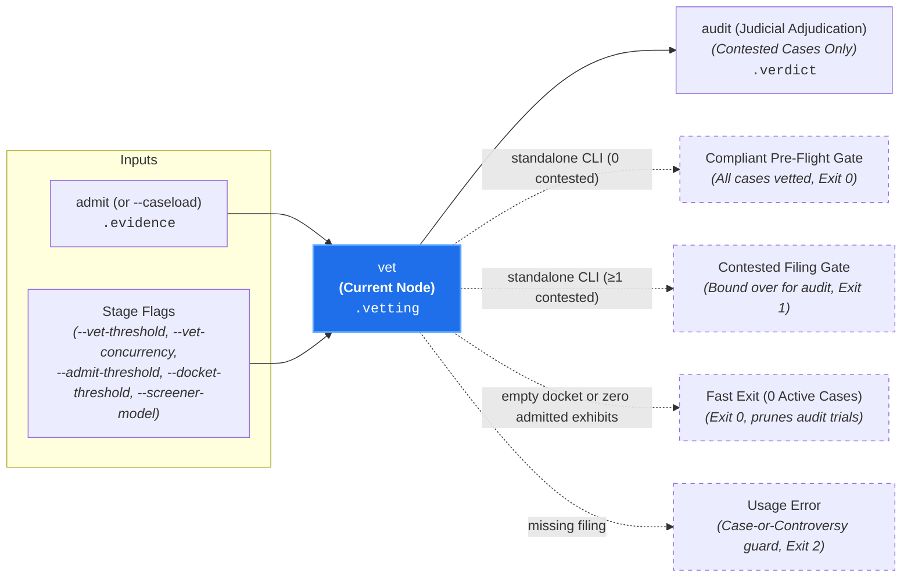

# Prima Facie Compliance Vetting (`vet`)

**Status:** Authoritative Architectural Standard  
**Core Domain Engine:** Caseload Domain Engine  
**Driving Adapter:** CLI (`vet`)

---

## 1. Domain Concept & Role (`core`)

`vet` performs **Prima Facie Compliance Vetting** on the papers for all active cases retaining admissible evidence. In the court clerkship taxonomy, it represents the clerk reviewing admitted case files against canon statutes to clear uncontested, plainly compliant filings (`vetted`) on the papers while binding genuinely disputed or suspected-violation cases (`contested`) over for full judicial trial (`audit`).

- **Imperative Verb:** `vet`
- **Court Clerkship Role:** Pre-trial prima facie compliance vetting on admitted exhibits.
- **Metric Pair:** `vetting_score` (number `[0.0, 1.0]`) and `vetting_summary` (string rationale).
- **Core Question:** *"Given the admitted exhibits, statutory grounding references, and governing invariant/exceptions, does the filing clearly comply on its face without requiring judicial remediation or line annotations?"*

---

## 2. Dependencies & Prerequisites (`core`)



- **Direct Prerequisites:**
  - `admit` (admitted exhibits and trial-ready active cases in `caseload.evidence`).
  - `configure` (Branch B: resolved screener model specifier and active screener-provider credentials in `caseload.config`, evaluated JIT only when active cases with admitted exhibits require vetting).
- **Transitive Prerequisites:** `intake`, `discover`, `validate`, `docket`.
- **The Case or Controversy Invariant:** Like `docket`, `admit`, and `audit`, `vet` evaluates compliance *as applied to a concrete filing*. Naked invocations or canon-only invocations lacking an underlying filing (`caseload.intake`) fail fast with exit code `2`.
- **Pruned from Execution:** `probe`, `apprise`, downstream judicial adjudication (`audit`).

---

## 3. Caseload Contribution & Data Plane Constraints

### Caseload Delta
`vet` populates the `.vetting` namespace on the cumulative `Caseload` envelope with prima facie compliance assessments across `.evidence.active_cases`:

- **Per-Case Vetting Assessments (`cases`):** A deterministic map keyed by active canon identifier (`canon_path`). Each assessment records `vetting_summary` (rationale or discriminative model score summary), continuous `vetting_score` in `[0.0, 1.0]`, and deterministically derived `vetting_status` (`"vetted"` when `vetting_score >= --vet-threshold`, otherwise `"contested"`). When multi-slice discriminative vetting clears one or more exhibit slices (`>= --vet-threshold`) while leaving a proper subset of slices contested (`< --vet-threshold`), the assessment additionally records `contested_exhibits`—a stably sorted, deduplicated list of admitted file exhibit paths belonging to the un-cleared slice(s)—so downstream `audit` can prune summarily vetted slices rather than re-adjudicating clean exhibits (`contested_exhibits` is omitted when `"vetted"` or when all sliceable admitted file exhibits remain contested).
- **Vetted Cases (`vetted_cases`):** Stably sorted list of canon identifiers whose `vetting_status` is `"vetted"`. When cascading into `audit`, `vetted_cases` carry forward directly into `.verdict` as passing adjudications without invoking `auditor_model`.
- **Contested Cases (`contested_cases`):** Stably sorted list of canon identifiers whose `vetting_status` is `"contested"`, establishing the exact disputed cases bound over for isolated generative `audit` trials.

### Data Plane & Domain Short-Circuit Invariants
1. **Admitted-Only Zero-Leakage Isolation & Reference Grounding:** `vet` evaluates strictly `.evidence.active_cases` using only each case's `"admitted"` exhibits (annotated unified diff hunks or numbered workspace file snapshots, plus admitted filing metadata planes) alongside static workspace `references:` resolved within the canon's monorepo `<scope>/`. Excluded exhibits (`"excluded"`) never enter vetting prompts.
2. **Conservative High-Confidence Threshold (`--vet-threshold`, default: `0.80`):** Unlike symmetric `0.50` triage gates (`apprise`, `docket`, `admit`, `audit`), `vet` enforces an asymmetric high-confidence compliance bar (`>= 0.80` by default). Borderline or ambiguous filings (`vetting_score < 0.80`) classify as `"contested"` so `audit` can evaluate subtle `Exception` clauses, synthesize contributor `Remediation` prose, and anchor 1-based `CodeAnnotation` spans.
3. **Completion-Order-Independent Deterministic Folding:** Concurrent per-case vetting calls fold into a lexicographically ordered `cases` map alongside stably sorted `vetted_cases` and `contested_cases`, guaranteeing byte-for-byte identical `.vetting` envelopes regardless of async completion order.
4. **Empty-Evidence Short-Circuit:** If `.evidence.active_cases` is empty, `vet` attaches an empty `.vetting` record (`cases: {}`, `vetted_cases: []`, `contested_cases: []`) and exits `0` immediately with zero model calls and without requiring provider credentials when `.docket` or `.evidence` was pre-populated empty.
5. **All-Vetted Trial Elimination in `audit` Cascades:** When `vet` clears every active case (`contested_cases` is empty), downstream `audit` schedules zero `auditor_model` trials and folds `vetted_cases` directly into a passing `.verdict`.
6. **Generative-Screener Pass-Through in Telescoping `audit`:** When `canon-clerk audit` telescopes with a purely generative `screener_model` (`google:*`) and `.vetting` is not pre-populated, executing a separate generative `vet` pass prior to `auditor_model` would duplicate autoregressive roundtrips on contested cases. The cascade scheduler therefore deterministically skips `vet` (`⊘ vet : skipped (all N active case(s) bound directly to audit)`), omitting `.vetting` from the `Caseload` envelope so `audit` adjudicates `.evidence.active_cases` directly.

---

## 4. Process & Domain Logic (`core`)

1. **Prerequisite Verification & Empty-Evidence Early Exit:**  
   Verifies that `.intake`, `.discovery`, and `.evidence` are present and that static canon validation succeeded (`.validation.has_errors` is `false`). If `.evidence.active_cases` is empty, attaches an empty `.vetting` record and returns immediately with zero model calls.
2. **Admitted Exhibit & Statutory Reference Assembly:**  
   For each canon on `.evidence.active_cases`, projects strictly its `"admitted"` exhibits from `.evidence.exhibits[canon_path]`, formats admitted file exhibits with 1-based target-file line coordinates alongside admitted metadata planes (`pr_title`, `pr_body`, `linked_issues`, `commit_messages`), and injects static frontmatter `references:` from the workspace snapshot.
3. **Dual-Mode Prima Facie Vetting (`typesafe:*` Discriminative `Noul` vs. `google:*` Standalone Generative):**  
   Evaluates active cases concurrently up to `--vet-concurrency` (default: `4`) using `caseload.config.screener_model`, emitting incremental per-case `StageProgress` completion events as cases finish and aggregating token accounting and thought events into `StageFinish` telemetry:
   - **Discriminative `Noul` Vetting (`typesafe:*`, e.g., `jev-latest`):** Evaluates each case's admitted exhibits and statute via binary compliance `Noul` checks with zero output tokens—assessing whether the admitted exhibits satisfy the canon's Normative Invariant (or a declared `Exception`) with zero unexcused violations. When a multi-file case's admitted exhibits exceed a single discriminative context window, `vet` partitions the admitted file exhibits into context-budgeted slices—repeating the governing statute, grounding references (including pinned diffs for any admitted files declared in `references:`), admitted metadata exhibits, and full admitted-file path manifest on every slice—and records the conjunctive minimum score (`min` across slices) so every admitted exhibit is inspected in full. When at least one slice clears `>= --vet-threshold` while one or more slices score `< --vet-threshold`, `vet` records the stably sorted file exhibit paths from the un-cleared slice(s) in `contested_exhibits` so downstream `audit` skips summarily vetted slices (omitting `contested_exhibits` when all slices clear or when every slice fails). If an individual exhibit or reference set still exceeds the discriminative token ceiling, the case deterministically classifies as `"contested"` (`vetting_score: 0.0`, omitting `contested_exhibits`) so it binds over to long-context generative `audit` without aborting vetting of sibling cases.
   - **Standalone Generative Vetting (`google:*`, e.g., `gemini-flash-lite-latest`):** When `canon-clerk vet` is invoked explicitly with a generative `screener_model`, evaluates each active case in an isolated, zero-thinking structured turn at `temperature: 0.0` enforcing a reason-first JSON schema (`vetting_summary` followed by `vetting_score` in `[0.0, 1.0]`):
     ```json
     {
       "vetting_summary": "All newly added CLI flags follow kebab-case naming conventions.",
       "vetting_score": 0.96
     }
     ```
4. **Deterministic Threshold Classification (`vetting_score >= --vet-threshold`, default: `0.80`):**  
   The domain engine normalizes `vetting_score` into `[0.0, 1.0]`, assigns `vetting_status: "vetted"` when `vetting_score >= threshold` and `"contested"` otherwise, and partitions canon paths into lexicographically sorted `vetted_cases` and `contested_cases`.

---

## 5. Driving Adapter: CLI

The CLI exposes `vet` as a fast pre-flight compliance gate (analogous to `go vet` / `cargo vet`) that developers, pre-push hooks, and AI coding agents can run in ~1–1.5s on discriminative screeners before optionally escalating contested cases to `canon-clerk audit`:

```bash
# 1. Fast pre-flight compliance check using TypeSafe Jev (0 output tokens):
git diff origin/main | canon-clerk vet --diff - --screener-model jev

# 2. Vet explicit target paths or newline-delimited stdin paths:
canon-clerk vet src/cli src/vet --screener-model jev
git diff origin/main --name-only | canon-clerk vet - --screener-model jev

# 3. Chain vet into audit only when contested cases require remediation & line annotations:
git diff origin/main | canon-clerk vet --diff - --screener-model jev --output-caseload caseload.json \
  || canon-clerk audit --caseload caseload.json

# 4. Emit tab-separated compact vetting records for shell scripting:
git diff origin/main | canon-clerk vet --diff - --format compact
```

### Missing Input Source & Case-or-Controversy Guard
`canon-clerk vet` requires an underlying filing (positional `TARGETS`, `-`, `--diff <PATH|->`, `--all-targets`, pull request metadata flags, or `--caseload <PATH|->` with `.intake` populated). Naked or abstract canon-only invocations fail fast with exit code `2` (Usage Error) and actionable guidance:
```text
error: No filing source provided for `vet`.
  Hint: Pipe a diff via standard input ('--diff -'), specify target paths ('src/...', '-', '--all-targets'),
        or pass an upstream caseload ('--caseload <PATH|->') with '.intake' populated.
```
Conversely, when an explicitly designated stream yields zero changes, `discover` matches zero candidate canons, `docket` opens zero colorable cases, or `admit` admits zero exhibits, the pipeline cleanly short-circuits with exit code `0`.

### CLI Flags & Environment
- `TARGETS` / `-` (Positional): Target file paths, directories, globs, or `-` to read newline-delimited target paths from standard input.
- `--diff <PATH|->`, `--all-targets`, `--intent <TEXT>`, `--pr-title <TEXT>`, `--pr-body <TEXT>`, `--pr-body-file <PATH>`: Shared filing source and metadata flags.
- `--all-canons`, `--canon <PATH|GLOB>`: Shared canon selection scope flags (evaluated against the underlying filing).
- `--vet-threshold <FLOAT>` (fallback env: `CANON_CLERK_VET_THRESHOLD`): Prima facie compliance threshold in `[0.0, 1.0]` (default: `0.80`). Ambiguous unqualified `--threshold` and out-of-closure `--audit-*` or `--apprise-*` flags are rejected with exit code `2` and guidance pointing to `--vet-threshold`, `--admit-threshold`, and `--docket-threshold`.
- `--vet-concurrency <COUNT>` (fallback env: `CANON_CLERK_VET_CONCURRENCY`; config file key: `vetConcurrency`): Optional positive integer (`>= 1`) bounding maximum concurrent in-flight per-case vetting calls (default: `4`). Follows standard precedence (explicit CLI flag $\to$ environment variable $\to$ `~/.config/canon-clerk/config.json` $\to$ built-in default).
- `--admit-threshold <FLOAT>` (`CANON_CLERK_ADMIT_THRESHOLD`), `--admit-concurrency <COUNT>` / `--max-concurrent-calls <COUNT>` (`CANON_CLERK_ADMIT_CONCURRENCY`): Upstream micro evidentiary admissibility options accepted transitively.
- `--docket-threshold <FLOAT>` (`CANON_CLERK_DOCKET_THRESHOLD`), `--docket-batch-size <COUNT>` / `--max-canons-per-call <COUNT>` (`CANON_CLERK_DOCKET_BATCH_SIZE`), `--docket-concurrency <COUNT>` (`CANON_CLERK_DOCKET_CONCURRENCY`): Upstream macro jurisdiction triage options accepted transitively.
- `--screener-model <MODEL>` (`CANON_CLERK_SCREENER_MODEL`), `--auditor-model <MODEL>` (`CANON_CLERK_AUDITOR_MODEL`), `--reasoning-budget <TOKENS>` (`CANON_CLERK_REASONING_BUDGET`), `--gemini-api-key <KEY>` (`GEMINI_API_KEY`), `--typesafe-api-key <KEY>` (`TYPESAFE_API_KEY`): Shared model configuration and credential options (resolved JIT and gated strictly on `screener_model` credentials so `TYPESAFE_API_KEY` alone suffices when running `canon-clerk vet --screener-model jev`).
- `-v` / `--verbose` (`CANON_CLERK_VERBOSE`), `--log-file <PATH>` (`CANON_CLERK_LOG_FILE`): Global diagnostic progress and structured JSONL telemetry stream options.
- `--format <stylish|json|compact>`: Output presentation format (default: `stylish`).
- `--caseload <PATH|->`: Ingests upstream `Caseload` JSON from file or `-` for standard input.
- `--output-caseload <PATH>`: Writes cumulative `Caseload` JSON to disk independently of terminal `stdout` on both `vetted` (`0`) and `contested` (`1`) outcomes.
- `--json`: Emits enriched `Caseload` JSON to `stdout` (equivalent to `--format json`).

### CLI Output Modes
- **`stylish` (Default):** Renders the 7-stage **Pipeline Funnel Provenance Receipt** (`intake` $\to$ `discover` $\to$ `validate` $\to$ `configure` $\to$ `docket` $\to$ `admit` $\to$ `vet`) followed by the Vetting Gate summary (`PASS` when all cases are `vetted`, `CONTESTED` when one or more cases require `audit`) and per-case `vetting_summary` details.
- **`compact`:** Emits unadorned tab-separated `<canon>\t<status>\t<score>\t<summary>` records in deterministic lexicographical order by `canon_path`.
- **`json` / `--json`:** Emits the cumulative `Caseload` JSON envelope containing the populated `.vetting` container.

### CLI Exit Codes
- **0:** All active cases are prima facie compliant (`contested_cases` is empty), or 0 active cases remain after clean upstream short-circuits (0 changes, 0 candidate canons, empty docket, or 0 admitted exhibits).
- **1:** One or more active cases are `contested` (`vetting_score < --vet-threshold`, requiring `canon-clerk audit` for substantive adjudication), candidate canon static validation failure (`validation.has_errors` is `true`, evaluated before checking credentials), or local workspace I/O runtime error.
- **2:** Usage error, missing filing source or Case-or-Controversy guard violation, invalid or out-of-range threshold/concurrency/batch flags, rejected `--threshold`, `--audit-*`, or `--apprise-*` flag, conflicting `stdin` operands, missing screener API credentials, or model provider error.
