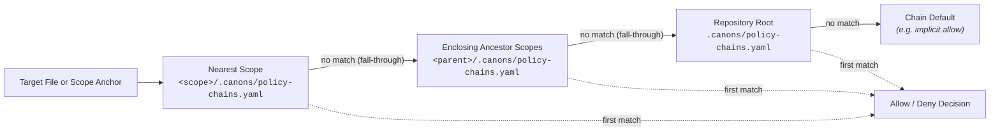

# Workspace Policy Chains & Evaluation

**Status:** Authoritative Architectural Standard  
**Domain Concept:** Cross-Cutting Declarative Workspace Policy Chains, Trust Boundaries & Nearest-Scope-First Lexical Cascading

---

## 1. Architectural Role & Cross-Cutting Scope

Canon Clerk separates **declarative repository policy** (version-controlled rules governing which canons or workspace context artifacts apply to a repository or monorepo subtree) from **clerk runtime configuration** (user-level provider credentials, endpoint URLs, model bindings, and execution budgets).

This document is the single authoritative architectural contract for how `<scope>/.canons/policy-chains.yaml` files are discovered, isolated from untrusted inputs and runtime secrets, validated fail-fast, and evaluated via ordered `allow`/`deny` chains across independent DAG feeder branches. Related contracts reside in:
- **[`SPEC.md` §7](../../SPEC.md#7-workspace-policy-chains-canonspolicy-chainsyaml):** Normative file format, `canon-policy-chain:` selector grammar, validation rules, and CLI precedence.
- **[`nodes/discover.md`](nodes/discover.md):** Branch A `discover` consumption of `canon-policy-chain:` and `.discovery.policy_files` provenance.
- **[`nodes/configure.md`](nodes/configure.md):** Branch B `configure` user-level runtime configuration (`~/.config/canon-clerk/config.json`) and workspace-external credential isolation.
- **[`nodes/validate.md`](nodes/validate.md):** Branch A `validate` directory hygiene (`no-non-canon-files`) permitting direct `<scope>/.canons/policy-chains.yaml` files while flagging stray or nested non-`.md` files under `.canons/`.
- **[`exhibits.md`](exhibits.md):** `--workspace-state base` in-memory patch overlay and the policy trust boundary.

---

## 2. Repo-Content Policy vs. Clerk Runtime Configuration

A strict architectural boundary separates workspace-resident declarative policy from workspace-external clerk runtime configuration:

| Dimension | Workspace Policy Chains (`<scope>/.canons/policy-chains.yaml`) | Clerk Runtime Configuration (`~/.config/canon-clerk/config.json`, Env, CLI) |
| :--- | :--- | :--- |
| **Location** | Inside the repository at `<scope>/.canons/policy-chains.yaml` (version-controlled). | Strictly outside the repository workspace (`$XDG_CONFIG_HOME/canon-clerk/config.json` / `~/.config/canon-clerk/config.json`, environment variables, CLI flags). |
| **Authority** | Declarative repository-content policy chains (such as `canon-policy-chain:`) scoping canons and workspace exhibits. | Operational clerk knobs: provider profiles, API keys, endpoint `baseUrl`s, model bindings, reasoning controls, retry/concurrency limits, and character/line budgets. |
| **Trust Model** | Read strictly from the trusted checkout on disk; never patched from untrusted diff streams under `--workspace-state base`. | Owner-only (`0600`/`0400` on POSIX) local host secrets; never serialized into `Caseload` artifacts or read from inside the repository. |
| **Cross-Contamination** | Runtime credential, provider, model, or budget keys in `policy-chains.yaml` fail fast with exit code `2`. | Workspace `config.json` files inside the repository fail fast with exit code `2`. |

---

## 3. Scoped Discovery, Containment & Trust Boundaries

All DAG stages consuming workspace policy share a single deterministic discovery and trust-boundary contract:

1. **Canonical Direct-Child Path:** Policy files reside strictly at `<scope>/.canons/policy-chains.yaml` as a direct child of a `.canons/` directory (with `<scope>` empty at the repository root: `.canons/policy-chains.yaml`). Alternate filenames (such as `.canons/config.yaml`, `config.yml`, `policy-chains.yml`, `.canon-clerk.yaml`, or root-level files) are never loaded.
2. **Workspace-Root Containment:** Discovery traverses strictly within the workspace / Git repository root (respecting default noise exclusions such as `.git`, `.bare`, `node_modules`, `dist`, `.turbo`, `target`) and never ascends above the workspace root.
3. **No Nesting Inside `.canons/`:** Files named `policy-chains.yaml` placed inside topical subdirectories under `.canons/` (for example, `.canons/security/policy-chains.yaml`) are ignored by policy evaluation and emit a non-fatal diagnostic warning to `stderr` / telemetry without mutating the `Caseload` envelope.
4. **Trusted-Checkout Boundary (`--workspace-state base`):** When evaluating untrusted changes against a trusted base checkout (such as GitHub Actions `pull_request_target` with `--workspace-state base`), `<scope>/.canons/policy-chains.yaml` is always read strictly from the trusted checkout on disk and is never overlaid with patches from `.intake.diffs`. This prevents untrusted pull requests from injecting `- deny: all` to bypass enforcement.
5. **Deterministic Provenance:** Discovered direct `<scope>/.canons/policy-chains.yaml` paths are recorded in stable lexicographical POSIX order on the consuming stage's `Caseload` namespace (for example, `.discovery.policy_files`), omitted when empty.

---

## 4. Fail-Fast Validation Contract

Every discovered `<scope>/.canons/policy-chains.yaml` file is parsed and validated eagerly before evaluation. Any violation halts execution immediately with **CLI exit code `2`**:

- **Document Structure:** Must be valid UTF-8 YAML whose root document is a mapping (an empty document, comment-only file, or empty chain sequence is a valid no-op).
- **Strict Key Allowlist:** Unrecognized top-level or entry keys fail fast. Forbidden clerk runtime keys—including provider/credential keys (`providers`, `defaults`, `nodes`, `apiKey`, `api_key`, `baseUrl`, `model`, `models`, `credentials`, `thinking_level`, `reasoning_budget`) and deferred future keys (`validate`, `packs`)—emit targeted remediation diagnostics.
- **Entry Polarity:** Each chain entry must declare exactly one action (`allow` or `deny`) with a non-empty selector string; entries omitting both or combining both fail fast.
- **Scope Containment & Glob Validity:** Leading `/` absolute paths, `../` directory traversal segments, empty patterns, and syntactically invalid glob expressions in selectors or `exhibits:` filters fail fast.

---

## 5. Ordered Allow/Deny Chains & Nearest-Scope-First Cascading

Policy chains share a uniform evaluation model across monorepo scopes:

1. **First-Match-Wins Within a File:** Rules within a chain evaluate strictly top-to-bottom; the first matching entry determines the outcome (`allow` or `deny`) and terminates evaluation.
2. **Nearest-Scope-First Lexical Cascade:**
   - For a file-anchored target under `<scope>/`, evaluation walks scopes from the deepest enclosing directory upward to the repository root: `[<deepest-scope> -> <parent> -> ... -> root -> chain default]`.
   - For non-file-anchored evaluations (such as metadata-only filings or plenary `--all-canons`), evaluation anchors at the subject's own scope (`[<subject-scope> -> <ancestor> -> ... -> root -> chain default]`, with global and `builtin:*` canons anchored at repository root).
3. **Fall-Through & Subtree Isolation:** A child scope with targeted rules overrides matching items and falls through to ancestor scopes for everything else. Placing a terminal `- deny: all` entry in a child scope halts fall-through completely, isolating vendored or transplanted subtrees without requiring a separate sentinel flag.
4. **Scope-Relative Matching:** Path patterns in a `<scope>/.canons/policy-chains.yaml` file (such as `exhibits:` globs) are evaluated strictly relative to `<scope>/` and remain additive on top of built-in default noise exclusions.
5. **CLI Override Precedence:** Explicit CLI selection and exclusion flags (such as `--canon <selector>` and `--no-builtins` for `canon-policy-chain:`) take precedence over workspace `policy-chains.yaml` rules per [`SPEC.md` §7.4](../../SPEC.md#74-cli-precedence).
