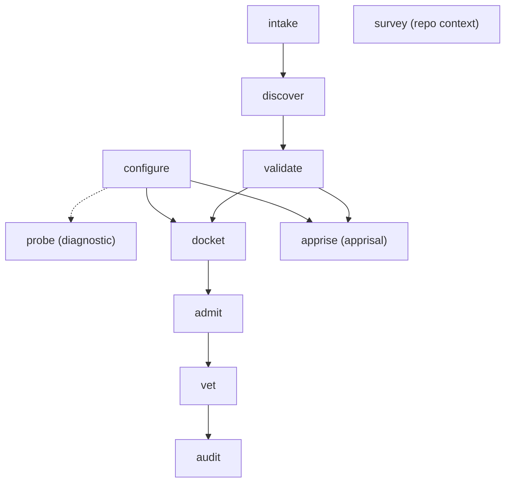
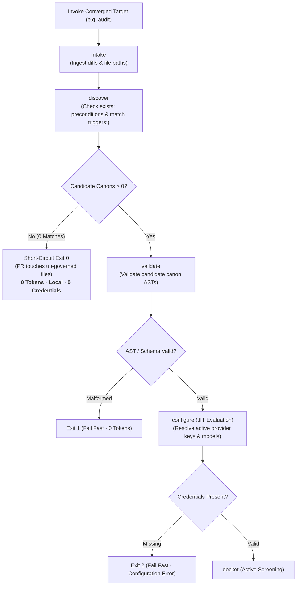

# DAG Scheduling & Execution Semantics

**Status:** Authoritative Architectural Standard  
**Domain Concept:** Dependency Closure Calculation & Scheduling

---

## 1. Executive Summary

Canon Clerk's subcommands represent **terminal stop points** along a Directed Acyclic Graph (DAG) with an auxiliary diagnostic leaf. 

Under Canon Clerk's Hexagonal Architecture, **DAG scheduling and execution semantics are implemented as pure domain services within the evaluation engine core**. The CLI binary delegates to this engine service, ensuring identical closure calculation, pruning, and lazy scheduling behavior regardless of whether an audit is initiated from a local terminal or a remote CI runner.

Instead of running a monolithic pipeline that redundantly requires network connectivity and API keys for purely local operations, the scheduler calculates the **transitive dependency closure** for the requested terminus node and prunes unneeded branches.

---

## 2. Transitive Dependency Closures & Pruning

Operating over the canonical DAG topology defined in [`overview.md` §2](overview.md#2-dag-topology-feeder-branches--adjudication-track--apprisal-track), the scheduler computes minimal ancestor subgraphs per terminal stop point:



### Dependency Closure Calculation
When an operator or CI workflow executes a subcommand $T$, the runner constructs the minimal ancestor subgraph $\text{Closure}(T)$ required to evaluate $T$:

| Terminus Node ($T$) | Transitive Dependency Closure $\text{Closure}(T)$ | Pruned Branches & Nodes |
| :--- | :--- | :--- |
| `intake` | $\{\text{intake}\}$ | Branch B, Branch C, Diagnostic Leaf, downstream Branch A (`discover`, `validate`), Adjudication Track, Apprisal Track |
| `discover` | $\{\text{intake}, \text{discover}\}$ | Branch B, Branch C, Diagnostic Leaf, `validate`, Adjudication Track, Apprisal Track |
| `validate` | $\{\text{intake}, \text{discover}, \text{validate}\}$ | Branch B, Branch C, Diagnostic Leaf, Adjudication Track, Apprisal Track |
| `configure` | $\{\text{configure}\}$ | Branch A, Branch C, Diagnostic Leaf, Adjudication Track, Apprisal Track |
| `survey` | $\{\text{survey}\}$ | Branch A, Branch B, Diagnostic Leaf, Adjudication Track, Apprisal Track |
| `probe` | $\{\text{configure}, \text{probe}\}$ | Branch A, Branch C, Adjudication Track, Apprisal Track |
| `docket` | $\{\text{intake}, \text{discover}, \text{validate}, \text{configure}, \text{docket}\}$ | Branch C, Diagnostic Leaf, Apprisal Track, downstream Adjudication Track (`admit`, `vet`, `audit`) |
| `admit` | $\{\text{intake}, \text{discover}, \text{validate}, \text{configure}, \text{docket}, \text{admit}\}$ | Branch C, Diagnostic Leaf, Apprisal Track, downstream Adjudication Track (`vet`, `audit`) |
| `vet` | $\{\text{intake}, \text{discover}, \text{validate}, \text{configure}, \text{docket}, \text{admit}, \text{vet}\}$ | Branch C, Diagnostic Leaf, Apprisal Track, `audit` |
| `audit` | $\{\text{intake}, \text{discover}, \text{validate}, \text{configure}, \text{docket}, \text{admit}, \text{vet}, \text{audit}\}$ | Branch C, Diagnostic Leaf, Apprisal Track |
| `apprise` | $\{\text{intake}, \text{discover}, \text{validate}, \text{configure}, \text{apprise}\}$ | Branch C, Diagnostic Leaf, Adjudication Track |

### Transitive Closure Pruning Rules
1. **Branch A Independence:** `configure` and `probe` execute with zero knowledge of Git diffs, modified files, or repository canons.
2. **Branch B Independence:** `intake`, `discover`, and `validate` execute with zero knowledge of AI providers, model configurations, or API credentials.
3. **Diagnostic Isolation:** `probe` is never scheduled during [Adjudication Track](overview.md#2-dag-topology-feeder-branches--adjudication-track--apprisal-track) or [Apprisal Track](overview.md#2-dag-topology-feeder-branches--adjudication-track--apprisal-track) runs, eliminating unnecessary health-check latency prior to screening.
4. **Plenary Corpus Validation (`--all-canons`):** When `validate` is invoked with `--all-canons`, Branch A executes with full corpus scope: `intake` establishes plenary scope, `discover` promotes all discoverable workspace canons to `candidate_canons`, and `validate` verifies the entire statutory corpus without requiring diffs or code changes.

---

## 3. The Guarded / Lazy Scheduling Invariant

When executing toward a converged [Adjudication Track](overview.md#2-dag-topology-feeder-branches--adjudication-track--apprisal-track) or [Apprisal Track](overview.md#2-dag-topology-feeder-branches--adjudication-track--apprisal-track) target, both Branch A (`validate`) and Branch B (`configure`) are required ancestors. However, running `configure` unconditionally at startup would break a critical engineering invariant: **PRs touching un-governed files must pass in CI without requiring API credentials or external secret provisioning.**

To uphold this guarantee, the scheduler enforces the **Guarded / Lazy Scheduling Invariant**:



### Sequential Invariant Guarantees:
1. **`intake` and `discover` execute first.** If zero candidate canons match the modified paths and state preconditions, Canon Clerk immediately logs `0 candidate canons matched` and exits with code `0`.
2. **Branch B (`configure`) is never evaluated if candidates count is zero.** Fork pull requests, documentation updates, and changes to un-governed directories succeed locally with zero tokens and without configured provider credentials (`GEMINI_API_KEY` / `TYPESAFE_API_KEY`).
3. **`validate` evaluates candidate syntax before credentials are checked.** If a canon contains YAML or markdown errors, the runner fails fast with exit code `1` before loading provider credentials.
4. **`configure` resolves JIT with closure-exact node bindings and credential sufficiency** only when valid candidate canons exist and heuristic evaluation is imminent. `configure` resolves the active default provider (`--provider <slug>` $\succ$ `CANON_CLERK_PROVIDER` $\succ$ `defaults.provider` $\succ$ `"google"`) and each closure node's `<provider>:<model>` binding along the 4-level per-node specificity cascade, verifying credentials strictly for the providers referenced by the heuristic nodes executed in that closure (for example, allowing `--provider typesafe` with `TYPESAFE_API_KEY` alone to execute `apprise`, `docket`, `admit`, and `vet` without `GEMINI_API_KEY`, while failing fast with exit code `2` on `audit` unless `audit` is provisioned with a `Generator` model and its provider credential). When `--caseload` chains a partial upstream closure into a downstream command (`vet` $\to$ `audit`), downstream `audit` preserves pre-populated upstream node bindings and resolves `audit` JIT, invalidating upstream/downstream stages only when an upstream stage's model or active provider is explicitly overridden.
5. **Stage-seam concurrency drains to zero and remains thread-identity isolated.** Multi-unit [heuristic stages](overview.md#5-the-caseload-pipeline-nodes) execute bounded concurrent work uniformly within each stage over the shared pooled provider requester ([`transport.md`](transport.md)) and drain all in-flight worker activity—including waking any cooldown-parked sibling workers upon cooperative stage abort—before advancing to the next DAG node, guaranteeing that upstream cardinality (`1` unit vs. `N` units) never alters the transport liveness or execution behavior of downstream stages.

---

## 4. Execution Ergonomics: Telescoping vs. Unix Pipelining

Canon Clerk provides two ergonomic execution patterns:

### Pattern A: Telescoping Backfill Mode (Default Interactive & CI)
When a developer or CI job invokes a downstream terminus naked:
```bash
git diff origin/main | canon-clerk audit --diff -
```
The runner:
1. Initializes a blank `Caseload`.
2. Resolves the transitive closure for `audit`: `[intake, discover, validate, configure, docket, admit, vet, audit]`.
3. Executes each node in-memory sequentially according to the guarded scheduling invariant.
4. Returns the final verdict and exit code.

### Pattern B: Composable Unix Pipelining (`--caseload <path|->`)
For distributed build systems, caching servers, or debugging sessions, every subcommand accepts an existing `Caseload` record via `--caseload <path|->` and emits the updated Caseload via `--json`:

```bash
# 1. Deterministic Filing Track on developer machine (offline, no keys):
git diff origin/main | canon-clerk intake --diff - --json > caseload-1.json
canon-clerk discover --caseload caseload-1.json --json > caseload-2.json
canon-clerk validate --caseload caseload-2.json --json > caseload-3.json

# 2. Heuristic Screening & Adjudication in CI worker:
canon-clerk configure --caseload caseload-3.json --json > caseload-4.json
canon-clerk docket --caseload caseload-4.json --json > caseload-5.json
canon-clerk admit --caseload caseload-5.json --json > caseload-6.json
canon-clerk vet --caseload caseload-6.json --output-caseload caseload-7.json \
  || canon-clerk audit --caseload caseload-7.json
```

### Pattern C: The Stage-Prefixed Flag Scoping Contract
To prevent cross-stage parameter leakage in telescoping cascades, all stage-specific model, threshold, batching, and concurrency options use **explicit stage-prefixed flags**:
- **Per-Node Model (`--<node>-model <provider:model>`):** `--apprise-model`, `--docket-model`, `--admit-model`, `--vet-model`, `--audit-model`
- **Per-Node Threshold (`--<node>-threshold <float>`):** `--docket-threshold` (`0.5`), `--admit-threshold` (`0.5`), `--vet-threshold` (`0.8`), `--audit-threshold` (`0.5`), `--apprise-threshold` (`0.5`)
- **Per-Node Batch Size (`--<node>-batch-size <count>`):** `--apprise-batch-size`, `--docket-batch-size`
- **Per-Node Concurrency (`--<node>-concurrency <count>`):** `--apprise-concurrency`, `--docket-concurrency`, `--admit-concurrency`, `--vet-concurrency`, `--audit-concurrency`
- **Repository Survey Controls (`--survey-*` / `--no-survey-context`):** `--survey-context <glob>`, `--no-survey-context`, `--survey-max-file-chars <count>`, `--survey-max-total-chars <count>` (accepted strictly on closures containing `survey`; rejected with exit code `2` on all out-of-closure commands).

#### Scoping & Validation Invariants:
1. **Transitive Acceptance on Evaluation Closures:** An evaluation subcommand accepts a stage-prefixed flag if and only if that stage exists within its transitive dependency closure (while standalone `configure` and `probe` accept all heuristic `--<node>-model` flags to inspect and probe full bench configurations):
   - `canon-clerk audit` accepts `--audit-*`, `--vet-*`, `--admit-*`, and `--docket-*` flags because `docket`, `admit`, and `vet` precede `audit`.
   - `canon-clerk vet` accepts `--vet-*`, `--admit-*`, and `--docket-*` flags.
   - `canon-clerk admit` accepts `--docket-*` and `--admit-*` flags.
   - `canon-clerk docket` accepts `--docket-*` flags.
   - `canon-clerk apprise` accepts `--apprise-*` flags.
2. **Strict Rejection (Exit 2):** Any subcommand whose closure does NOT execute a stage rejects that stage's flags with exit code `2` (Usage Error). For example:
   - `canon-clerk discover --admit-threshold 0.7` $\implies$ Exit `2` (unexpected flag; prevents dead-letter configuration).
   - `canon-clerk vet --audit-model google:gemini-4-carbon` $\implies$ Exit `2` (`audit` is outside `vet`'s closure).
3. **No Unqualified or Retired Tier Aliases:** Ambiguous generic flags (`--threshold`, `--model`, `--batch-size`, `--max-canons-per-call`, `--concurrency`, `--max-concurrent-calls`) and retired tier flags (`--screener-model`, `--auditor-model`) are disallowed and fail fast with exit code `2`, directing the operator to `--provider <slug>` and the stage-prefixed `--<node>-*` alternatives.

---

## 5. Static Schedule Lookup Table

The scheduler determines the node sequence using a deterministic static table. For any terminus command, the runner evaluates nodes in the listed order, **fast-forwarding past any node whose corresponding section is already populated** on the incoming `Caseload`:

| Command Terminus | Guarded Execution Sequence | Fast-Forward Skip Property |
| :--- | :--- | :--- |
| `canon-clerk intake` | `[intake]` | Skips `intake` if `caseload.intake` present |
| `canon-clerk discover` | `[intake, discover]` | Skips `intake` if `caseload.intake` present;<br>Skips `discover` if `caseload.discovery` present |
| `canon-clerk validate` | `[intake, discover, validate]` | Skips `intake` if `caseload.intake` present;<br>Skips `discover` if `caseload.discovery` present;<br>Skips `validate` if `caseload.validation` present |
| `canon-clerk configure` | `[configure]` | Skips `configure` if `caseload.config` present |
| `canon-clerk survey` | `[survey]` | Skips `survey` if `caseload.survey` present (unless overridden via `--survey-*` / `--no-survey-context`) |
| `canon-clerk probe` | `[configure, probe]` | Skips `configure` if `caseload.config` present;<br>Skips `probe` if `caseload.probe` present |
| `canon-clerk docket` | `[intake, discover, validate, configure, docket]` | Skips any node whose corresponding field (`.intake`, `.discovery`, `.validation`, `.config`, `.docket`) is already present |
| `canon-clerk admit` | `[intake, discover, validate, configure, docket, admit]` | Skips any node whose corresponding field is already populated |
| `canon-clerk vet` | `[intake, discover, validate, configure, docket, admit, vet]` | Skips any node whose corresponding field (`.intake`, `.discovery`, `.validation`, `.config`, `.docket`, `.evidence`, `.vetting`) is already populated |
| `canon-clerk audit` | `[intake, discover, validate, configure, docket, admit, vet, audit]` | Skips any node whose corresponding field is already populated |
| `canon-clerk apprise` | `[intake, discover, validate, configure, apprise]` | Skips any node whose corresponding field (`.intake`, `.discovery`, `.validation`, `.config`, `.apprisal`) is already present |

### Missing Input Source Guard vs. Empty Stream Short-Circuit
The scheduler and CLI enforce strict input handling to distinguish operator error from legitimate no-ops:

1. **Missing Source Guard (Naked Invocation $\implies$ Exit 2):**  
   When a subcommand requiring filing context or explicit scope (any [Filing Track, Adjudication Track, or Apprisal Track](overview.md#2-dag-topology-feeder-branches--adjudication-track--apprisal-track) subcommand) is invoked without file arguments, diff flags (`--diff`), intent flags (`--intent`), stream tokens (`-`), an incoming `--caseload`, or an explicit scope flag (`--all-canons`, `--all-targets`), execution immediately terminates with **exit code 2** (Usage Error) and prints actionable guidance. The CLI never silently hangs waiting for input on a TTY.

2. **Empty Stream Short-Circuit (Legitimate No-op $\implies$ Exit 0):**  
   When an operator explicitly designates an input source (e.g. `git diff origin/main | canon-clerk audit --diff -`) and that source produces zero changes:
   - `intake` records an empty filing (`diffs: {}`, `target_paths: []`).
   - `discover` intersects with empty target paths $\implies$ `candidate_canons: []`.
   - The runner logs `0 modified files; 0 candidate canons matched` and short-circuits cleanly with **exit code 0**.

3. **The Case or Controversy Invariant:**  
   The [Adjudication Track](overview.md#2-dag-topology-feeder-branches--adjudication-track--apprisal-track) evaluates the application of canons *as applied to a concrete change*. While statutory linting can operate in the abstract (`validate --all-canons`), running adjudication on a null intake (e.g. `canon-clerk docket --all-canons` without target files) is rejected with **exit code 2**: a court cannot open an active docket or hold a trial without an underlying complaint or controversy. In contrast, the [Apprisal Track](overview.md#2-dag-topology-feeder-branches--adjudication-track--apprisal-track) (`apprise`) operates under **Statutory Apprisal Authority**, taking prospective design intent queries—optionally narrowed to prospective target paths or defaulting to `--all-canons`—to determine governing statutes.

### Short-Circuit Fast Exit Conditions
Across the pipeline, the following deterministic short-circuit conditions trigger early termination:
1. **At `discover`:** If `candidate_canons` is empty $\implies$ Exit `0` immediately (`intake` and `discovery` attached to emitted Caseload; downstream nodes skipped).
2. **At `validate`:** If `validation.has_errors == true` $\implies$ Exit `1` immediately (malformed canon syntax; zero tokens spent).
3. **At `docket`:** If `active_docket` is empty $\implies$ Exit `0` immediately (all candidate canons dismissed at macro screening; zero trials scheduled).
4. **At `admit`:** If all active cases retain zero admitted exhibits $\implies$ Exit `0` immediately (no admissible evidence; zero trials scheduled).
5. **At `vet` (cascading into `audit`):** If `contested_cases` is empty $\implies$ `audit` folds `vetted_cases` into a passing `.verdict` and exits `0` immediately with zero `audit` model calls.
6. **At `apprise`:** If `candidate_canons` is empty $\implies$ Exit `0` immediately (all candidate canons dismissed at discovery; empty apprisal brief attached to emitted Caseload).

---

## 6. The Pipeline Funnel Provenance Contract (Terminal Receipts)

To prevent the **"Silent Zero" / "Mysterious Clean Run"** anti-pattern—where an operator or CI runner receives an empty pass (`0 violations found`) without knowing which upstream filter caused the zero—the CLI adapter enforces the **Pipeline Funnel Provenance Contract**.

### The Ergonomic Principle: No Unexplained Zeroes
A zero-result or clean run can occur at any stage along the DAG:
1. **At `intake`:** An invalid or un-matched target path produced a null filing.
2. **At `discover`:** Target paths did not match any canon triggers, or state preconditions (`exists:`) were unmet.
3. **At `validate`:** Candidate canons failed AST linting (aborts with Exit 1).
4. **At `docket`:** Canons were dismissed during macro triage as uncolorable for the change.
5. **At `admit`:** Diff hunks and files failed admissibility thresholds (insufficient relevant evidence).
6. **At `vet`:** Active cases passed prima facie compliance vetting on the papers (`contested_cases: []`, zero `audit` trials required).
7. **At `audit`:** Contested exhibits were adjudicated compliant with canon statutes (or satisfied declared `Exception` clauses).

### The Funnel Receipt Format
When a multi-stage command runs in human-readable mode (default TTY stdout), the terminal output prints a compact **Pipeline Funnel Receipt** summarizing the operational watermark of every executed ancestor node in the closure (grouping closure nodes that share identical resolved models on the `configure` line, and surfacing `(all-canons)` on the `discover` line whenever trigger matching was bypassed):

```text
Pipeline Provenance:
  ✓ intake    : 1 target file ingested ('src/parser.rs', 45 diff lines)
  ✓ discover  : 3 candidate canons matched triggers (14 canons un-triggered)
  ✓ validate  : 3 candidate canons valid (0 errors, 0 warnings)
  ✓ configure : docket, admit, vet 'google:gemini-decision-1'; audit 'google:gemini-4-carbon'
  ✓ docket    : 2 case(s) colorable (1 dismissed, threshold 0.50)
  ✓ admit     : 2 exhibit(s) admitted across 2 case(s) (0 excluded, threshold 0.50)
  ✓ vet       : 2 case(s) vetted, 0 contested (threshold 0.80)
  ⊘ audit     : 2 vetted, 0 trials scheduled (fast-forward: all active cases vetted)

Verdict: PASS (2 passed, 0 failed)
```

### Fast-Exit and Short-Circuit Watermarks
When an early exit or pass-through occurs, downstream stages are explicitly marked with `(fast-forward: <reason>)` or `skipped (...)`, immediately surfacing the exact filtering stage:

```text
Pipeline Provenance:
  ✓ intake    : 1 target file ingested ('docs/faq.md')
  ⊘ discover  : 0 candidate canons matched triggers (17 canons evaluated)
  ⊘ validate  : (fast-forward: zero candidate canons)
  ⊘ configure : (fast-forward: zero candidate canons)
  ⊘ docket    : (fast-forward: zero candidate canons)
  ⊘ admit     : (fast-forward: zero candidate canons)
  ⊘ vet       : (fast-forward: zero candidate canons)
  ⊘ audit     : (fast-forward: zero candidate canons)

Verdict: PASS (0 candidate canons governing target files)
```

### Machine-Readable Provenance (`--json`)
When invoked with `--json`, the serialized output is the cumulative `Caseload` structure. Because each executed stage preserves its own namespace (`caseload.intake`, `caseload.discovery`, `caseload.docket`, `caseload.evidence`, `caseload.vetting`, `caseload.verdict`), programmatic consumers and CI pipelines receive bit-for-bit full provenance across every filter step without specialized flags.
