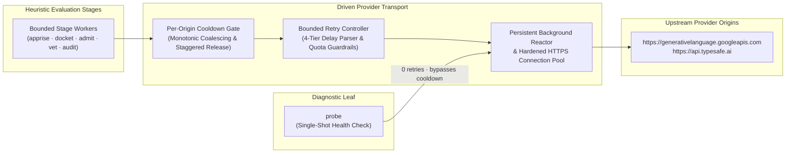
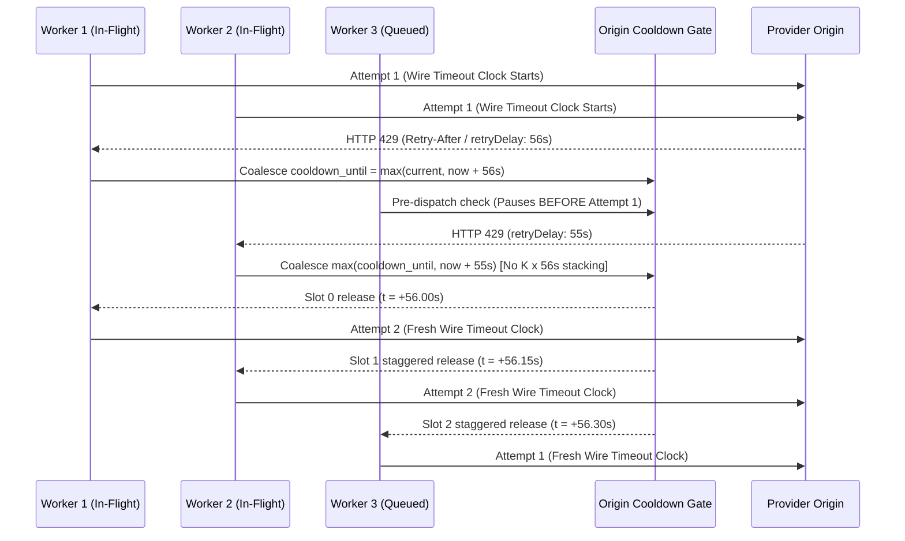

# Provider Transport, Pooling & Rate-Limit Scheduling

**Status:** Authoritative Architectural Standard  
**Domain Concept:** Pooled HTTPS Requester, Per-Origin Cooldown Coordination & Bounded Transient Retry

---

## 1. Executive Summary & Architectural Role

On medium-to-large filings, heuristic Caseload stages (`apprise`, `docket`, `admit`, `vet`, `audit`) fan out 30–50+ bounded concurrent model requests (`scheduling.md` §3) against shared upstream provider origins (`generativelanguage.googleapis.com` and `api.typesafe.ai`). Uncoordinated, single-shot HTTP execution exhibits two structural failure modes under realistic pull-request workloads:

1. **Rolling Minute-Window Rate-Limit Exhaustion (`HTTP 429`):** High-throughput discriminative and generative stages can consume a provider's rolling 60-second input-token or request-per-minute quota mid-stage. Naive per-call millisecond retries exhaust all attempts while tens of seconds remain in the rolling window, while uncoordinated sibling workers continue firing doomed Attempt-1 calls into the throttled origin and wake up in a simultaneous thundering herd.
2. **Bimodal Tail-Latency Spikes & Transient Transport Faults:** A single transient socket reset, upstream `5xx` overload, or reasoning tail-latency timeout on one slice out of dozens otherwise aborts the entire pipeline and discards all completed sibling work units.

Canon Clerk centralizes outbound provider transport behind a **shared pooled HTTPS requester** combining **thread-identity invariant connection pooling**, **pre-dispatch per-origin cooldown scheduling**, and **multi-source bounded transient retry**—while preserving zero-thread offline execution on deterministic closures and strict single-shot behavior on diagnostic `probe` health checks.

---

## 2. Persistent Reactor & Connection Pool Lifecycle

1. **Lazy Background Reactor Initialization (`0ms` Offline Overhead):** Persistent HTTPS connection pools and asynchronous timers execute on a dedicated, continuously driven background reactor initialized lazily on the first live network request. Purely local closures (`intake`, `discover`, `validate`, `configure`) and guarded zero-candidate short-circuits (`scheduling.md` §3) spawn zero background reactor threads and initialize zero TLS pools.
2. **Thread-Identity Invariant Socket Reuse:** Because stage work units run on scoped OS worker threads that exit at each DAG node seam (`scheduling.md` §3), driving all socket I/O and idle keep-alive tasks on the persistent background reactor ensures pooled HTTP/1.1 and HTTP/2 connections remain live across worker thread exits and stage transitions (`docket` $\to$ `admit` $\to$ `vet` $\to$ `audit`).
3. **Unified Multi-Adapter Sharing:** Within a composite multi-provider session, generative adapters (`google:gemini-*` via `:generateContent`) and discriminative decision adapters (`google:gemini-decision-*` via `/v1beta/decisions` and `typesafe:jev-*` via `/v1/systemone`) share the same underlying connection pool and origin cooldown registry.
4. **Socket Liveness & Full-Body Timeout Classification:** Pooled connections enforce a fast-fail TCP/TLS connection establishment timeout (`10s`, distinct from the per-attempt generation timeout), a conservative idle pool retention window (`30s`, below common `60s` upstream NAT/load-balancer silent eviction thresholds), proactive OS-level TCP keep-alive probes, and full response-body streaming timeout classification so mid-stream stalls surface accurately as request timeouts rather than malformed payload errors.

---

## 3. Per-Origin Cooldown Scheduling & Worker Coordination

Cooldown state is partitioned by **normalized endpoint origin authority** (`scheme://host[:port]`), ensuring generative `:generateContent` calls and discriminative `/v1beta/decisions` calls targeting `https://generativelanguage.googleapis.com` share one coordinated rate-limit gate while keeping `https://api.typesafe.ai` and distinct loopback test servers completely isolated.

### Scheduling Invariants

1. **Pre-Dispatch Cooldown Gate:** Before dispatching any heuristic stage attempt onto the wire, the worker checks the target origin's active cooldown deadline. If the origin is cooling down, queued work units wait cleanly at the gate *before* spending Attempt 1, preserving their full retry budget.
2. **Monotonic Coalescing (Zero Multiplicative Stacking):** When multiple already-in-flight workers receive `HTTP 429` (or `HTTP 503` carrying an explicit retry delay) concurrently from the same origin, each worker updates the shared origin deadline monotonically (`cooldown_until = max(cooldown_until, now + advised_delay)`). Consequently, $K$ concurrent workers share a single cooldown window rather than stacking $K \times \text{delay}$.
3. **Staggered Worker Release:** Workers releasing from an origin cooldown gate reserve staggered wakeup slots spaced by short intervals (`100ms–250ms`), smoothing burst re-entry into the provider's rolling token/request window and preventing wakeup thundering herds.
4. **Wire-Only Per-Attempt Timeout Isolation:** Waiting on a pre-dispatch origin cooldown gate or inter-attempt retry backoff **never** consumes the request's per-attempt wire timeout budget (`timeout_ms`, default `60,000ms`). Each attempt's socket timeout clock starts strictly when the HTTP request dispatches onto the wire.
5. **Cross-Stage Continuity & Cooperative Abort Wakeup:** Within a telescoping CLI cascade (`docket` $\to$ `admit` $\to$ `vet` $\to$ `audit`), the shared requester carries origin cooldown state across stage seams. If an unrecoverable failure triggers cooperative stage abort (`scheduling.md` §3) while sibling workers in that stage are parked on a cooldown or backoff timer, parked workers wake immediately rather than stalling terminal exit for the remainder of the cooldown window.

---

## 4. Failure Taxonomy & Multi-Source Backoff Precedence

### Retryable vs. Non-Retryable Failure Classes

| Failure Category | Upstream Signal | Disposition | Behavioral Contract |
| :--- | :--- | :--- | :--- |
| **Wire Timeout** | Per-attempt socket/body read exceeds `timeout_ms` | **Retryable** | Retries with jittered exponential backoff up to `--max-retries` |
| **Transient Transport** | Connect timeout, connection reset, broken pipe, unexpected EOF | **Retryable** | Retries with jittered exponential backoff up to `--max-retries` |
| **Recoverable Rate Limit** | `HTTP 429` without hard-quota exhaustion and advised wait $\le$ `--max-backoff-ms` | **Retryable + Origin Gate** | Updates per-origin cooldown gate and retries within `--max-retries` |
| **Transient Server Error** | `HTTP 500`, `502`, `503`, `504` (with advised wait, if any, $\le$ `--max-backoff-ms`) | **Retryable** *(+ Origin Gate if `503` specifies delay)* | Honors explicit retry delay if present, else jittered exponential backoff |
| **Hard / Daily Quota Exhaustion** | `HTTP 429` signaling `limit: 0`, billing/plan lock, per-day quota exhaustion, or advised wait $>$ `--max-backoff-ms` | **Fail Fast (Attempt 1)** | Zero sleep; returns actionable quota/tier remediation `Hint:` immediately |
| **Client / Context Rejection** | `HTTP 400` (malformed payload, unsupported parameter, or context/token limit overrun) | **Fail Fast (Attempt 1)** | Zero sleep; allows `vet` to bind oversized discriminative cases over to `contested` immediately |
| **Auth / Endpoint Rejection** | `HTTP 401`, `403` (invalid/unauthorized key), `HTTP 404` (unknown model/endpoint), other `4xx` | **Fail Fast (Attempt 1)** | Zero sleep; returns credential or model specifier remediation `Hint:` |
| **Content / Schema Failure** | Safety/recitation block, empty candidate, malformed `2xx` JSON envelope, or schema decode error | **Fail Fast (Attempt 1)** | Zero sleep; deterministic at `temperature: 0.0` so retrying wastes tokens |

### Four-Tier Retry-Delay Extraction Precedence

When a retryable response is received, the wait duration resolves in strict descending precedence order:

1. **HTTP `Retry-After` Header (RFC 9110):** Non-negative integer delta-seconds (e.g., `Retry-After: 56`) or HTTP-date timestamp converted to remaining duration relative to current wall-clock UTC time.
2. **Structured JSON Retry Metadata:** Upstream RPC details matching `google.rpc.RetryInfo` (`"retryDelay": "56s"` / `"56.125s"`) inside `error.details[]`, or top-level numeric/duration `retry_after` / `retry_after_ms` fields.
3. **Diagnostic Message Fallback:** Embedded human-readable retry hints in upstream error text (`"Please retry in <N>s"`, `"Please retry in <N>ms"`, `"retry after <N>s"`, supporting integer and decimal seconds).
4. **Default Jittered Exponential Backoff:** Applied when no explicit upstream retry delay is present (timeouts, socket resets, bare `500`/`502`/`503`/`504`/`429`), stepping exponentially (`1,000ms` base $\to$ `3,000ms` with bounded jitter) capped at `--max-backoff-ms`.

### Rolling TPM Window Ceiling (`--max-backoff-ms`, default: `90,000ms`)

Standard provider rate limits enforce 60-second rolling token-per-minute (TPM) and request-per-minute (RPM) windows (typically advising `Retry-After` or `retryDelay` values of `15s–60s`). Honoring upstream delays up to `90,000ms` (`90s`) allows rolling minute windows to clear automatically in a single coordinated pause, whereas any parsed upstream retry delay exceeding `--max-backoff-ms` fails fast immediately with zero sleep and an actionable remediation `Hint:`.

---

## 5. Single-Shot Diagnostic `probe` Isolation

The diagnostic health check leaf ([`nodes/probe.md`](nodes/probe.md)) verifies live endpoint reachability, authentication, and single-roundtrip latency. Accordingly, `probe` is isolated from heuristic retry orchestration:

- **Zero Retries (`0`):** `probe` dispatches exactly one HTTP request per deduplicated target in `.probe.targets`.
- **Cooldown Gate Bypass:** `probe` never sleeps on pre-dispatch origin cooldown gates and never mutates shared cooldown state, ensuring a throttled endpoint immediately reports its `HTTP 429` status on `.probe` within `--timeout` (`5000ms` default).
- **Strict CLI Flag Scoping:** Passing `--max-retries` or `--max-backoff-ms` to `canon-clerk probe` (or to offline commands `intake`, `discover`, `validate`, `configure`) is rejected with exit code `2`.

---

## 6. Out-of-Band Telemetry & CLI Transport Controls

### `ProviderRetry` Telemetry & Terminal Liveness

Before sleeping on any pre-dispatch origin cooldown or inter-attempt retry backoff, heuristic stages emit a structured out-of-band `ProviderRetry` event on the Telemetry Event Stream ([`overview.md` §8](overview.md#8-observability--the-telemetry-event-stream)):

- **Event Attributes:** Active `stage`, optional work-unit `label` (such as `canon_path` or batch/slice identifier), target origin `host`, 1-based retry `attempt` and `max_retries` ceiling (`0` when waiting on a pre-dispatch cooldown prior to Attempt 1), planned `wait_ms`, and concise `reason`.
- **Interactive TTY Liveness Without `-v`:** When `stderr` is attached to an interactive terminal (and neither `--quiet` nor `CI` is active), multi-second cooldown waits (`wait_ms >= 1000`) render a concise progress notice on `stderr` even without `--verbose` (`-v`) so a 56-second TPM window recovery never resembles a hung process. Under `-v`, all `ProviderRetry` events render on `stderr`, and `--log-file` records every event as structured JSONL.
- **Substantive Determinism:** Retry waits and attempt counts are strictly operational telemetry; `stdout` and serialized `Caseload` JSON envelopes remain bit-for-bit identical whether an evaluation succeeds on Attempt 1 or recovers after transient retries.

### Shared CLI Flags, Environment Fallbacks & `config.json` Keys

All five heuristic evaluation subcommands (`apprise`, `docket`, `admit`, `vet`, `audit`) accept shared transport retry controls resolved via Canon Clerk's standard 4-level specificity cascade (explicit CLI flag $\succ$ environment variable $\succ$ `~/.config/canon-clerk/config.json` `defaults` $\succ$ built-in default):

| CLI Flag | Environment Variable | `config.json` Key | Default | Domain & Validation Contract |
| :--- | :--- | :--- | :--- | :--- |
| `--max-retries <COUNT>` | `CANON_CLERK_MAX_RETRIES` | `defaults.maxRetries` | `2` | Non-negative integer (`>= 0`) bounding retry attempts after Attempt 1 (`2` $\implies$ up to `3` total attempts; `0` disables retries). Negative or non-integer values fail fast with exit code `2`. |
| `--max-backoff-ms <MS>` | `CANON_CLERK_MAX_BACKOFF_MS` | `defaults.maxBackoffMs` | `90000` | Non-negative integer (`>= 0`) in milliseconds bounding any single cooldown or retry wait (`0` fails fast immediately on any rate-limit delay). Negative or non-integer values fail fast with exit code `2`. |

Like stage concurrency and batch-size settings, `--max-retries` and `--max-backoff-ms` govern live HTTP transport execution and are omitted from `Caseload.config`.
